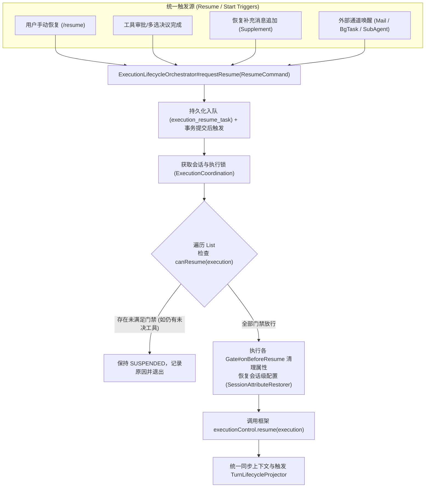
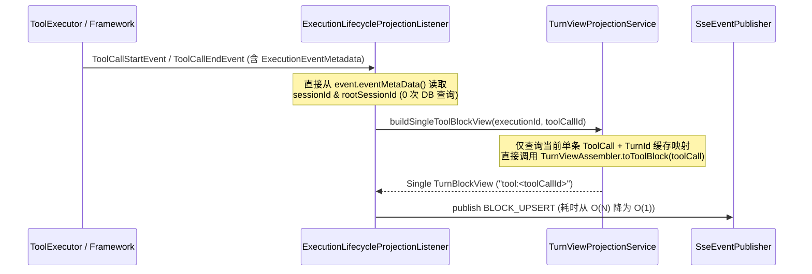

# `com.summit.dp.workflow` 架构诊断与整体重构设计文档

## 一、现状诊断与核心痛点

当前 `com.summit.dp.workflow` 包下共有 **203 个 Java 类**，横跨 `api`（20 个）、`application`（46 个）、`infrastructure`（137 个）。随着局部功能迭代与缺陷修补（如多版本审批、恢复补充、外部信箱唤醒、后台进程监控、子代理委派、上下文溢出恢复、SSE 块级增量推送等），代码逐渐演变为**按历史修补场景堆叠的补丁集合**，主要存在以下四类架构与性能问题：

### 1. 暂停 / 恢复 / 唤醒链路碎片化（4 条并行路径 + 散落的 Attribute 补丁）

当前针对同一个 `Execution` 的启动、挂起、恢复与唤醒，分散在多套彼此重叠甚至绕过核心协调器的组件中：

| 触发场景 | 当前调用链路 | 存在问题 |
| :--- | :--- | :--- |
| **手动恢复 (`/resume`)** | `ChatServiceImpl#resume` | 直接在 HTTP 请求线程上同步锁 `session:<id>` 与 `<executionId>`，手工清理 `USER_PAUSED`、`AUTO_ROUNDS` 属性，直接调用 `executionControl.resume(execution)` 和 `modelContextService.replace(...)`，未经过 `ExecutionResumeCoordinator`。 |
| **v1 工具审批决策** | `ToolCallDecisionService#decide` | 审批落库后直接用 `CompletableFuture.runAsync` 异步调用 `SuspendedExecutionResumer#resume`，绕过了持久化恢复队列 `ExecutionResumeCoordinator`（进程崩溃即丢失恢复任务，且可能与队列任务并发冲突）。 |
| **v2 审批 / 多选答案 / 恢复补充** | `VersionedToolCallDecisionService` / `ChoiceAnswersService` / `CommandApprovalExecutor` / `ResumeSupplementService` $\rightarrow$ `ExecutionResumeCoordinator#accept` | 写入 `execution_resume_task` 表并在事务提交后唤醒虚拟线程消费，内部再调 `SuspendedExecutionResumer#resume`，结束后再调 `InputWakeupService#resumeIfInputPending`。 |
| **外部输入到达（信箱 / 后台任务 / 子代理）** | `InputWakeupService` $\rightarrow$ 挂起态走 `ExecutionResumeCoordinator#accept`；终态走 `InputTurnContinuation#continueTurn` + `InputTurnAdmission#admit` | 当执行已 `COMPLETED` 时，手工从 `MailInputSource` 和 `BackgroundTaskInputSource` 拼接文本构造 `ChatCommand`，重新走一遍 `RequestPreparer#prepare` + `PreparedChatExecutor#submitAsync`。 |
| **首次运行 vs 子代理委派运行** | `PreparedChatExecutor` vs `AsyncDelegationSubmitter` | 两处各自维护一套 `executionControl.run`、异常兜底关闭（`markStartupFailedQuietly` vs `failCreatedExecutionQuietly`）与 `modelContextService.replace` 逻辑。 |

**根因**：缺少统一的 **`ExecutionLifecycleOrchestrator`（执行生命周期编排器）** 与 **`SuspensionGate`（挂起门禁契约）**。每新增一种挂起或恢复原因，都在外围新建 Coordinator / Resumer / Service，并直接读写 `Execution.agentRequest.runtimeParameters.attributes` 中的松散键值（`USER_PAUSED`、`AUTO_ROUNDS`、`LAST_RESUME_SUPPLEMENT_ID`、`RECEIPTS` 等）。

---

### 2. 工具审批与互动决策类高度重复（`application/approval` 下 12 个类职责交叠）

目前处理用户对挂起工具（Promise 卡片、AskQuestion 多选、RunCommand 终端命令）的响应被拆成了 12 个类：
- **入口分叉**：`ToolCallWorkflowService` + `ToolCallDecisionService`（v1 旧接口）、`VersionedToolCallDecisionService`（v2 乐观锁回执接口）、`ChoiceAnswersService`（多选批量提交接口）。
- **命令两阶段分叉**：`CommandApprovalExecutor`、`CommandApprovalRegistrar`、`ApprovalFinalizer`、`CommandOutcomeResolver`、`ApprovedCommandRestorer`、`CommandDecisionSpec`。
- **共性逻辑重复**：上述入口几乎都在重复编写以下样板流程：
  1. 获取会话/执行级锁（`ExecutionCoordination.monitor`）；
  2. 校验幂等回执与乐观锁版本（`commandId`、`decisionDigest`、`expectedVersion`）；
  3. 判定 `Execution` 是否处于 `SUSPENDED`、对应的 `ToolCall` 是否为 `WAITING_APPROVAL`；
  4. 调用 `ExecutionToolSlot.write` 回填框架挂起槽位（`ToolResponse`）；
  5. 调用 `toolCall.complete(...)` 更新领域状态并持久化；
  6. 保存 `Execution` 快照并更新 `modelContextService.replace(...)`；
  7. 判定是否所有未决工具均已完成，若是则触发 `ExecutionResumeCoordinator#accept`。

**根因**：未将「**交互式槽位决议（Slot Resolution）**」抽象为统一的模板与策略接口。立即回填型决策（单工具审批、多选问答、计划确认）与两阶段副作用型决策（T1 锁槽位 $\rightarrow$ 锁外执行命令/写入白名单 $\rightarrow$ T2 落库收尾）本应共享同一个事务与幂等骨架。

---

### 3. 外部输入源与循环拦截器割裂（同一概念存在 3 套平行机制）

向模型轮次注入外部/上下文信息的逻辑散落在三处：
1. **`InputSource<T>` 体系**（`MailInputSource`、`BackgroundTaskInputSource`、`SubExecutionInputSource` + `InputResolver`）；
2. **独立 `LoopInterceptor` 体系**（`ResumeSupplementInterceptor` [-850]、`MemoryMonitorInterceptor` [-825]、`EmailLoopInterceptor` [-800]、`ImageInjectionInterceptor` [-750]、`GenerateImageInterceptor` [-740]、`SubAgentWaitInterceptor` [-700]、`BackgroundTaskLoopInterceptor` [-650]、`ChecklistReminderInterceptor` [-600]）；
3. **`ContextAttachmentProvider` 体系**（`PlanContextAttachmentProvider` [-800]、`ChecklistContextAttachmentProvider` [-700]）。

**突出问题**：
- **双轨消费与格式分裂**：`MailInputSource` 和 `BackgroundTaskInputSource` 在循环内由各自的 `LoopInterceptor` 消费并拼接为 `UserMessage`；而在执行 `COMPLETED` 后的跨轮次唤醒中，又由 `InputTurnContinuation` + `InputTurnAdmission` 用另一套代码消费并拼接为 `ChatCommand`；反观 `ResumeSupplement`（恢复补充消息）却没有实现 `InputSource`，而是单独写了 `ResumeSupplementService` + `ResumeSupplementInterceptor`。
- **热路径无条件查库**：`ResumeSupplementInterceptor#onBeforeModelInvoke` 在**每一个模型推理轮次前**都无条件查询 `chat_turn` 表和 `session_message` 表（`messages.findResumeSupplements`），即使当前执行从未挂起过。

---

### 4. 轮次视图投影与事件监听器的性能瓶颈及耦合（查询/插入稳定性隐患）

在本地 Agent Harness 高频流式输出与密集工具调用场景下，当前的事件监听与持久化层存在严重的**查询放大（$O(N^2)$）**与**逐行写入瓶颈**：

#### (1) 流式分片热路径：每个 Token 触发 2 次数据库查询（`AgentEventListener#resolveTarget`）
- **现状**：`AgentEventListener` 监听 `AgentPartialTextEvent` 与 `AgentPartialThinkingEvent`。每收到一个流式 token 分片（一次回答通常产生数百个分片），`resolveTarget(event)` 都会调用：
  - `executionLocator.sessionId(executionId)` $\rightarrow$ 执行 `SELECT session_id FROM execution WHERE id = ?`
  - `executionLocator.resolveRootSessionId(sessionId)` $\rightarrow$ 执行 `SELECT * FROM session WHERE id = ?`（甚至递归查父会话）
- **讽刺点**：`RuntimeEvent.eventMetaData()`（即 `ExecutionEventMetadata`）在框架构造时（`LocalExecutionRepository#toMetadata`）**已经携带了 `sessionId` 和 `rootSessionId`**，监听器完全忽略了事件自带的元数据而去反复查库。

#### (2) 工具块增量推送热路径：每次工具开始/结束都重装整轮视图再丢弃 99%（$O(N^2)$ 放大）
- **现状**：当单个工具触发 `ToolCallStartEvent` 或 `ToolCallEndEvent` 时：
  1. `BlockUpsertRuntimeListener#broadcast` 先查一次 `tool_call` 表，再查一次 `chat_turn` 表拿到 `turnId`；
  2. 调用 `TurnViewBroadcaster#broadcastBlockUpsert(turnId, List.of("tool:" + toolCallId))`；
  3. `TurnViewBroadcaster#broadcastTurn` **再次**查询 `chat_turn` 表，查 2 次 `session` 表（`resolveRootSessionIdOrNull` + `sessionRepository.findById`）；
  4. 调用 `TurnViewService#buildView(turn)`，加载该轮次**所有** `session_message` 行（`messageRepository.findByTurnIds`），反序列化**所有**历史 `AI` 消息的 JSON 以提取 `toolCallId`，再批量查询该轮次**所有** `tool_call` 行（`toolCallRepository.listByIds`），在内存中组装出整轮的完整 `List<TurnBlock>`；
  5. 最后调用 `filterBlocks(blocks, targetIds)`，**把除了当前 `tool:<toolCallId>` 之外的所有 Block 全部丢弃**，仅推送这 1 个 Block！
- **后果**：若单轮包含 30 次工具调用（共 60 次 Start/End 事件），仅 `BLOCK_UPSERT` 就会触发 **300+ 次 SQL 查询**与 **$60 \times N$ 次大 JSON 反序列化**，随着单轮工具数增长呈典型 $O(N^2)$ 退化。

#### (3) 消息转录落库：逐行 `INSERT` + 逐个工具乐观锁 `SELECT & UPDATE`
- **现状**：
  - `SessionMessageRepositoryImpl#appendAll` 使用 `for` 循环逐条调用 `mapper.insert(entity)`，未利用批量插入；
  - `ConversationTranscriptService#append` 在写入转录消息后，遍历每条 `TOOL` 消息调用 `toolCallRepository.bindSessionMessage(toolCallId, row.id())`，内部对每个工具调用先 `SELECT` 再带版本号 `UPDATE`，形成 N+1 写放大。

#### (4) `LocalExecutionRepository` 充当“上帝仓储” + 6 个 `RuntimeListener` 职责交错
- **现状**：`LocalExecutionRepository`（436 行）不仅是持久化适配器，还注入了 8 个业务组件（`ToolCallReadinessService`、`ToolCallService`、`SubExecutionLifecycle`、`SessionContextUsageProjector`、`ChatTurnLifecycleProjector`、`RuntimeEventPublisher`、`InputWakeupService`、`SessionExecutionRegistry`），在 `save()` 内部通过比对旧状态手工编排业务副作用；同时外部又有 6 个 `RuntimeListener`（`ChatTurnRuntimeListener`、`AgentEventListener`、`ToolCallExecutionListener`、`TurnViewRuntimeListener`、`BlockUpsertRuntimeListener` 等）监听相同的生命周期事件，靠 `@Order` 硬编码维持脆弱的先后顺序。
- **快照写放大**：每次 `save(execution)` 均将完整 `Execution`（含全量历史消息列表）序列化写入本地磁盘文件并 `fsync`（`LocalFileCheckpointStore`），随后业务层又调用 `modelContextService.replace` 将同一份全量消息列表序列化为 JSON 写入数据库的 `session_context` 表。

#### (5) 启动自检全表 N+1 查询（`InputStartupRecheck`）
- **现状**：应用启动时 `InputStartupRecheck` 查询所有根会话，然后对每个根会话循环调用 `sessions.findSessionTree(root.getId())`，在本地历史会话较多时显著拖慢启动速度。

---

## 二、重构设计原则与目标包结构

### 1. 核心设计原则
1. **单一正交职责**：仓储层（`Repository`）只负责状态持久化与快照读写，严禁在 `Repository#save` 中直接编排业务投影、子代理生命周期或唤醒逻辑。
2. **行为契约化，消除场景补丁类**：将「执行生命周期控制」、「工具槽位互动决议」、「外部输入源感知与消费」、「轮次视图投影与增量推送」抽象为 4 组核心接口，用策略/管道模式替代散落的十几个 Service/Helper。
3. **热路径零冗余 IO**：SSE 流式转发只读内存元数据；单块增量推送（`BLOCK_UPSERT`）只构造目标单块；循环拦截器通过轻量级脏标记（Dirty Flag / Attribute 门禁）避免空轮询数据库；落库操作全面批次化。
4. **严格遵守项目 DDD 与代码规范**：不使用 `var`，不使用 `xxxOf` 命名（统一用 `resolveXxx` / `toXxx` / `parseXxx` / `buildXxx`），持久化统一走 MyBatis-Plus `PO + BaseMapper + RepositoryImpl`。

### 2. 目标包结构（从 203 个类收敛至约 115 个高内聚组件）

```text
com.summit.dp.workflow
├── api                                      # REST/SSE 控制器与请求/响应契约（移除 v1 冗余入口或统一委托）
│   ├── controller                           # ChatController, ToolCallController
│   ├── dto                                  # Request / View / Event DTOs
│   └── sse                                  # SseEventPublisher, SessionStreamRegistry
├── application                              # 应用编排层（按 4 大核心域收敛）
│   ├── chat                                 # 会话提问、重发、回滚事务脚本 (ChatServiceImpl, ConversationRollbackService)
│   ├── lifecycle                            # 【核心抽象 1】统一执行生命周期、挂起门禁与恢复调度
│   │   ├── ExecutionLifecycleOrchestrator   # 统一管理 start / pause / requestResume / cancel (合并根会话与子代理启动)
│   │   ├── SuspensionGate                   # 挂起原因门禁接口 (UserPauseGate, UnresolvedToolGate, SubAgentWaitGate)
│   │   └── ResumeDispatchQueue              # 基于 execution_resume_task 的持久化恢复队列调度器
│   ├── decision                             # 【核心抽象 2】统一工具交互决议引擎
│   │   ├── InteractionDecisionEngine        # 统一锁、幂等回执、乐观锁、槽位回填与恢复触发模板
│   │   ├── ToolSlotResolutionStrategy       # 策略接口：ImmediateSlotStrategy (单审/多选/计划) vs TwoPhaseCommandStrategy (命令T1/T2)
│   │   └── ApprovedCommandPolicyService     # 命令审批策略与白名单恢复
│   ├── input                                # 【核心抽象 3】统一外部输入通道与跨轮次唤醒
│   │   ├── PendingInputChannel<T>           # 统一信箱、后台任务、子代理结果、恢复补充 (ResumeSupplement) 的拉取/消费/格式化契约
│   │   ├── InputChannelCoordinator          # 聚合所有通道：供循环内拦截器消费 & 供终态跨轮次自动续跑消费
│   │   └── InputWakeupOrchestrator          # 统一处理外部输入到达时的唤醒或新轮次准入
│   └── projection                           # 【核心抽象 4】轮次视图渲染与实时事件投影管道
│       ├── TurnLifecycleProjector           # 统一处理 Execution 状态迁移对应的 ChatTurn / ToolCall / ContextUsage 投影
│       ├── TurnViewProjectionService        # 支持全量轮次组装 (buildFullTurnView) 与 O(1) 单块增量组装 (buildSingleToolBlockView)
│       └── RuntimeStreamBroadcaster         # 基于 EventMetadata 零查库路由的流式与块级广播器
└── infrastructure                           # 基础设施实现层
    ├── harness                              # 框架桥接：纯持久化 LocalExecutionRepository、LifecycleEventBridge、CheckpointStore
    ├── interceptor                          # 框架 LoopInterceptor 实现（收敛为 UnifiedInputLoopInterceptor 等少量正交拦截器）
    ├── context                              # SystemPromptBuilder, ContextAttachmentProviders, TranscriptSink
    ├── tool                                 # 内置工具定义与执行器 (filesystem, bash, subagent,interaction, media, plan, checklist)
    └── persistence                          # execution_resume_task 等工作流专属持久化 Mapper 与 RepositoryImpl
```

---

## 三、核心领域的接口抽象与高复用设计

### 1. 执行生命周期与暂停/恢复统一模型（`ExecutionLifecycleOrchestrator` & `SuspensionGate`）

#### (1) 设计目标
彻底消除 `ChatServiceImpl#resume`、`ToolCallDecisionService`（异步裸跑）、`ExecutionResumeCoordinator`、`SuspendedExecutionResumer`、`PreparedChatExecutor`、`AsyncDelegationSubmitter` 各自为政的局面，并将业务副作用从 `LocalExecutionRepository#save` 中剥离。



#### (2) 核心接口定义

```java
package com.summit.dp.workflow.application.lifecycle;

import com.summit.core.runtime.Execution;

/**
 * 挂起门禁契约：统一判定挂起中的 Execution 当前是否具备恢复条件，以及恢复前的状态清理。
 */
public interface SuspensionGate {

    /**
     * 门禁检查优先级，数值越小越先检查。
     */
    int order();

    /**
     * 判定当前执行是否被该门禁阻断。返回非空原因表示不可恢复。
     */
    GateCheckResult checkResumeReadiness(Execution execution);

    /**
     * 当允许恢复（或主动触发特定恢复模式）时，在调用底层框架 resume 前清理关联的挂起属性。
     */
    void clearSuspensionState(Execution execution, ResumeTriggerType triggerType);
}
```

通过三个标准实现替代散落各处的硬编码校验与 Attribute 清理：
- **`UserPauseSuspensionGate`**：管理 `USER_PAUSED` 与 `AUTO_ROUNDS` 属性；当 `triggerType == ResumeTriggerType.MANUAL_USER_RESUME` 时自动清除暂停标记。
- **`UnresolvedToolSuspensionGate`**：检查 `toolCallRepository.listUnresolvedByExecutionId(execution.id())`；在手动 `/resume` 模式下若仍存在未决工具，直接返回明确业务提示 `"当前存在待确认的工具调用，请先完成审批或问答"`，而在自动触发模式下静默保持挂起。
- **`SubAgentWaitSuspensionGate`**：检查是否存在未完成的同步等待子代理（替代散落在 `SubExecutionLifecycle` 与 `SubAgentWaitInterceptor` 中的状态判断）。

```java
package com.summit.dp.workflow.application.lifecycle;

/**
 * 执行生命周期统一编排接口：收敛根会话与子代理的启动、暂停、恢复请求与取消。
 */
public interface ExecutionLifecycleOrchestrator {

    /**
     * 统一提交新执行（内部复用同一套启动失败兜底、上下文同步与异常处理，供根会话和子代理共用）。
     */
    void submitNewExecution(ExecutionLaunchSpec launchSpec);

    /**
     * 请求暂停指定会话的活跃执行。
     */
    void pauseSessionExecution(String sessionId);

    /**
     * 统一请求恢复挂起执行（所有入口一律经过此方法，不再允许业务类直接调用 executionControl.resume）。
     */
    ResumeAcceptResult requestResume(ResumeRequest request);
}
```

---

### 2. 互动审批与工具槽位决策抽象（`InteractionDecisionEngine` & `ToolSlotResolutionStrategy`）

#### (1) 设计目标
将 `application/approval` 下的 12 个类收敛为 **1 个模板引擎 + 2 个策略实现**。废弃绕过恢复队列的 v1 独立逻辑（v1 控制器接口直接适配为调用统一引擎），让「单工具审批」、「多选问答批量提交」、「计划审批」、「终端命令两阶段执行」完全复用同一套**锁获取 $\rightarrow$ 幂等回执校验 $\rightarrow$ 槽位状态校验 $\rightarrow$ 槽位写回 $\rightarrow$ 领域模型完成 $\rightarrow$ 触发恢复队列**骨架。

#### (2) 核心接口与模板设计

```java
package com.summit.dp.workflow.application.decision;

import com.summit.core.runtime.Execution;
import com.summit.dp.toolcall.domain.model.ToolCall;
import java.util.List;

/**
 * 工具槽位决议策略：封装不同交互类型如何验证参数、如何产生最终 ToolResponse 以及是否包含锁外副作用。
 */
public interface ToolSlotResolutionStrategy<R extends SlotDecisionCommand> {

    /**
     * 支持的决议命令类型。
     */
    Class<R> supportedCommandType();

    /**
     * 在事务与执行锁内校验目标 ToolCall 集合的合法性，并计算每个槽位应写入的响应文本与领域完成动作。
     */
    List<SlotResolutionItem> prepareSlotResolutions(Execution execution, List<ToolCall> targetToolCalls, R command);

    /**
     * 是否需要在第一阶段（T1 锁槽位）释放锁后执行耗时副作用（仅终端命令立即执行返回 true）。
     */
    default boolean requiresOutOfLockSideEffect(R command) {
        return false;
    }

    /**
     * 锁外执行的耗时副作用（如执行终端命令），返回最终用于第二阶段（T2）收敛的结果。
     */
    default OutOfLockOutcome executeOutOfLockSideEffect(Execution execution, List<ToolCall> lockedCalls, R command) {
        return OutOfLockOutcome.empty();
    }
}
```

- **`ImmediateSlotResolutionStrategy`**：处理普通工具同意/拒绝、计划确认（`CreatePlanTool`）、多选问答（`ChoiceAnswers`）。在单次事务内直接完成 `ExecutionToolSlot.write`、`toolCall.complete(...)`、保存回执并调用 `lifecycleOrchestrator.requestResume(...)`。
- **`TwoPhaseCommandResolutionStrategy`**：处理终端命令审批（`RunCommand`）。复用引擎的 T1 阶段将 `ToolCall` 推进到 `EXECUTING` 并预写防丢占位响应，锁外执行 `CommandApprovalExecutor` 逻辑，最后复用引擎的 T2 阶段落库真实输出并触发 `lifecycleOrchestrator.requestResume(...)`。
> **口径说明（2026-11-08，Phase5 轮次C 补记）**
>
> 上面提到的「运行乐观锁冲突（409）」指的是**冲突的表达方式**，落地口径是
> **HTTP 200 + body 业务码 4090~4095**（`DecisionErrorCode`：4090 STATE_CONFLICT /
> 4091 DECISION_ALREADY_APPLIED / 4092 INTERACTION_NOT_READY / 4093 EXECUTION_ENDED /
> 4094 RESUME_FAILED / 4095 COMMAND_CONFLICT），**不是 HTTP 409 状态码**。
> 前端 `frontend/src/services/toolCall.ts` 按 `isOk(res.code)` 判定并用 `errMsg` 抛错；
> 处理器 `GlobalExceptionHandler#handleDecisionConflict` 刻意不调 `setStatus`。
> 该口径由后端 `DecisionConflictHttpContractTest`（逐码 + 真实引擎端到端）与前端
> `frontend/tests/toolCallConflictContract.test.ts`（冲突不被吞掉）双向守住。
> 本条只澄清表达方式，不降低本节任何目标、不删任何条目。


---

### 3. 外部输入通道与循环拦截统一管道（`PendingInputChannel` & `UnifiedInputLoopInterceptor`）

#### (1) 设计目标
消除「信箱 (`MailInputSource`)」、「后台任务完成通知 (`BackgroundTaskInputSource`)」、「子代理完成结果 (`SubExecutionInputSource`)」与「恢复补充消息 (`ResumeSupplement`)」之间的机制割裂。解决：
1. 循环内拦截器（`LoopInterceptor`）与终态跨轮次续跑（`InputTurnContinuation`）各自写一套消费和文本格式化代码的问题；
2. `ResumeSupplementInterceptor` 每轮无条件查库的问题。

#### (2) 核心接口定义

```java
package com.summit.dp.workflow.application.input;

import com.summit.core.runtime.Execution;
import java.util.List;

/**
 * 统一的待处理外部输入通道契约。
 * 同时服务于：
 * 1. 循环内模型调用前注入 (UnifiedInputLoopInterceptor)
 * 2. 执行终态后的新轮次合成与准入 (InputTurnContinuation)
 * 3. 启动与恢复前的待办探测 (InputWakeupOrchestrator)
 */
public interface PendingInputChannel<T> {

    /**
     * 通道注入优先级，数值越小越先注入上下文。
     */
    int order();

    /**
     * 快速门禁判定：通过内存/Execution 属性判断是否可能有待处理输入，避免无意义的数据库查询。
     */
    default boolean mightHavePending(Execution execution, String sessionId) {
        return true;
    }

    /**
     * 查询指定会话/执行下尚未消费的输入项。
     */
    List<T> pollPendingItems(String sessionId, Execution execution);

    /**
     * 将待处理项格式化为注入模型的标准文本块（循环内与跨轮次续跑共用同一套格式化输出）。
     */
    String formatForModelContext(List<T> items, InputInjectionStage stage);

    /**
     * 标记该批输入项已消费（在消息成功追加到上下文或新轮次成功创建后调用）。
     */
    void markConsumed(String sessionId, Execution execution, List<T> items);

    /**
     * 当前会话是否仍有未完结的上游异步依赖（如运行中的后台任务或运行中的异步子代理）。
     */
    default boolean hasOpenAsyncDependency(String sessionId, Execution execution) {
        return false;
    }
}
```

#### (3) 四个标准通道实现
1. **`ResumeSupplementInputChannel`（order = -850）**：
   - **消除无条件查库**：仅当用户调用 `ResumeSupplementService#append` 时，在 `Execution` 属性（或内存轻量标记集）中打上 `HAS_PENDING_SUPPLEMENT = true`；`mightHavePending` 为 `false` 时直接跳过数据库查询！
2. **`MailInputChannel`（order = -800）**：统一信箱拉取、消费与 `<commander_mail>` / `<subagent_mail>` 格式化。
3. **`SubExecutionResultChannel`（order = -700）**：统一子代理结果汇聚与未完结子代理探测。
4. **`BackgroundTaskInputChannel`（order = -650）**：统一后台进程完成通知拉取与格式化。

通过一个 **`UnifiedInputLoopInterceptor`** 按 `order()` 顺序遍历所有 `PendingInputChannel`，即可一次性替换原有的 `ResumeSupplementInterceptor`、`EmailLoopInterceptor`、`BackgroundTaskLoopInterceptor`，并且 `InputTurnContinuation` 也直接调用同一套 `PendingInputChannel` 聚合结果，彻底消灭双轨消费代码。

---

### 4. 轮次渲染视图与实时事件投影架构（`TurnViewProjectionService` & `RuntimeStreamBroadcaster`）

#### (1) 设计目标
1. **将业务副作用从 `LocalExecutionRepository` 中彻底移出**：`LocalExecutionRepository` 只做 `Execution` 的读写与发布标准框架事件；新增单一的 **`ExecutionLifecycleProjectionListener`** 统一按明确顺序协调 `ChatTurn` 状态流转、`ToolCall` 就绪推进、上下文用量统计与 SSE 轮次广播，取代原先 6 个各自为战、靠 `@Order` 抢顺序的 `RuntimeListener`。
2. **实现真正的 $O(1)$ 单块增量组装**：当触发 `ToolCallStartEvent` / `ToolCallEndEvent` 时，不再重查整轮消息和全部工具，而是直接把当前单个 `ToolCall` 转换为单个 `TurnBlock` 推送给前端。



#### (2) 实测更正（B1 落地时用真实 H2 + MyBatis 计数所得，只记录事实）

1. **框架不存在 `ToolCallDecision*` 事件类**。`harness-core` 的 `com.summit.core.conversation.event` 下只有
   `ToolCallStartEvent` / `ToolCallEndEvent`（`ToolCallEvent` 接口的两个实现），审批决策走的是
   `ToolCallDecisionService` 的业务调用，不产生框架事件。因此「工具事件元数据优先路由」的覆盖面
   实际就是 Start / End 两条。
2. **事件元数据键名与解析入口**（`ExecutionEventMetadata`，均为十进制字符串）：
   `turnId()`、`sessionId()`、`parseRootSessionId()`；三键齐备才算「权威归属」，缺一即整份回退。
   业务侧的构造点在 `RequestPreparer`（受理）与 `SessionAttributeRestorer`（修复旧执行）——
   后者只补 `rootSessionId` / `historyRevision`，`turnId` 缺省时不会凭空补出，这与「旧检查点回退」一致。
3. **单次工具块推送的真实语句数**（H2 文件库 + `SqlCaptureInterceptor`，从真实事件到 `publishBusiness`）：
   - 元数据齐备：**4 条** —— `chat_turn` 主键读 1、`session` 主键读 1、`session_message` USER 窄查 1、`tool_call` 只读投影 1；
     其中「按 `execution_id` 反查轮次」**0 条**、「解析根会话」**0 条**。
   - 元数据缺失（回退）：**6 条** —— 在上一组之上多出 `chat_turn WHERE execution_id` 反查 1、`session` 主键读 1（解析根会话）。
   因此本次消除的固定成本是「每次工具事件 2 条语句」，而非「每轮数百条」；后者属于流式 Token 路径（§四.1），不在本条范围内。
4. **仍必须查库的 4 项窄查询**（事件里没有、也推不出来的唯一来源）：
   `chat_turn` 主键读（`version` 展示版本号、`status`、`parentTurnId`）、`session` 主键读（上下文用量快照）、
   `session_message` 的 USER 行窄查（提问 / 图片 / 补录 / `userMessageId`）、`tool_call` 只读投影（状态与 `raw_output`）。

---

## 四、查询与插入稳定性及性能优化方案

针对本地 Agent Harness 的高频读写特征，制定以下 6 项确定性性能优化改造：

### 1. 消除流式 Token 转发的数据库查询（每轮减少数百次 SQL）
- **定位**：`AgentEventListener#resolveTarget(RuntimeEvent)`（第 92-104 行）。
- **改造**：优先读取 `event.eventMetaData()`：
  ```java
  private EventTarget resolveTarget(RuntimeEvent event) {
      EventMetadata metadata = event.eventMetaData();
      if (metadata instanceof ExecutionEventMetadata executionMeta
              && StringUtils.hasText(executionMeta.getSessionId())
              && StringUtils.hasText(executionMeta.getRootSessionId())) {
          return new EventTarget(executionMeta.getRootSessionId(), executionMeta.getSessionId());
      }
      // 仅当元数据缺失时走 executionLocator 兜底并写入短期本地缓存
      String sessionId = executionLocator.sessionId(event.executionId());
      String rootSessionId = executionLocator.resolveRootSessionId(sessionId);
      return new EventTarget(rootSessionId, sessionId);
  }
  ```
- **收益**：在 `AgentPartialTextEvent` / `AgentPartialThinkingEvent` 流式输出期间，数据库查询次数从 **$2 \times \text{TokenChunk数}$** 降至 **0 次**。

### 2. 将 `BLOCK_UPSERT` 从「整轮重装后过滤」改为「单块直接构造」（消除 $O(N^2)$ 查询与 JSON 解析）
- **定位**：`BlockUpsertRuntimeListener` $\rightarrow$ `TurnViewBroadcaster#broadcastBlockUpsert` $\rightarrow$ `TurnViewService#buildView`。
- **改造**：
  1. 在 `TurnViewAssembler` 中公开单块构造方法 `TurnBlock buildSingleToolBlock(ToolCall toolCall)`（复用现有的 `toToolBlock(ToolCall)` 逻辑）；
  2. 在 `TurnViewBroadcaster#broadcastBlockUpsert(ChatTurn turn, ToolCall toolCall, ExecutionEventMetadata metadata)` 中，直接利用已知的 `ChatTurn` 和单个 `ToolCall` 构造仅含该 `TurnBlock` 的 `TurnView` DTO 并推送，不再调用 `turnViewService.buildView(turn)` 加载全量 `session_message` 与全量 `tool_call`；
  3. 仅在轮次结束（`ExecutionEndEvent` / `ExecutionSuspendEvent` / `ExecutionErrorEvent`）时调用一次 `buildView(turn)` 进行全量 `TURN_UPSERT` 校准。
- **收益**：30 次工具调用的轮次中，每次工具状态变更的 DB 查询从 **5~6 次（含全表消息扫描与大 JSON 解析）** 降至 **1 次精准主键查询**，彻底根除长轮次下工具越多越卡顿的 $O(N^2)$ 退化。

  > **实测更正（2026-11-07，Phase 0 缺口 + Phase 1 落地后）**：本条「语句数」口径与实测不符，落地验收按真实行为记录如下，后续批次请以此为准。
  > - 语句数**没有下降**：整轮装订与单块装订都是 2 条（一条 `session_message`、一条 `tool_call`）；按代码路径计，一次 `BLOCK_UPSERT` 端到端仍是 6 条（listener 1 + 广播路由 3 + 装配 2），改造前后相同。
  > - 真实收益是**读列宽**：`session_message` 由 `turn_id IN (?)` 全类型全列（含整条 AI 行 JSON，30 工具时 3919 字符）收窄为 `turn_id = ? AND type = ?` 只取 USER 行；`tool_call` 保持 7 列只读投影、不含 `content`/`raw_input`/`meta_data`。因此**代价不再随工具数与输出体积线性增长**，但耗时在本机同量级（中位数 ~42ms vs ~40ms），不能用毫秒证明收益。
  > - 仍未收敛的是**广播路由查询**（`TurnViewBroadcaster#resolveTarget`：轮次反查 + 根会话解析 + 会话读取）。这些查询对每个工具事件都会发生，可作为下一批的独立优化项（工具事件元数据里已带 `turnId` 与 `rootSessionId`，具备零查库改造条件）。
  > - 证据：`.lingxi/plan/kou-phase1-baseline.md`、`.lingxi/qa/qa-phase01-report.md`。

### 3. 消息转录批量插入与工具锚点一次性绑定（消除写路径 N+1）
- **定位**：`SessionMessageRepositoryImpl#appendAll` 与 `ConversationTranscriptService#append`。
- **改造**：
  1. **批量插入消息**：在 `SessionMessageRepositoryImpl#appendAll` 中使用 MyBatis-Plus 批量写入（或 `SessionMessageMapper` XML `<foreach>` 批量 `INSERT`），将单轮结束时的多条转录消息合并为 1 次数据库往返；
  2. **合并工具消息锚点更新**：在 `ToolCallRepository` 中新增 `bindSessionMessagesBatch(Map<String, String> toolCallIdToMessageId)`，在单条批量 SQL（或一次批量主键查询 + 批量更新）中完成 `session_message_id` 绑定，替代原先在循环中逐个调用 `bindSessionMessage`。

### 4. `ResumeSupplementInterceptor` 增加脏标记门禁（消除每轮模型调用前的无效查库）
- **定位**：`ResumeSupplementInterceptor#onBeforeModelInvoke`。
- **改造**：归并入 `ResumeSupplementInputChannel` 后，仅当 `Execution` 曾进入过 `SUSPENDED` 且存在未消费补充标记（或在 `ResumeSupplementService#append` 时打标）时才查询 `session_message` 表，正常连续推理轮次实现 **0 次额外 SQL 查询**。

### 5. `LocalFileCheckpointStore` 与 `session_context` 冗余序列化减负
- **定位**：`LocalExecutionRepository#save` 与 `ModelContextService#replace`。
- **改造**：
  1. 区分**状态位跃迁保存**（如 `CREATED -> RUNNING`）与**上下文内容变更保存**：当 `Execution.agentRequest.messages` 引用/摘要未发生变化时，`LocalFileCheckpointStore` 可仅更新轻量元数据头或跳过重复的全量消息 JSON 序列化；
  2. 将 `modelContextService.replace(sessionId, execution.getAgentRequest().getMessages())` 收敛至 `TurnLifecycleProjector` 的挂起/终态节点统一执行一次，消除在 `ChatServiceImpl#resume`、`SuspendedExecutionResumer`、各 `ApprovalService` 中到处重复调用 `modelContextService.replace` 的现象。

### 6. 启动自检 `InputStartupRecheck` 消除会话树 N+1 查询
- **定位**：`InputStartupRecheck#onApplicationEvent`。
- **改造**：在启动自检时，不先查所有根会话再循环查全量会话树，而是**反向按需查询**：直接从 `MailInputChannel` / `BackgroundTaskInputChannel` / `ExecutionRepository` 查询「当前存在未消费输入或处于活跃/挂起态的 `sessionId` 集合」，仅对命中的少量活跃会话解析根会话并触发唤醒，使启动耗时与历史总会话数脱钩（$O(1)$ 启动开销）。

---

## 五、分阶段渐进式重构路线图与验证护栏

为严格遵守项目「**一个逻辑单元一次提交，不留长期挂空工作树**」与「**断言必须能因缺陷变红**」的工程纪律，建议按以下 5 个独立可评审阶段推进重构：

| 阶段 | 重构目标 | 核心交付物与拟删减/合并类 | 验证与回归护栏 |
| :--- | :--- | :--- | :--- |
| **Phase 1：查询与写入热路径止血（零行为变更）** | 消除流式 Token 查库、`BLOCK_UPSERT` 全量重装、消息逐行插入与启动 N+1 | 改造 `AgentEventListener`、`TurnViewBroadcaster`、`TurnViewAssembler`、`SessionMessageRepositoryImpl`、`InputStartupRecheck` | 编写针对 `TurnViewBroadcaster#broadcastBlockUpsert` 的 Spy/计数测试，断言单块广播不再调用 `messageRepository.findByTurnIds`；运行全量现有回归测试。 |
| **Phase 2：外部输入通道与循环拦截器统一** | 建立 `PendingInputChannel<T>` 体系，合并恢复补充、信箱、后台任务、子代理结果 | 新增 `PendingInputChannel` 及 4 个实现 + `UnifiedInputLoopInterceptor`；移除 `ResumeSupplementInterceptor`、`EmailLoopInterceptor`、`BackgroundTaskLoopInterceptor` 及 `InputTurnContinuation` 中的重复格式化逻辑 | 覆盖「循环内注入」与「COMPLETED 后跨轮次唤醒」两类集成测试，验证消费幂等性与消息顺序一致。 |
| **Phase 3：执行生命周期与挂起门禁统一** | 建立 `ExecutionLifecycleOrchestrator` 与 `SuspensionGate`，剥离 `LocalExecutionRepository` 中的业务编排 | 新增 `ExecutionLifecycleOrchestrator`、3 个 `SuspensionGate`、`TurnLifecycleProjector`；收敛 `SuspendedExecutionResumer`、`ExecutionResumeCoordinator`、`PreparedChatExecutor`、`AsyncDelegationSubmitter`；瘦身 `LocalExecutionRepository` | 重点运行并发恢复、手动 `/resume` 拦截未决工具、子代理完成唤醒父会话等状态机回归测试。 |
| **Phase 4：互动审批与槽位决议引擎收敛** | 建立 `InteractionDecisionEngine` 与 `ToolSlotResolutionStrategy`，消灭 v1/v2 重复审批代码 | 新增 `InteractionDecisionEngine`、`ImmediateSlotResolutionStrategy`、`TwoPhaseCommandResolutionStrategy`；合并 `ToolCallDecisionService`、`VersionedToolCallDecisionService`、`ChoiceAnswersService`、`ApprovalFinalizer` 等 12 个类为 4 个核心类 | 运行乐观锁冲突（409）、幂等重放、命令两阶段 T1/T2 崩溃恢复及批量多选回答测试。 |
| **Phase 5：目录包结构归整与遗留清理** | 将 `workflow` 下剩余类按 `chat` / `lifecycle` / `decision` / `input` / `projection` 归档，清理死代码 | 调整包路径并更新 import，确保无 `var`、无新增 `xxxOf` 命名、无违反 DDD 仓储分层代码 | 全量编译、后端单测与前端联调测试全绿。 |


---

## 六、审阅意见与优化建议（2026-11-06）

> 抽查范围：`AgentEventListener`、`ChatTurnRuntimeListener`、`ToolCallDecisionService`、`CommandApprovalExecutor`、`ResumeSupplementInterceptor`。其余结论没有逐一核对，落地前请对照源码再确认一次。

### 1. 与源码不符或会引入回归的点（必须修正）

1. **`ResumeSupplementInputChannel` 的脏标记不能放在 `Execution` 属性里。** 看 `ResumeSupplementInterceptor` 的类注释：「从已提交历史注入补充，自动恢复**提前读取的旧检查点**也能收到要求」。它每轮查库，正是因为恢复方可能在补充写入**之前**就读到了检查点。标记如果写进 `Execution.attributes`，旧检查点里根本没有这个标记，补充会被静默丢掉，等于把原来修过的缺陷又带回来。建议改成：
   - 门禁放在**检查点之外**：进程内维护 `executionId → 补充版本号`（`ResumeSupplementService#append` 提交后递增），拦截器拿它和检查点里的游标 `LAST_RESUME_SUPPLEMENT_ID` 比较；进程重启后版本表为空，第一轮必须回退查库一次。
   - 顺带把每轮都要做的 `turns.findByExecutionId` 也缓存掉，这同样是一次热路径查询，文档没有统计进去。
2. **第四章第 5 条「`modelContextService.replace` 收敛到投影器统一执行」和现有的原子性约束冲突。** `ToolCallDecisionService` 第 56–64 行明确要求「槽位和上下文必须与结论一起提交，不能先开放恢复再补结论」，`replace` 和 `ExecutionToolSlot.write`、`toolCall.complete` 在同一个事务里。挪到挂起/终态节点去做，会出现「工具已完成、上下文还没同步」的窗口。建议只去掉**重复**调用，保证「谁写槽位，谁就在同一事务里同步上下文」这一条不变。
3. **第四章第 1 条的示例代码和真实签名对不上。** 实际方法是 `resolveTarget(AgentEvent)`，在第 167 行（不是 92–104 行），ID 类型是 `long`，返回 `BroadcastTarget(sessionId, rootSessionId)`。项目里已经有现成的解析方法 `ExecutionEventMetadata.parseRootSessionId(event.eventMetaData())`（`ChatTurnRuntimeListener#resolveRootSessionId` 在用），应该直接复用，不要再写一份 `instanceof` 判断。元数据缺失时的兜底要保留「无归属就丢弃」的语义，不能静默改成广播到别的会话。
4. **漏掉了第二处裸 `CompletableFuture.runAsync`。** `CommandApprovalExecutor#dispatchAsync`（第 225 行）跑在公共 `ForkJoinPool` 上，`ToolCallDecisionService` 也一样。两处都应该纳入 Phase 3/4 的收敛清单，至少换成受管的线程池。
5. **v1 审批接口返回的是 `SseEmitter`。** `ToolCallDecisionService#decide` 先 `connect` 再在异步段里 `finish`，前端依赖的是「恢复跑完连接才关闭」。改成走持久化队列之后，这个契约就变了。第三章「v1 控制器直接适配统一引擎」需要写清楚 v1 的响应语义怎么处理（立即返回回执，由会话级 SSE 推进展），并同步评估前端调用方。

### 2. 与 `AGENTS.md` 规范的冲突（需要先决策）

- **【已拍板 2026-11-06：保留每模块一个薄拦截器，不修改 `AGENTS.md`】**
- **`UnifiedInputLoopInterceptor` 和 `ExecutionLifecycleProjectionListener` 违反了「框架扩展点：一个模块一个实现，不挤在一个类里」**（规范原文：「邮箱注入归 `EmailLoopInterceptor`」）。建议保留**通道抽象**（`PendingInputChannel` 统一格式化和消费），但每个模块继续写一个**薄拦截器**，各自声明 `order()` 和 `catchErr()`。合并成一个之后，`catchErr` 只能取一个值，原来按模块区分的「吞掉还是上抛」语义就丢了（`BackgroundTaskLoopInterceptor`、`ResumeSupplementInterceptor` 都是 `false`）。如果坚持合并，就要先修改 `AGENTS.md`。
- 6 个 `RuntimeListener` 靠 `@Order` 维持先后顺序确实很脆弱，但把它们合成一个类就成了新的上帝类。更推荐的做法是：只把**有因果顺序**的投影（`ChatTurn` 状态 → `ToolCall` 就绪 → 广播）收进一个事务脚本，旁路观测（流式转发、用量统计）继续保持独立的监听器。

### 3. 设计层面的简化建议

- **`SuspensionGate` 要区分同步和异步两种语义。** 手动 `/resume` 需要**同步**给用户返回「当前存在待确认的工具调用」，可 `requestResume` 走的是异步队列，门禁在消费端判定时已经没法把错误回给 HTTP 请求。建议入口先同步预检（`throwIf`），消费端再复检一次，复检不通过就静默保持挂起。顺带一提，接口 Javadoc 写的是「返回非空原因」，返回类型却是 `GateCheckResult`，要统一。
- **`PendingInputChannel` 的「先 poll 再 `markConsumed`」不是原子的。** 消息追加进上下文以后、标记消费之前进程崩溃，重启会重复注入。建议统一参照 `LAST_RESUME_SUPPLEMENT_ID` 的做法：消费游标**跟着检查点一起持久化**，`markConsumed` 只做尽力而为的清理。
- **`ToolSlotResolutionStrategy<R>` + `supportedCommandType()` 的泛型路由偏重。** 实际只有两种形态，用 sealed 接口加两个实现就够了，不需要按 `Class` 查找。另外第三章写的是「1 引擎 + 2 策略」，Phase 4 写的却是「12 个类收敛为 4 个」，数字要统一。
- **第四章第 5 条「检查点跳过全量序列化」建议降级为「先度量、再决定」。** 检查点是崩溃恢复的唯一依据，而判断「消息有没有变化」本身也要算摘要，收益不确定，风险却很高。
- 第四章第 6 条写的「$O(1)$ 启动开销」不准确，实际是 $O(\text{活跃会话数})$。

### 4. 路线图调整建议

1. **阶段依赖要理顺。** Phase 2（`InputTurnContinuation` 改造）和 Phase 4（`requestResume`）都依赖 Phase 3 的 `ExecutionLifecycleOrchestrator`，建议把顺序调整为 **1 → 3 → 2 → 4 → 5**；或者在 Phase 2 里先保留旧的唤醒入口，用适配层过渡。
2. **Phase 1 开工前先把基线测出来。** 统计「单轮 30 次工具调用」场景下的 SQL 次数和 `BLOCK_UPSERT` 耗时，作为前后对照。文档里「300+ 次」这类数字目前是推算出来的。
3. **Phase 1 声称「零行为变更」，就需要一条等价性守卫。** 对同一轮数据，断言 `buildSingleToolBlock(toolCall)` 的结果和 `filterBlocks(buildView(turn), "tool:<id>")` **逐字段相等**。如果 `TurnBlock` 里有字段依赖 AI 消息上下文（参数、序号等），这条用例会当场暴露出来。只用 Spy 断言「没有调用 `findByTurnIds`」守不住输出正确性。
4. **批量插入要确认 ID 回填。** `ConversationTranscriptService#append` 依赖 `row.id()` 去绑定工具锚点，改成批量写入后要验证主键仍然能拿到（雪花 `ASSIGN_ID` 可以预先生成；数据库自增配合 `<foreach>` 时，各驱动的回填行为不一样）。
5. **每个阶段都要有变异验证**：把改动回退以后，对应用例必须变红，这一点落实 `AGENTS.md`「断言必须能因缺陷变红」的要求。


---

## 七、H2 临时 LOB 写放大专项（Phase 0，优先于 Phase 1）

> 背景：49.34 GB 的库文件里，真实表数据约 120 MB，其余都是 `LobStorageMap` 的临时 LOB 映射。只要结果集里带上一个超过 256 字节的 CLOB 列，H2 就会在 `copyLob(-3)` 里给每行持久化写两次 put，而且要滞留 `LOB_TIMEOUT = 5 分钟`才清理。所以**治理原则只有一条：查询不需要的 CLOB 列，就不要 SELECT 它**。这一章的优先级高于第四章的性能项，第四章第 2 条（`BLOCK_UPSERT`）直接合并进本章。

### 1. 已核实的热点（2026-11-06 对照源码）

| 位置 | 核实结论 | 修正要点 |
| :--- | :--- | :--- |
| `BackendProcessManager#listTasks`（第 129–145 行） | ✅ 属实。`queryPageBySessionId`（`selectPage`）和 `findActiveBySessionId` 都是全列查询，`TaskPO` 有 3 个 CLOB 列；第 139/140 行调用的是 `toView(task, null)`，`output` 查出来直接丢弃 | 只有 `output` 能排除：`command`（第 141 行在 Java 里截断到 256 字符）和 `intention` 都会下发。**新增**摘要查询方法，不要改动现有方法，因为 `queryPageBySessionId` 可能还有别的调用方需要 `output` |
| `ToolCallRepositoryImpl#existsById`（第 148 行） | ✅ 属实。`selectById` 会把 4 个 CLOB 全部读出来 | 改成 `selectCount`，或者 `select(ToolCallPO::getId)` 加 `last("LIMIT 1")` |
| `ToolCallRepositoryImpl#bindSessionMessage`（第 174 行） | ✅ 属实。先 `findById` 读 4 个 CLOB，再走 `updateById`（`toPO` 全量实体更新）把非空的 CLOB 全部写回 | 改成用 `LambdaUpdateWrapper` 只 `set(sessionMessageId)` 加 `setSql("version = version + 1")`，条件是 `eq(id)` 并且 `sessionMessageId` 为空或不等于目标值。**必须保留版本号自增**，这是原有语义：其他持有旧模型的写入方要能检测到冲突 |
| `BlockUpsertRuntimeListener` → `TurnViewBroadcaster#broadcastTurn` → `assembleTurnView` | 未逐行核对，和第一章第 4(2) 条的结论一致 | 见第四章第 2 条，再加上「单块构造只读需要的列」 |
| `SessionBootstrapService#resolveUnresolvedCards` | 未逐行核对。`listByConversationId`（第 118 行）确实没有状态过滤；仓储里已经有 `unresolved()` 条件构造器和 `listUnresolvedByExecutionId` | 新增 `listUnresolvedByConversationIds(Collection<Long>)`，复用 `unresolved()`，一次 `IN` 查询替代按会话循环 |
| `SessionServiceImpl#messages` → `buildBlockViews` | 未核对 | 复用当页已经查出的 `session_message` 和 `tool_call`，按 `turnId` 分组后组装，不再逐轮回查 |

### 2. 约束与风险

- **领域方法和窄更新之间有取舍。** `AGENTS.md` 要求更新一律走领域方法。`bindSessionMessage` 改成窄更新以后，`ToolCall#bindSessionMessage` 里如果有校验，要在仓储里保留同等判断，或者先在轻量模型上调用一次领域方法。提交信息里要写清楚「为什么这里不走全量 `updateById`」。
- **列裁剪后的模型是不完整的。** `select(...)` 查出来的 `Task` / `ToolCall` 缺少 CLOB 字段，**严禁**拿它去 `updateById`。全量实体更新本身是安全的，因为 MyBatis-Plus 默认 `NOT_NULL` 策略会跳过空字段，但这个前提很脆弱。建议摘要查询返回专用的只读视图或记录类型，不要复用领域模型。
- **单块构造只读 `raw_output` 的前提要先确认。** 「`TurnViewAssembler#buildToolBlock` 只用到 `raw_output` 里的 `outcome`」这个结论，要先用等价性用例锁定（见第六章第 4 节第 3 条），然后才能裁掉 `content`、`raw_input`、`meta_data`。
- **根治方案只评估，本期不做。**
  - 把 CLOB 列改成 `CHARACTER VARYING`：H2 2.x 的单值上限约 1M 字符，`raw_output` 可能超限。
  - 调大 `MAX_LENGTH_INPLACE_LOB`：行内存储会让主表膨胀。
  - 这两项都需要单独的迁移方案。
- **存量库修复不在本期代码范围。** 已经膨胀的库要用 `SHUTDOWN COMPACT` 或者导出再导入来回收空间，属于运维动作，需要另外处理。

### 3. 验收护栏

- 每个热点都要有一条用例，断言的是**实际执行的 SQL 不含 CLOB 列**或者**查询次数**（可以用 MyBatis 拦截器或 P6Spy 记录 SQL），不能只断言「方法被调用」。按 `AGENTS.md` 的要求，把修复回退后用例必须变红。
- `bindSessionMessage`：并发用例要证明另一方持有旧版本时仍然会得到冲突；还要断言 UPDATE 语句里不含 `raw_output`。
