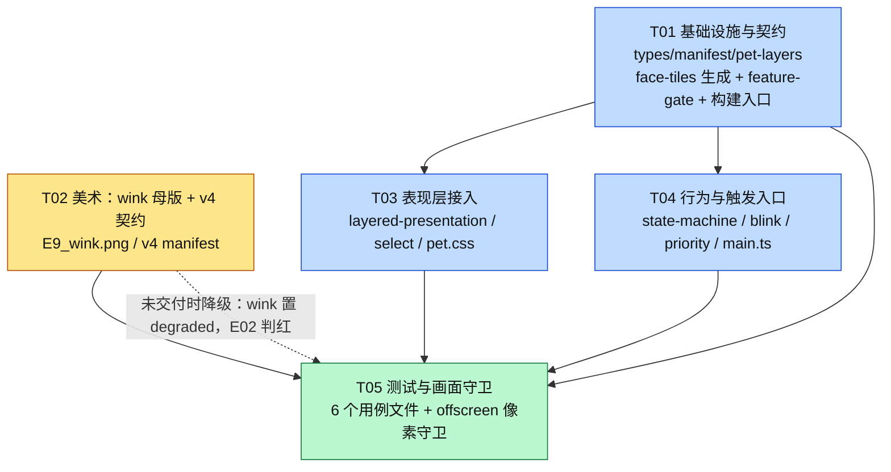

# 桌宠 M0 整合评估 + M1「可见表情闭环」细化设计与任务分解

> 架构：高见远（Gao）。本轮**只读代码、只写本设计文档**，未修改任何源码、未执行任何合并操作。
> 日期：2026-11-03。上游方案：`docs/desktop-pet-continuation-plan.zh-CN.md`（§2 证据基线、§3 差距清单、§4.1 表情与资产路线、§5 M1 判据、§6 验收纪律）。

## 0. 评估快照（先声明我看的是什么，免得后面被旧快照误导）

| 项 | 值 |
| --- | --- |
| worktree | `D:\Code\LingXi\.lingxi\work\desktop-pet-visual` |
| 分支 | `feature/desktop-pet-visual` |
| **分支 HEAD（设计时）** | **`f82388de`** `docs(pet): 核验桌宠现状并制定原型全机制开发与验收方案` |
| **分支 HEAD（合并清单复测时，2026-11-03）** | **`4b39b197`** `docs(pet): 台账补跨 DPI/多显示器取证与 Q1/Q2 结论`（M1 实施完成，工作树干净） |
| 工作树在飞改动（设计时） | 开工 3 个 → 收工 8 个（`pet-dev-probe.cjs`、`pet-window.cjs`、`scripts/pet-dev-*.cjs`、`tests/petDev*.test.cjs`，K4/K1/K3 修复中）。**这些已在 `f71f738c`/`2158898f`/`0d3ab93b`/`d4cdbe80` 落地，现无在飞改动。** |
| 主仓 `main` HEAD（设计时） | **`318f983a`** `完全放行仅保留高危审批，移除旧命令硬拒与预设叠加` |
| **主仓 `main` HEAD（复测时）** | **`0213305b`** `修复委派任务首帧因轮次摘要迟到而闪现用户气泡` |
| 分叉点（merge-base） | `063835d1` `build(coverage): JaCoCo 只插桩自有代码…` |
| 分支独有提交 | 设计时 **39** → 复测 **57** |
| main 独有提交 | 设计时 **73** → 复测 **77** |

> 本文 §1–§13 是对设计时快照（`f82388de` vs `318f983a`）的记录；**合并阶段一律以 §14.1 的复测数据为准**（`4b39b197` vs `0213305b`，11 个冲突路径）。M1 的设计落点刻意**不依赖**当时的在飞文件，所以两类快照不会互相推翻。

---

# A 部分：系统设计

## 1. M0：与 main 的整合评估

### 1.1 硬数据（我自己实测，不照抄文档）

```
git -C D:\Code\LingXi log -1 --oneline              → 318f983a
git rev-list --count main..HEAD                      → 39
git rev-list --count HEAD..main                      → 73
git diff --shortstat main...HEAD                     → 233 files changed, 25124 insertions(+), 327 deletions(-)
git diff --name-status main...HEAD                   → M:12  A:219  D:2
```

- **219 个新增**：桌宠的 `src/pet/**`、`electron/pet-*.cjs`、`scripts/*pet*`、`tests/pet*`、`docs/assets/desktop-pet/{p1,v3}`、`public/live2d/pet-p1/**` 等。main 从来没有过这些路径，属「首次进门」。
- **12 个修改**：其中 8 个在 main 侧是**被删除**（见 1.2），只有 4 个是两边都动过（`.gitattributes`、`frontend/electron/main.cjs`、`frontend/package.json`、`frontend/tsconfig.node.json`）。
- **2 个删除**：`frontend/public/live2d/pet-v1/expressions.png`、`frontend/public/live2d/pet-v1/front-master.png`——被 `pet-v3`/`pet-p1` 运行时资产取代的旧贴片（桌宠专属，**不是主应用逻辑**）。合并会让 main 少这两个文件，属于预期清理，但必须在合并说明里写明。

### 1.2 真实冲突面（`git merge-tree` 只读模拟，未碰工作树/索引）

> **时点说明**：本节记录的是 M1 开工时（分支 `f82388de` / main `318f983a`）的实测。M1 落地后 main 又前进了 4 个提交，合并前的**最新实测是 11 个冲突路径（3 内容 + 8 modify/delete）**，见 §14.1；此处保留原始结论作为设计期间的证据，冲突处置规则仍以 §14.3/14.4 为准。

```
git merge-tree --write-tree --name-only main HEAD
→ 结果树 e0552897cc94188b69ad81b9f58eac963c234175，共 9 个冲突路径：
  CONFLICT (content)        frontend/electron/main.cjs          ← 唯一语义冲突，且只有 1 个冲突块
  CONFLICT (modify/delete)  frontend/electron/pet-preload.cjs
  CONFLICT (modify/delete)  frontend/electron/pet-window.cjs
  CONFLICT (modify/delete)  frontend/pet.html
  CONFLICT (modify/delete)  frontend/src/pet/main.ts
  CONFLICT (modify/delete)  frontend/src/pet/pet.css
  CONFLICT (modify/delete)  frontend/public/live2d/README.md
  CONFLICT (modify/delete)  docs/assets/desktop-pet/v1/front-master.png
  CONFLICT (modify/delete)  docs/assets/desktop-pet/v2/README.md
```

**关键更正（给主理人）**：`git diff --name-only main...feature/desktop-pet-visual` 那 233 个文件里「main 侧也存在」的确实是 4 个，但**不是完整的冲突面**。main 在 `4a37ab6b chore(release): 将桌宠骨架从本次发布中隔离` 里**删掉**了 8 个桌宠文件，而分支修改了它们 ⇒ git 会报 **modify/delete 冲突**。这 8 个才是「要么丢桌宠、要么加回来」的真正决策点。

好消息是冲突极度可控：

```
git diff --numstat main <merge-result> -- frontend/electron/main.cjs frontend/package.json
→ 38  0   frontend/electron/main.cjs      （对 main 零删除，只有新增）
→ 10  0   frontend/package.json           （对 main 零删除，只有新增）
```

`.gitattributes`、`frontend/tsconfig.node.json` 在 main 侧**没被改过**（分支单侧改动），无冲突。

`main.cjs` 的完整冲突块（合并结果第 569–572 行）：

```
  createWindow();
<<<<<<< main
  setupTray();
=======
>>>>>>> HEAD
```

主因：分支 `47488d04` 把「托盘 + 桌宠」前移到 `backend.start()` **之前**（后端起不来也要留住桌宠/托盘这个唯一存活 UI），`setupTray()` 因此从 `createWindow()` 后面搬走了；main 侧 `4a37ab6b` 又把桌宠从 main.cjs 摘掉、把托盘放回原位。

### 1.3 整合路径结论：**普通 merge（三分支合并），不用 rebase、不做按边界迁移**

结论：**`git switch feature/desktop-pet-visual && git merge main`（在分支上先合 main），解冲突（设计时实测 9 个；合并前复测 **11** 个，见 §14.1）→ 全量回归 → 再 `git merge --no-ff feature/desktop-pet-visual` 回 main。**

理由（按证据逐条）：

1. **对 main 零删除已被实测**（1.2 的 `--numstat`）：整体 merge 不会吃掉 main 的 73 个提交内容，唯一需要人判的是 1 行 `setupTray()`。
2. **rebase 不选**：39 个提交要逐个重放到 main 上，而 8 个桌宠文件在 main 侧是「删除」状态 ⇒ 每个触碰这些文件的提交都会重新冲突一次（至少 10+ 次），且会重写已入库的提交号——验收台账（方案 §6 要求「记录被测提交」）全部失效。
3. **按边界迁移 233 文件不选**：219 个新增文件里有强耦合链（`pet-layers.json` ↔ `public/live2d/pet-p1/layers/*.webp` 的 sha256、`pet-assets.json` ↔ `docs/assets/desktop-pet/v3` 的母版摘要、`lxa://` 协议 ↔ `public/live2d` 目录）。手工搬运漏一个字节就是「资源加载不出来」的静默故障，比解 9 个冲突贵得多。**只有在实测冲突面大于 50 个文件时才值得动用迁移**，本轮实测 9 个。
4. **先「分支 ← main」再「main ← 分支」**：冲突只解一次，且解冲突期间 main 仍在演进时还能再合一次；最终回 main 用 `--no-ff` 保留「一次桌宠整合」的可见边界，便于回滚（`git revert -m 1`）。

### 1.4 冲突处理原则 + `frontend/electron/main.cjs` 逐块审阅清单

**语义真源原则**（按文件分区，不搞「以某侧为准」的一刀切）：

| 冲突路径 | 处置 | 真源 |
| --- | --- | --- |
| 8 个 `modify/delete` 的桌宠文件 | **保留分支版本**（`git checkout --ours`），main 的「从发布中隔离」意图改由 §1.6 的 dev-only 门禁承接 | 分支 |
| `frontend/electron/main.cjs` 的 `setupTray()` 冲突块 | **取 HEAD 侧（删掉 main 那一行）**，但必须同时确认前移后的 `setupTray()` 调用**恰好存在一次** | 分支的启动顺序 + main 的托盘实现 |
| `frontend/package.json` | 自动合并（+10/-0）；人工只需复核 `build.files` 段（§1.6 要改） | 两侧并集 |
| `.gitattributes` / `frontend/tsconfig.node.json` | 自动合并，无冲突 | — |

**`main.cjs` 逐块审阅清单**（合并后逐条打勾，括号内是 main 侧现状位置，来自 `git show main:frontend/electron/main.cjs`）：

必须**原样保留**的 main 侧逻辑（73 提交的成果，任何一条被删都算回归）：

| # | 功能块 | main 侧符号 | 合并后检查点 |
| --- | --- | --- | --- |
| 1 | 单实例锁 + 第二实例聚焦 | `requestSingleInstanceLock` / `app.on('second-instance')` | 存在且未被 pet 分支逻辑包裹 |
| 2 | 启动遮罩 | `createSplash()` / `closeSplash()` | 后端起不来时仍关闭遮罩 + 错误框 |
| 3 | 主窗口装配 | `createWindow()`（含 `nativeTheme`/标题栏主题同步） | 仍在后端就绪后创建 |
| 4 | 托盘基础三项 | `setupTray()` 内「显示界面 / 分隔符 / 彻底退出」 | 三项结构不变，仅**追加**「显示桌宠」勾选项（且仅 dev 暴露，§1.6） |
| 5 | 文件预览 IPC | `registerFilePreview({...})` | 未变 |
| 6 | 背景图片 IPC（3114bc68） | `registerBackgroundImages({..., assertTrustedSender})` | 未变，`assertTrustedSender` 仍传入 |
| 7 | 通知窗口 | `registerNotificationWindow` / `ipcMain.handle('notify')` / `showNativeNotification` | 未变 |
| 8 | 更新器 7 个 IPC + 日志流 | `createUpdater` / `update:*` / `ensureUpdaterLog` / `broadcastUpdateState` | 未变，`updater.start()` 仍在 `createWindow()` 之后 |
| 9 | 目录选择 IPC | `ipcMain.handle('dialog:select-directory')` | 未变 |
| 10 | 重启 IPC | `ipcMain.handle('app:relaunch')` | 未变 |
| 11 | 退出收尾 | `before-quit`（closeFilePreviews / backgroundImages.close / notifications.closeAll / 停更新器）+ `will-quit` + `window-all-closed` | 四个收尾一个不少；**追加** `pet.destroy()` 且必须在 dev 门禁内 |
| 12 | 来源校验 | `assertTrustedSender(event)` = `event.sender === mainWindow.webContents` | 保持严格（**不许**为了让桌宠 IPC 通过而放宽——桌宠窗口天然不等于 mainWindow，放宽等于给所有窗口开后门） |
| 13 | 任务栏图标/AppUserModelId | `windowsAppId`（dev/prod 区分） | 未变 |
| 14 | 高危审批相关改动（318f983a 附近） | 主仓 `main` 最近提交涉及的 IPC/审批路径 | 若落在 `main.cjs`，以 main 为准 |

必须由分支**重新加回**的桌宠块（`4a37ab6b` 删掉的那 7 处）：

| # | 块 | 位置 | 备注 |
| --- | --- | --- | --- |
| P1 | `require('./pet-window.cjs')`、`require('./lx-protocol.cjs')` | 文件头 require 区 | 必须放进 dev 门禁分支（§1.6） |
| P2 | `registerPetWindow({ ipcMain, isDev, frontendRoot })` | require 之后、`setupTray` 之前 | 托盘菜单要读 `pet.isVisible()` |
| P3 | `registerLxSchemePrivileges()` | **必须在 `app.whenReady()` 之前** | ready 后登记会抛且不生效 |
| P4 | `registerLxProtocol({ userDataDir, appRoot, extraBases })` | `whenReady` 内第一步 | dev 额外挂 `public/live2d` |
| P5 | 托盘菜单「显示桌宠」checkbox + `buildTrayMenu()` + `pet.onVisibilityChange` | `setupTray()` | 仅 dev 暴露 |
| P6 | `pet.show()` 前移到 `backend.start()` 之前 | `whenReady` | 分支 `47488d04` 的语义：后端起不来也要留住桌宠 |
| P7 | `pet.destroy()` | `before-quit` | 置顶窗口残留会盖住桌面 |

审阅「在飞」项（**以工程师落地后的版本为准，我不基于当前快照断言**）：`pet-window.cjs` 的 `ipcMain` 处理器是否也对来源做了校验、右键菜单项清单、dev 探针端点引用。合并时只需确认「K4/K1/K3 的修复内容整体进了合并结果」——用 `git log --oneline 063835d1..HEAD -- frontend/electron/pet-window.cjs` 对照，不逐行重审。

### 1.5 「main 逻辑没被吃掉」的验证清单（合并阶段执行，本轮**未执行**）

静态（一条命令即可证伪）：

1. `git diff --numstat main HEAD -- frontend/electron/main.cjs frontend/package.json frontend/tsconfig.node.json .gitattributes` → 期望**删除列全为 0**；任何非 0 逐行说明归属。
2. `git diff --diff-filter=D --name-only main HEAD` → 期望只有那 2 个 `pet-v1` 旧贴片。
3. `grep -c "setupTray()" frontend/electron/main.cjs` → 期望 2（1 处定义 + 1 处调用），**不是 3**（否则重复建托盘）。
4. §1.4 的 14 个「必须保留」行逐条 grep 命中。

动态（按仓库现有入口跑，顺序从便宜到贵）：

5. `cd frontend && npx vue-tsc -b` → 0；`npm run npm run test:pet`（桌宠 365 项基线，方案 §2 记录）→ 全绿。
6. `cd frontend && npm test`（主应用 TS 测试集）→ 与合并前 main 的基线**同一批失败集合**；`npm run test:process` → 绿。
7. `cd frontend && npm run gate:theme && npm run visual:check && npm run visual:components:check` → 绿（主题/视觉门禁是 main 侧最敏感的两道，合并动了 `pet.css`/`main.cjs` 就必须跑）。
8. 后端不受本轮改动影响，但合并后主链路必须冒烟一次：`mvn -q -DskipTests package` 或仓库既有脚本（以 `README`/CI 配置为准）。
9. 真机冒烟 5 条：① dev 起主窗口 + 托盘 + 桌宠三者同在；② 右键菜单关掉桌宠后主应用仍可操作、托盘勾选变灰；③ `backend.start()` 人为失败 → 遮罩关闭 + 错误框 + **桌宠/托盘仍驻留**（47488d04 语义）；④ 更新器日志/检查仍工作；⑤ 彻底退出后无残留置顶窗口、无残留进程。

### 1.6 安装版不展示桌宠入口（用户硬约束 #3）

**现状（这是真风险，不是理论）**：
- `frontend/vite.config.ts:61-65` 的 `build.rollupOptions.input` 有 **三个入口**，其中 `pet: resolve(__dirname, 'pet.html')` ⇒ `frontend/dist/pet.html` **现在就存在**（实测 `dir frontend\dist` 有 `pet.html`）。
- `frontend/package.json` 的 electron-builder `files` 含 `dist/**/*`、`electron/**/*`、`pet-geometry.json` ⇒ **安装包里同时有桌宠页面、桌宠主进程模块与 lxa 协议**。
- 结论：只要合并时把 `pet.show()` 加回 `main.cjs` 而不加门禁，**安装版就会冒出桌宠窗口**（且因为 `dist/pet.html` 在包里，它会正常加载）。

**开关单一真源**：新增 `frontend/electron/pet-feature-gate.cjs`（纯函数 + 常量，无 electron 依赖，可在 node 里直接测）：

```js
// 伪代码即契约
resolvePetExposure({ isPackaged, env = process.env }) →
  isPackaged                      ? { enabled: false, reason: 'packaged' }     // 安装版恒关，env 不得覆盖
  : env.lx_pet === '0'            ? { enabled: false, reason: 'env-off' }      // 开发态单次关闭
  :                                 { enabled: true,  reason: 'dev' }
createDisabledPet()               → { show: () => false, toggle(){}, destroy(){},
                                      isVisible: () => false, onVisibilityChange(){} }
```

- **默认值 = 安装版不展示**（`app.isPackaged === true` ⇒ `enabled === false`，且**不允许**被 `LX_PET=1` 打开；要开闸必须是 M6 的显式代码改动 + 发布评审）。
- 开发链（`pet-up.cmd` / `npm run dev:pet` / `electron .`）都是未打包态 ⇒ 默认开，与今天行为一致。

**受影响的具体文件（绝对路径）与 UI 入口**：

| 入口 | 文件 | 处置 |
| --- | --- | --- |
| 桌宠窗口本身 | `D:\Code\LingXi\.lingxi\work\desktop-pet-visual\frontend\electron\main.cjs`（P1/P2/P6/P7 四处） | 全部包在 `if (petExposure.enabled)`；`pet` 用 `createDisabledPet()` 空对象兜底（下游 `pet.isVisible()` 调用零分叉） |
| 托盘菜单「显示桌宠」 | 同上（P5，`setupTray()`/`buildTrayMenu()`） | 菜单项按 `petExposure.enabled` 条件拼装 |
| `lxa://` 协议（把本地目录暴露给渲染层） | 同上（P3/P4） | 打包态不注册、不 require（`lx-protocol.cjs` 只服务桌宠资源，主应用零使用——已全仓核对） |
| 桌宠页面产物 | `…\frontend\vite.config.ts`（`build.rollupOptions.input`） | **从生产构建入口移除 `pet`**（dev server 走 `vite.pet.config.ts`，不受影响） |
| 打包文件清单 | `…\frontend\package.json`（`build.files`） | 移除 `pet-geometry.json`；**M1 先不动 `electron/pet-*.cjs` 的排除**（见下方取舍），M6 随安装包冒烟改 |
| 构建/校验脚本 | `…\frontend\scripts\check-pet-not-shipped.mjs`（新增） | 断言 `dist` 里没有桌宠入口 |

**取舍说明（不私自折中）**：`electron/**/*` 里的 `pet-window.cjs` / `pet-preload.cjs` / `pet-dev-*.cjs` 打包后会成为「惰性文件」。我**建议 M1 只做运行时门禁 + 移除构建入口**，把「从 `files` 里排除 `electron/pet-*`」放到 M6 与安装包冒烟一起做。理由：一旦排除，而门禁万一判错成 enabled，`require` 会直接抛在主进程启动路径上——**打包版白屏**比「包里多几个不加载的 .cjs」严重得多。M1 的目标是「入口不可达」，运行时门禁 + 无 `dist/pet.html` 已经达成；把代码从包里彻底拿掉属于发布卫生，要配套安装包验收。

**守卫方式（可执行）**：

1. `frontend/tests/petFeatureGate.test.cjs`（node，无 electron）：
   - 真值表：`{isPackaged:true, env:{}}` → false；`{isPackaged:true, env:{LX_PET:'1'}}` → **false**（不可被 env 打开）；`{isPackaged:false}` → true；`{isPackaged:false, env:{LX_PET:'0'}}` → false。
   - `createDisabledPet()` 的每个方法调用都不抛、`show()` 返回 false。
   - **静态扫描** `main.cjs`：`registerPetWindow(` 与 `require('./pet-window.cjs')` 只允许出现在 `petExposure.enabled` 的三元/if 分支内（正则取门禁变量名前后 3 行做邻域断言）；`buildTrayMenu` 里的「显示桌宠」字面量必须在条件表达式内。
2. `frontend/scripts/check-pet-not-shipped.mjs`（构建后跑，进 `test:pet` 与 CI）：
   - `frontend/dist/pet.html` **不存在**；`dist` 下任何文件都不含 `id="pet-root"` 与 `lx-app" content="pet"` 指纹；
   - `vite.config.ts` 的 `build.rollupOptions.input` 静态解析后**没有** `pet` 键；
   - `package.json` 的 `build.files` 不含 `pet-geometry.json`；
   - 打印一行 `✓ 桌宠入口未进入产物`（与主题门禁同风格，缺这行说明脚本没跑）。
3. **变异体（必须变红）**：
   - G1 把门禁改成 `return { enabled: true }` → `petFeatureGate.test.cjs` 的打包真值表变红。
   - G2 把 `pet.show()` 挪到门禁 if 之外 → 静态邻域断言变红。
   - G3 把 `pet` 加回 `build.rollupOptions.input` → `check-pet-not-shipped.mjs` 变红（`dist/pet.html` 出现）。
   - G4 托盘菜单「显示桌宠」去掉条件 → 静态断言变红。

> 口径确认：这**不是 M1 功能缩水**。E01–E08+wink 的可见性验收在**开发链**（`npm run dev:pet` + `pet-up.cmd`）上执行，与今天验收口径完全一致；M6 才开安装版闸门。

### 1.7 M0 风险

| 风险 | 影响 | 缓解 |
| --- | --- | --- |
| main 在 M1 期间继续前进 | `main.cjs` 再次分叉 | 实测冲突仅 1 行；M1 完成即合并，不拖到 M6 |
| 解冲突时「顺手」删了 main 的某个收尾调用 | 更新器/通知/背景图泄漏 | §1.5 第 1、4 条 + 真机冒烟 ⑤ |
| 8 个 `modify/delete` 被取 main 侧 | 桌宠直接消失 | §1.2 已定「保留分支版本」；合并后 `npm run test:pet` 会立刻红 |
| 移除 `dist/pet.html` 后有人用安装版验收 M1 | 误判「桌宠坏了」 | 验收台账写明「M1 只在开发链验收」，`check-pet-not-shipped` 的输出行留证 |
| 在飞文件（K4/K1/K3）未提交就被合并 | 半成品进 main | 合并前置条件：`git status --porcelain` 干净 |

### 1.8 M0 结论摘要（5 条，含核实到的提交号）

1. **快照**：分支 `feature/desktop-pet-visual` HEAD = `f82388de`（另有 8 个在飞文件未提交），主仓 `main` = `318f983a`，分叉点 `063835d1`；分支独有 **39** 提交 / main 独有 **73** 提交（方案文档记 38，已过期）。
2. **真实冲突面只有 9 个路径**（`git merge-tree` 实测，结果树 `e0552897`）：1 个内容冲突 `frontend/electron/main.cjs`（只有 1 个冲突块，`setupTray()` 位置）+ 8 个 modify/delete（main 的 `4a37ab6b` 删了桌宠文件而分支在改）。**主理人给的「4 个热点文件」不完整**——那 4 个是「分支改过且 main 仍有」的文件，漏了 modify/delete 这一半。<br>（**合并前复测已更新为 11 个路径**：main 新增的 `5f42eb6a`/`78cbaa79` 让 `package.json` 与 `vite.config.ts` 也进了冲突面，见 §14.1）
3. **整合路径选定：普通 merge**（先把 main 合进分支、解冲突（设计时 9 个 → 合并前复测 **11** 个，§14.1），再 `--no-ff` 合回 main）。硬依据：合并结果相对 main **零删除**（设计时 `main.cjs` +38/−0、`package.json` +10/−0；复测 +151/−0、+15/−0、`vite.config.ts` +16/−0）。rebase 会让 39 个提交逐个重撞同一批删除、并重写已入库提交号；按边界迁移 233 文件不划算（生成物 sha256 链一断就是静默故障）。
4. **M1 可以在当前分支先做，且应当做完立刻合并**：M1 的改动集中在 `src/pet/**` + 3 个共享文件，与 main 的 73 提交无交集；拖延只让 `main.cjs` 重新分叉（实测当前仅 1 行）。
5. **安装版不展示桌宠**已定性为「合并前置」而非「M6 再说」：现状 `dist/pet.html` 与 `electron/pet-*.cjs` 都会进安装包，所以合并时必须同时落地 §1.6 的 dev-only 门禁（单真源 `electron/pet-feature-gate.cjs` + 生产构建入口移除 + 产物校验脚本），否则一合并就违规。

---

## 2. 实现方案：难点、选型、架构模式

### 2.1 需求难点（按「为什么会做错」排序）

| 难点 | 具体表现 | 本设计的对策 |
| --- | --- | --- |
| **表情要「贴在脸上」，而脸现在是被别人画好的** | 分层合成的脸来自 `body-occluder`（支撑层，z=30），没有独立脸层；加脸层就会与耳朵/发夹/呆毛/蝴蝶结抢像素 | 脸区取一个**实测**与所有可动部件零重叠、且被 body-occluder 100% 不透明覆盖的矩形（§4.1 三项校验全过） |
| **同一个「眨眼」被当成三种东西** | `blink`（双层闭合）/`blinkHalf`（半闭）/`sleepy`（困倦）混用；半闭帧借困倦整脸 ⇒ 嘴型抖 | id 重定义 + `BLINK_LIKE_EXPRESSIONS` 集合 + 「未交付半闭帧就两态眨眼，**绝不回落 sleepy**」（§5） |
| **降级路径比主路径更容易错** | 三级模式（composite/partial/layered）下元素**永远都挂载**，判「元素存在」等于判永远为真 | 改用**可见性**判分支（`visibleLayerIds`）；缺脸层时靠 `plan.ts` 既有 `z<=SAFE_OVERLAY_Z` 判据自动回落，零新增降级代码 |
| **子矩形贴片 vs 整画布层** | 现有渲染器只支持整画布 ``；给脸层写死 2048×3072 会吃 ~250MB | 只对新层启用 `[data-placement='rect']` + 百分比变量，既有 9 层写入面零变化 |
| **「指令发出去了」被当成「用户看见了」** | 现有断言只查 `fallback.applied.length` | 三层守卫：结构 → 行为 → **真实渲染像素 + 来源对照（隐藏 face 层后变化必须消失）** |
| **未完成功能不能对用户暴露** | 当前 `dist/pet.html` 与 `electron/pet-*.cjs` 都会被装进安装包 | 运行时门禁单真源 + 生产构建入口移除 + 产物级检查脚本 + 4 个变异体（§1.6） |
| **长期分叉整合** | 分叉点 `063835d1`，两边各 39/73 提交（合并前 57/77） | 实测冲突 9 个路径（合并前复测 11）、对 main 零删除 ⇒ 普通 merge，逐块审阅清单（§1.3–1.5、§14） |

### 2.2 选型（都是「已经在仓库里跑着」的东西，不引入新框架）

| 关注点 | 选择 | 理由 | 放弃的方案 |
| --- | --- | --- | --- |
| 合成载体 | 多个原生 `` + CSS `transform`/CSS 变量（现状） | 常驻透明窗口，零 WebGL 上下文、零动画库；`motion-compiler` 已把关键帧编译成 CSS，导入新框架会把「可测」换回「不可测」 | Canvas/WebGL 合成（要重写合成器、要处理 DPR/预乘）、Live2D（P2 才做） |
| 表情承载 | **新增 `face` 层（子矩形 webp）** | 只换脸不动前景层；贴片小（~10–30KB），肉眼可辨；构建脚本可从已交付母版直接裁出，**不等美术就能让 E01–E08 可见** | 整头贴片重合成（会重盖耳朵/发夹）、整画布透明脸图（内存不可接受）、保留「压平帧兜底」当主路径（layered 下必然不可见） |
| 贴片格式 | `webp-lossless`（沿用 `layers/*.webp`） | 无损避免表情细节糊；已有构建脚本与预算基线 | PNG（体积 3–5×）、有损 webp（眼睫毛糊） |
| 像素校验 | `sharp` 解码后按 raw RGBA 逐像素比对 | 已在 devDependencies（实测 0.35.5 可用），与既有 `build-pet-layers.mjs` 同一依赖 | 引入 pixelmatch/pngjs（多一个依赖、且我们比的是「等/不等」不是「像不像」） |
| 真机守卫 | Electron offscreen + CDP `Page.captureScreenshot({clip})` | 本仓视觉门禁已验证这条路；`capturePage()` 高度被钳死不能用 | Playwright（多一套浏览器二进制，与 Electron 内嵌版本不一致）、纯 DOM 断言（证明不了像素） |
| 时间压缩 | 预注入虚拟时钟（`Date.now`/`setInterval` 缩放） | 让「闲置 60s/90s」在 1.5s 内**真实发生**，状态机零改动 | 等 90 秒（守卫不可用）、`petDebug.forceState`（调试按钮，方案 §6 明确不算） |
| dev-only 门禁 | 新增 `electron/pet-feature-gate.cjs` 纯函数 | 单真源、node 可测、无 electron 依赖；空对象兜底让下游零分叉 | 各处散写 `app.isPackaged`（无法单点验证）、只靠 `files` 排除（门禁判错就白屏） |

### 2.3 架构模式

**分层 + 端口/适配器（Hexagonal 味道的 MVP）**，与既有代码一致，不新造范式：

- **行为层（模型）**：`behavior/state-machine.ts` 只吃「事件 + 注入的时间/随机源」，产出 `PresentationOp[]`；不认识 DOM、不认识贴片。
- **表现层（视图/适配器）**：`presentation/*` 消费 op，落地到 `LayeredPresentation`（分层）或 `SpritePresentation`（压平帧）两种可互换实现；`select-presentation.ts` 是唯一构造点（seam S1）。
- **数据层**：`pet-layers.json` / `pet-face-tiles.json` / `pet-assets.json` 三份生成物 + 三个类型化访问器；渲染层永远不拼绝对路径。
- **主进程边界**：`electron/*.cjs` 只管窗口/IPC/协议；新增 `pet-feature-gate.cjs` 是**唯一**的「桌宠是否对外存在」判定点。
- 为什么不是 MVC/MVVM：桌宠没有表单、没有双向绑定、没有路由；它的复杂度在「状态机 × 渲染降级 × 资产契约」，用 MVP + 端口更贴合，也才能把 80% 逻辑放进 node 单测。

### 2.4 文件清单（本轮涉及的全部路径；`★` 新增，`△` 修改，其余为只读引用）

```
D:\Code\LingXi\.lingxi\work\desktop-pet-visual\
├─ docs\
│  ├─ desktop-pet-continuation-plan.zh-CN.md        只读（上游方案）
│  ├─ desktop-pet-m1-design.zh-CN.md                ★ 本文
│  ├─ desktop-pet-m1-acceptance.zh-CN.md            ★ T05 验收台账
│  └─ assets\desktop-pet\
│     ├─ v3\ (manifest.json, expr\E1..E8.png, body-without-head.png)   只读（历史交付，不得改）
│     ├─ p1\ (manifest.json, 01..06*.png, support\*.png, support\masks\*)  只读
│     └─ v4\                                        ★ T02
│        ├─ manifest.json  ★   ├─ README.md  ★
│        └─ expr\E9_wink.png  ★（美术唯一必交母版）
├─ frontend\
│  ├─ pet-layers.json                               △ T01（新增 face 层 + 回填 files）
│  ├─ pet-face-tiles.json                           ★ T01（生成物）
│  ├─ pet-assets.json                               △（blink.wink 随 v4 清单重建）
│  ├─ pet-motions.json                              只读（C7 校验用）
│  ├─ package.json                                  △ T01（scripts / build.files）
│  ├─ vite.config.ts                                △ T01（移除 pet 构建入口）
│  ├─ vite.pet.config.ts                            只读（开发链不受影响）
│  ├─ pet.html                                      只读
│  ├─ electron\
│  │  ├─ main.cjs                                   △ 合并阶段（P1–P7 加回 + 门禁）
│  │  ├─ pet-feature-gate.cjs                       ★ T01
│  │  ├─ pet-window.cjs / pet-preload.cjs / lx-protocol.cjs / pet-dev-*.cjs   只读（在飞，HOLD）
│  ├─ src\pet\
│  │  ├─ presentation\types.ts                      △ T01（ExpressionId +2）
│  │  ├─ presentation\layered-presentation.ts       △ T03
│  │  ├─ presentation\select-presentation.ts        △ T03
│  │  ├─ presentation\blink-driver.ts               △ T04
│  │  ├─ presentation\priority.ts                   △ T04
│  │  ├─ assets\manifest.ts                         △ T01（PetBlinkMapping.wink）
│  │  ├─ assets\face-tiles.ts                       ★ T01
│  │  ├─ layers\manifest.ts                         △ T03（注释反转 + faceLayer 访问器）
│  │  ├─ layers\plan.ts                             只读（靠既有判据承接回落）
│  │  ├─ behavior\state-machine.ts                  △ T04
│  │  ├─ behavior\hit-profile.ts                    ★ T04
│  │  ├─ main.ts                                    △ T04
│  │  └─ pet.css                                    △ T03
│  ├─ scripts\
│  │  ├─ build-pet-face-tiles.mjs                   ★ T01
│  │  ├─ check-pet-not-shipped.mjs                  ★ T01
│  │  ├─ check-pet-layers.mjs                       △ T01（C2/C3/C7/C8）
│  │  └─ pet-face-visual-guard.cjs                  ★ T05
│  ├─ tests\
│  │  ├─ petFaceLayer.test.ts ★  petFaceTiles.test.ts ★  petBlinkWink.test.ts ★   （T05）
│  │  ├─ petFeatureGate.test.cjs ★  petNotShipped.test.cjs ★                        （T05）
│  │  └─ petPresentationSelector.test.ts            △ T05（9→10 层期望）
│  └─ public\live2d\pet-p1\face\*.webp              ★ T01（生成物，入库）
```

### 2.5 M1 目标与「为什么现在看不见」的准确诊断

M1 判据（方案 §5）：**E01–E08 + 新增 wink 在默认 `layered` 模式下肉眼可见，每一档都能从真实用户入口触发；状态、资源 URL、截图区域变化三者互相印证。**

现状三处相乘，导致「脸上什么变化都看不到」：

1. `frontend/pet-layers.json` 只有 9 层（6 可动 + 3 支撑），**没有 face 层**；
2. `frontend/src/pet/presentation/layered-presentation.ts` 的 `applyExpression` 在 `views.get('face')` 为空时把表情交给 `baseFallback`（压平帧）；
3. `frontend/src/pet/pet.css` 在 `[data-composite-mode='layered']` 下把 `.pet-art-frame` 置 `opacity: 0`。

⇒ 表情指令落到一个不可见的元素上。**代码里还把这条写成了「已知限制 + 用户已决策 C 方案：不补 face 层、不要生成 face 贴图」**（`frontend/src/pet/layers/manifest.ts` 文件头注释、`pet.css:749` 附近注释）。M1 是**对该决策的显式反转**，因此这批注释必须同批改写——否则下一位工程师读到「不要做」会直接推翻本设计。这是本任务的**隐性交付物**，已列进 T03。

另外一个隐性缺陷（本设计顺带修掉）：`BLINK_EXPRESSION_MAP.half = 'sleepy'`（`blink-driver.ts:77`，与 `pet-assets.json.blink.half` 同源）。生理眨眼的**半闭帧用的是「困倦」贴片**，所以每眨一次眼，**嘴型会跳一下困倦**。方案 §3 的 E02/E08 判据要求「双眼闭合与半闭眼不混淆」「困倦嘴型不随眨眼跳动」——必须把 wink/blinkHalf 与 E08 解耦（见 §5）。

## 3. 脸层接入方案（文件级）

### 3.1 结论：新增第 10 层 `face`，`z = 32`，`rect = faceRegion`（非整画布）

不用「整张 2048×3072 的透明脸图」：那是 25MB RGBA/层，10 张脸贴片常驻内存 ≈ 250MB，常驻桌宠窗口不可接受。改用**子矩形贴片 + 矩形放置变量**。

**层序与遮挡（在既有 9 层里插一层，其余不动）**：

```
underpainting(0)     支撑：底绘（脸区下方已有不透明底）      z=0
tail-base(10)        可动：尾根
tail-tip(15)         可动：尾尖（链式）
ear-left(20)         可动：左耳        ← 在脸层之下（耳朵在头后）
ear-right(25)        可动：右耳        ← 在脸层之下
body-occluder(30)    支撑：前发/衣物/面部主体遮挡
face(32)             ★新增：表情脸区贴片（只在脸区内换像素）
ahoge(40)            可动：呆毛        ← 在脸层之上（不受表情影响）
bow(45)              可动：头饰蝴蝶结   ← 在脸层之上
foreground-occluder(50) 支撑：前景盖片
```

为什么 `z=32` 而不是 35：

- 必须 `> 30`（盖住 body-occluder 里画好的中性脸）且 `< 40`（呆毛/蝴蝶结永远压在脸之上，表情切换不能把它们刷掉）。
- 必须 `<= SAFE_OVERLAY_Z(35)`（`layers/plan.ts`）：该常量现有判定是「缺这一层 ⇒ **不降级、整体回落** `composite`」。脸层缺了就必须回落压平帧，正是我们要的兼容路径——**因此 `plan.ts` 一行都不用改**。若取 35 会与常量边界语义纠缠（`z <= SAFE_OVERLAY_Z` 恰好等于），取 32 让「缺脸层 ⇒ 回落」与「前景层缺失 ⇒ 可 partial」两条语义各归各位。

`pet-layers.json` 新增条目（人写部分）：

```json
{
  "layerId": "face",
  "role": "animatable",
  "z": 32,
  "parent": "root",
  "pivot": { "u": 0.5, "v": 0.5 },
  "rect": { "x": 560, "y": 1064, "width": 792, "height": 400 },
  "source": "face",
  "blend": "normal",
  "opacity": 1,
  "occludes": [],
  "files": {},                       // 由 build-pet-face-tiles.mjs 回填（neutral 那两张）
  "required": true
}
```

> `role` 取 `animatable` 而不是新造 `'face'` 角色：新角色要同步改 `LayerRole` 联合、`SUPPORTED_ROLES`、`plan.ts` 的缺失判定、`animatableLayerIds`、`applyDriven` 的角色判空、门禁与 6 个测试文件——收益只是「语义更好看」。用 `animatable` + **门禁禁止动作目录里有 `face` 轨道**（§4 校验项 C7）达到同样的约束强度，改动面小一个数量级。

### 3.2 渲染层：三处代码改动

**(a) 矩形放置**（`presentation/layered-presentation.ts` + `pet.css`）

现在每个 `.pet-layer` 是 `position:absolute; inset:0; width:100%; height:100%; object-fit:contain`——只支持整画布。新增：

```css
/* pet.css：只有声明了子矩形的层走这套，其余层逐字节不变 */
.pet-layer[data-placement='rect'] {
  inset: auto;
  object-fit: fill;            /* 百分比已是精确画布比例，再 contain 会二次缩放 */
  left:   var(--pet-layer-left);
  top:    var(--pet-layer-top);
  width:  var(--pet-layer-width);
  height: var(--pet-layer-height);
}
```

`mountLayerViews()` 与 `applyPlan()` 里写入四个百分比变量（`left = rect.x / canvas.width * 100 + '%'` …），**仅当 `rect` 不等于整画布时**才写并打 `data-placement='rect'`。这样既有 9 层的 DOM 写入面完全不变（`tests/petLayeredPresentation.test.ts` 现有断言不受影响），可回归性最大化。

**(b) 表情走 face 贴片**（同一文件）

- `LayeredPresentationDeps` 新增 `faceTileUrls: Partial<Record<ExpressionId, string>>`（来自 `pet-face-tiles.json`）；`expressionUrls` 保留给 `baseFallback`（压平帧），语义不混。
- `applyExpression` 改成**按「可见性」而不是「存在性」判分支**：

```ts
const faceVisible = this.visibleLayerIds.has(FACE_LAYER_ID);   // applyPlan 里更新的 Set
if (faceVisible) { /* 换 face.element.src = faceTileUrls[id] ?? expressionUrls[id] */ }
else { this.deps.baseFallback?.apply(op); }                     // 回落压平帧
```

  这条修的是一个**真实漏洞**：`partial` 模式下所有层元素都已挂载（`views` 有 face），但 face 可能不在本次计划里（`hidden = true`）。旧代码只看 `views.get('face')` 存在 ⇒ 会把 src 写进一个隐藏元素并 `return`，**不回落到压平帧**，表情又变没了。按可见性判，`partial`/`composite` 一律回落压平帧（那时 `.pet-art-frame` 可见），`layered` 才走贴片。
- 过渡：`op.fadeMs ?? crossfade.durationMs`；**生理眨眼类（`blink`/`blinkHalf`/`wink`）fade 强制 0**——100ms 的闭眼窗口里做 80–120ms 淡入，等于全程半透明，看起来像「眨眼没眨完」。CSS 侧补一条真正生效的进场动画（现在 `data-fading='in'` 在层上没有对应规则，等于没写）：

```css
.pet-layer[data-fading='in'] {
  animation: pet-face-in var(--pet-crossfade-ms, 100ms) var(--pet-crossfade-ease, ease-out) both;
}
@keyframes pet-face-in { from { opacity: 0 } to { opacity: 1 } }
```

**(c) 兼容路径（无脸层 ⇒ 回落压平帧）**

三条互斥分支，全部落到既有机制上，**不需要新的降级逻辑**：

| 场景 | 机制 | 用户看到 |
| --- | --- | --- |
| 资产包含 face 且解码成功 | `plan.mode='layered'`，face 在计划里 ⇒ 换贴片 | 表情可见，且尾巴/耳朵微动保留 |
| 资产缺 face（旧包/美术未交付）/ 解码失败 | `plan.ts` 的 `z<=SAFE_OVERLAY_Z` 判定 ⇒ `mode='composite'`；`pet.css` 里压平帧恢复可见 | 表情可见（整帧切换），失去部件微动 —— **有意的降级，不是缺陷** |
| 只有前景层缺（`partial`） | face 不在计划里 ⇒ (b) 的可见性分支走 `baseFallback` | 表情可见（压平帧），压平帧此时本就可见 |

第三条为什么安全：实测 E1–E8 八个整头贴片**只在脸区矩形内有像素差**（见 §4.1），所以「压平帧换表情 + face 贴片不在场」不会出现「身体像素被贴两遍」的重影。

### 3.3 调用流程（精确使用下文 §3.4 定义的类与接口）

```mermaid
sequenceDiagram
    autonumber
    participant U as 用户(鼠标)
    participant W as pet-window.cjs(Electron主进程)
    participant M as main.ts(渲染入口)
    participant HP as HitProfile
    participant SM as PetBehaviorStateMachine
    participant EQ as dispatchEntryOps
    participant BUS as PresentationBus
    participant PRI as priority.interruptDecision
    participant LP as LayeredPresentation
    participant FB as SpritePresentation(压平帧)
    participant DOM as 层栈img(DOM)

    U->>M: pointerdown(head 区, 2 次/1.5s)
    M->>HP: classifyProfile(u,v,LAYER_MANIFEST.face.rect)
    HP-->>M: 'head'
    M->>SM: handle('tap', {profile:'head'})
    SM-->>EQ: [motion shy(prio1,900ms), expression shy(prio1,900ms,force)]
    EQ->>BUS: dispatch(op) ×N
    BUS->>PRI: interruptDecision({incoming,active,sleeping,...})
    PRI-->>BUS: 'apply'
    BUS->>LP: apply(op)  (expression: shy)
    LP->>LP: faceVisible? → visibleLayerIds.has('face')
    alt layered 且 face 可见
        LP->>DOM: face.src = faceTileUrls['shy']
        LP->>DOM: face.dataset.expression='shy'; data-fading='in'
    else 无 face / partial / composite
        LP->>FB: apply(op)
        FB->>DOM: .pet-art-frame 双缓冲换帧（此时该元素可见）
    end
    Note over LP,DOM: 900ms 后 SM 回 idle → expression neutral 走同一路径
```

### 3.4 类图与接口（只画 M1 会动的类；`★` = 新增，`△` = 修改）

```mermaid
classDiagram
    direction LR

    class PetAssets {
        +number version
        +Size canvas
        +Size nativeCanvas
        +PetBlinkMapping blink
        +ExpressionId[] expressionIds
        +frames  Map~ExpressionId, PetDensityMap~
        +totals
    }
    class FaceTilesManifest {
        <<generated json>>
        +number version
        +string assetId
        +LayerRect faceRegion
        +NativeRect faceRegionNative
        +string[] degraded
        +faceTiles Map~ExpressionId, FaceTileFileMap~
    }
    class FaceTileFile {
        +string file
        +string url
        +number width
        +number height
        +number bytes
        +string sha256
        +string format
    }
    class PetBlinkMapping {
        +ExpressionId open
        +ExpressionId closed
        +ExpressionId half
        +ExpressionId wink
        +NativeRect eyeRegionNative
    }
    class LayerManifest {
        +number version
        +boolean enabled
        +string assetBase
        +Size canvas
        +LayerSpec[] layers
    }
    class LayerSpec {
        +string layerId
        +LayerRole role
        +number z
        +string parent
        +Pivot pivot
        +LayerRect rect
        +LayerRect allowedRegion
        +LayerFileMap files
        +boolean required
    }
    class CompositePlan {
        +CompositeMode mode
        +ResolvedLayer[] layers
        +string fallbackReason
        +PetDensity density
    }
    class PetPresentation {
        <<interface>>
        +apply(op PresentationOp) void
        +prepare(op PresentationOp) Promise
        +state PresentationState
        +dispose() void
    }
    class LayeredPresentation {
        +applyPlan(plan CompositePlan) void
        +apply(op PresentationOp) void
        +prepare(op PresentationOp) Promise
        +state PresentationState
        -Set~string~ visibleLayerIds
        -applyExpression(op) void
        -hasFaceLayer() boolean
        +rules readonly
    }
    class SpritePresentation {
        +apply(op PresentationOp) void
        +prepare(op PresentationOp) Promise
        +state PresentationState
        -swapFrame(url string) void
    }
    class BlinkDriver {
        +start() void
        +stop() void
        +isRunning boolean
        -emitBlink(reason string) void
        -schedule(delayMs number, fn) void
    }
    class PetBehaviorStateMachine {
        +handle(event PetBehaviorEvent, ctx TapContext) PresentationOp[]
        +tick() PresentationOp[]
        +enterState(state PetBehaviorDebugState) PresentationOp[]
        +snapshot() BehaviorSnapshot
        +restore(snapshot) boolean
        +isSleeping boolean
    }
    class HitProfileHelper {
        <<pure module: hit/hit-profile.ts>>
        +faceRectNormalized(manifest LayerManifest) NormalizedRect
        +classifyProfile(u number, v number, manifest LayerManifest) HitProfile
    }
    class PresentationBus {
        +dispatch(op PresentationOp) DispatchOutcome
    }
    class PriorityRules {
        <<pure module: priority.ts>>
        +interruptDecision(query InterruptQuery) InterruptDecision
        +BLINK_LIKE_EXPRESSIONS ExpressionId[]
    }
    class PetFeatureGate {
        <<cjs module: electron/pet-feature-gate.cjs>>
        +resolvePetExposure(input) PetExposure
        +createDisabledPet() DisabledPet
    }
    class FaceTileBuilder {
        <<script: scripts/build-pet-face-tiles.mjs>>
        +cropFace(masterPath, region) Buffer
        +emitDensities(buffer) void
        +writeCatalog(catalog FaceTilesManifest) void
        +verifyChecks(checks C1toC9) Report
    }

    PetAssets ..> PetBlinkMapping : 同源
    FaceTilesManifest "1" o-- "*" FaceTileFile : faceTiles
    LayerManifest "1" o-- "10" LayerSpec : layers（含 face z=32）
    LayerSpec ..> FaceTileFile : files[neutral]
    CompositePlan "1" o-- "*" ResolvedLayer : layers
    ResolvedLayer --> LayerSpec
    PetPresentation <|.. LayeredPresentation
    PetPresentation <|.. SpritePresentation
    LayeredPresentation --> SpritePresentation : baseFallback
    LayeredPresentation --> FaceTilesManifest : faceTileUrls
    LayeredPresentation --> CompositePlan : applyPlan
    BlinkDriver --> PriorityRules : 产出 blink/wink op 走总线
    PetBehaviorStateMachine --> HitProfileHelper : 用 profile 分流 tap 语义
    PetBehaviorStateMachine ..> PresentationBus : entryOps
    PresentationBus --> PriorityRules
    PresentationBus --> PetPresentation
    FaceTileBuilder ..> FaceTilesManifest : 生成
    FaceTileBuilder ..> LayerManifest : 回填 face.files
    PetFeatureGate ..> LayeredPresentation : 决定桌宠窗口是否创建（indirect）
```



## 4. 资产契约（可直接交给美术/构建脚本执行）

### 4.1 脸区矩形：**已用真实母版实测，不要再用 `nativeFaceEditCrop` 直接当脸区**

`docs/assets/desktop-pet/v3/manifest.json` 的 `nativeFaceEditCrop` = `(288,540,380,184)`（native 1024×1536）→ 母版 `(576,1080,760,368)`。我用 `docs/assets/desktop-pet/v3/expr/E1..E8` 逐张对 `E1_default.png` 求差（阈值 7/255），得到**实测差异包围盒**：

| 表情 | 差异 bbox（母版 2048×3072） | 宽×高 |
| --- | --- | --- |
| blink `E2` | x 590–1325, y 1084–1367 | 736×284 |
| surprised `E3` | x 588–1325, y 1084–1431 | 738×348 |
| sad `E4` | x 590–1325, y 1082–1417 | 736×336 |
| angry `E5` | x 590–1325, y 1084–1417 | 736×334 |
| shy `E6` | x 590–1325, y 1084–1421 | 736×338 |
| happy `E7` | x 590–1325, y 1084–1417 | 736×334 |
| sleepy `E8` | x 590–1323, y 1082–1417 | 734×336 |
| **并集** | **x 588–1325, y 1082–1431** | **738×350** |

并集落进 `nativeFaceEditCrop`，但上边只剩 **2px** 余量（1082 vs 1080）、下边 16px、左右各 10–12px。给 wink 新画的眼睛一旦比现有表情高 2px 就溢出。**因此脸区取「nativeFaceEditCrop 四周各外扩 8 native px」**：

- **`faceRegionNative` = `{ left: 280, top: 532, width: 396, height: 200 }`**
- **`faceRegionMaster` = `{ left: 560, top: 1064, width: 792, height: 400 }`**
- 输出尺寸：**`@2x = 396×200`**、**`@1x = 198×100`**（母版/2、母版/4，与既有 `layers/*.webp` 同一比例规则）

这个矩形我做过三项硬校验（实测数据，脚本见 §8 的 C1–C3）：

| 校验 | 结果 |
| --- | --- |
| 脸区内是否落入「可动部件」的墨迹（耳朵/呆毛/蝴蝶结/前景盖片/尾巴/底绘，α>8） | **全部 0 像素** |
| 脸区是否被 `body-occluder` 完全不透明覆盖 | **316800/316800 = 100%** |
| 该矩形内 `E1_default.png` 与 `body-occluder.png` 是否逐像素一致 | **diffPx = 0，maxDelta = 0** |

第三条是整套方案的基石：**脸贴片就是母版在该矩形内的原样裁切**，静止时与它下面那层像素完全相同 ⇒ 零重影、零补绘缝、锚点错了会立刻露馅（这也是变异体 M3 的抓手）。

> 耳朵为什么会转到脸区里？不会。耳朵 `z=20/25` 在 `body-occluder(30)` **之下**，而 body-occluder 在脸区 100% 不透明 ⇒ 耳朵（含 ±30° 抖动时甩出的部分）在脸区内本来就不可见。实测角度上限也只有 6°（`pet-motions.json`：ear-left −6/ear-right −5.4，呆毛 ±4，蝴蝶结 ±2）。**但这条不变式必须由门禁守住**：将来有人给耳朵加大幅度或改 z 序，C2/C3 会立刻红。

### 4.2 规范（美术与构建脚本共同遵守）

| 项 | 规格 |
| --- | --- |
| 命名 | 源文件 `docs/assets/desktop-pet/v4/expr/E9_wink.png`（沿用 `E<n>_<id>.png` 惯例）；产物 `frontend/public/live2d/pet-p1/face/<expressionId>@1x.webp`、`@2x.webp` |
| 母版画布 | 2048×3072，**与 v3 完全同一画布与锚点**（`anchor = 1024,2908`）；不得缩放、不得重新居中 |
| 颜色/透明 | sRGB、**straight alpha（不预乘）**、无半透明脏边：矩形外框一圈的 α **必须为 0**，矩形内不透明像素 α ≥ 248 占比 ≥ 99.5%（沿用 v3 `alphaCleanup` 的 8/248 阈值） |
| 尺寸 | `@2x` 恰好 396×200、`@1x` 恰好 198×100（由脚本从母版裁切缩放，**美术不交这两张**） |
| 对齐 | 放置靠 `pet-layers.json` 的 `rect`（母版像素）+ 百分比变量，**不用任何 CSS 偏移魔法**；`pivot` 取矩形中心 `0.5,0.5` |
| 遮挡 | 脸区**不得**包含耳朵、发夹/蝴蝶结、呆毛、前景盖片的任何可见像素（否则会与那些层的动画互相撕边）——机器校验，人工只需「别把整头再画一遍」 |
| 体积预算 | 单张 `@1x` ≤ 12KB、`@2x` ≤ 30KB；`face/` 总计 ≤ 400KB（10 张 × 2 档） |
| 禁止 | 整头贴片直接当脸贴片（会把耳朵/发夹重复盖上，旋转时撕边）；把带底色的矩形外框写进 webp（`object-fit: fill` 会把它放大成灰边） |

### 4.3 交付清单

| 角色 | 交付物 | 形态 |
| --- | --- | --- |
| **构建脚本（工程师）** | `frontend/scripts/build-pet-face-tiles.mjs` 从 `v3/expr/E1..E8.png` 裁 `faceRegionMaster` → 生成 8×2 张 webp + 回填 `frontend/pet-face-tiles.json`、`pet-layers.json` 的 `face.files` | 代码，**不等美术** |
| **美术（苏画意）** | `docs/assets/desktop-pet/v4/expr/E9_wink.png`（单眼闭合，见 §5） | 1 张母版 PNG |
| 美术（可选） | `docs/assets/desktop-pet/v4/expr/E10_blinkHalf.png`（半闭眼睑、嘴保持中性） | 未交付则走两态眨眼（§5） |
| 美术 | `docs/assets/desktop-pet/v4/README.md` + `v4/manifest.json` 的 `files[]`/`expressionIds` 记录（`supersedes: lingxi-pet-p0-v3`） | 清单 |

### 4.4 构建校验脚本的检查项（`build-pet-face-tiles.mjs` 与 `check-pet-layers.mjs` 新增段）

| ID | 检查 | 失败含义 |
| --- | --- | --- |
| C1 | 每张母版与 `E1_default.png` 的差异 bbox ⊆ `faceRegionMaster` | 脸区画小了（美术画到框外） |
| C2 | `faceRegionMaster` 内：`body-occluder` 不透明覆盖率 ≥ 99.5%，六个可动部件墨迹 = 0 | 脸区与可动层重叠（会撕边） |
| C3 | `neutral` 贴片与 `body-occluder` 在同矩形内 `maxDelta ≤ 2` | 锚点/裁切错位（对齐失败） |
| C4 | 输出尺寸严格 396×200 / 198×100，`format=webp-lossless`，sha256/bytes 回填 | 尺寸漂移 |
| C5 | 矩形外框一圈 α = 0；内部不透明占比 ≥ 99.5% | 灰边/脏边 |
| C6 | 八张表情贴片两两不同（`@2x` sha256 互不重复），且与 `neutral` 都不同 | 有贴片是复制粘贴的（E04 委屈被判「不可辨」的老问题） |
| C7 | `pet-motions.json` 的任何 `track.layerId` 都 **不是** `face` | 有人给脸派了动作轨道（脸会被尾巴带歪） |
| C8 | `face` 的 `z` 严格落在 `body-occluder.z`（30）与 `ahoge.z`（40）之间，且 `≤ SAFE_OVERLAY_Z` | 层序错 ⇒ 遮挡关系错 |
| C9 | `face.files[neutral]` 与 `pet-face-tiles.json` 的同名条目逐字段相等 | 两个生成器打架（单字段所有权没守住） |

## 5. wink 与生理 blink 的分离（状态语义 + 资产 + 优先级）

### 5.1 现在错在哪

`frontend/src/pet/presentation/blink-driver.ts`：

```
BLINK_EXPRESSION_MAP = { open: 'neutral', closed: 'blink', half: 'sleepy' }
```

- `half = 'sleepy'` ⇒ **每次眨眼的中段帧是「困倦」整脸**（含困倦嘴型）⇒ 每 0.9–9s 嘴型抖一下。方案 §3 明确要求「困倦嘴型不随眨眼跳动」。
- 更糟的是这个映射曾导致自锁：`main.ts` 里曾用「表情是不是 sleepy」反推「是不是睡着了」（已被 M6-b 第四轮改成只看 `behavior.isSleeping`，但映射本身没改）。
- E02 现状是「双眼闭合」，原图要的是**单眼 wink**，两者必须共存而不是互相顶替。

### 5.2 三套语义分开（全部落到 expression id，不再借用别人的脸）

| 语义 | expression id | 资产 | 触发 | 时长 |
| --- | --- | --- | --- | --- |
| 生理眨眼·闭合 | `blink` | `face/blink@2x.webp`（E2 裁切，**已有**） | BlinkDriver 随机 0.9–9s | 100ms |
| 生理眨眼·半闭 | `blinkHalf` | `face/blinkHalf@2x.webp`（**可选**；未交付则跳过此态） | BlinkDriver 闭眼后 80ms | 80ms |
| 情绪 wink | `wink` | `face/wink@2x.webp`（**美术新画 1 张**） | 抚摸结束回礼 / 右键菜单「打个招呼」 | 600ms |
| 困倦（**半闭**） | `sleepy` | `face/sleepy@2x.webp`（E8 裁切） | 闲置 60s → 入睡前 | 状态型，无 TTL（`motion sleepy` 循环） |
| **真睡（闭眼）** | `blink`（**复用**，不新增 id） | `face/blink@2x.webp`（复用 E2 贴片，**零新增美术资产**） | 闲置 90s（`SLEEP_AFTER_IDLE_MS`） | 状态型，无 TTL（`motion sleepy` 保持不变） |

规则（写成代码里的常量 + 测试）：

1. **`blink` / `blinkHalf` / `wink` 三者永不互相顶替**：`blink` 必须是双眼闭合；`wink` 必须是单眼闭合；`blinkHalf` 是眼睑半闭且**嘴型与 `neutral` 一致**。用例 R4/R5 用像素断言守（§8）。
2. **睡眠中抑制的是「生理/社交的眨眼请求」，不是「睡眠自己的基础表情」**（2026-11-03 补充的硬约束，工程侧已踩到）：
   - 抑制集合仍是 `BLINK_LIKE_EXPRESSIONS = ['blink','blinkHalf','wink']`（`priority.ts:56` 是单一真源，别处不许再写 `id === 'blink'`）；
   - 但抑制的判据必须限定为**表现请求**：实现口径是「`op.layer === 'base'` ⇒ 放行，其余槽位的眨眼类 ⇒ 抑制」（`priority.ts:87-94`）。真睡那一档下发的 `expression blink` 是 `base` 槽的**入态接管**（`entryOps()` 另加 `force: true`），它必须落地——否则「闭眼贴片」会被「睡眠抑制眨眼」这条自家规则拒掉，画面停在半闭的困倦脸，P4 当场红；
   - 现状（2026-11-03 复测）：抑制分支在 `priority.ts:166`、`takeover` 短路在 `:174`——**顺序仍在前，但已不再需要靠挪顺序解决**，因为 `isSleepSuppressedBlink()` 对 `base` 槽直接返回 `false`。判定键是**槽位**，不是 `force`：`force` 只负责让这条指令免于优先级/打断锁/80ms 判重，二者正交，别把放行条件写成「必须带 force」；
   - 反向守卫：把 `enterSleeping()` 的表情改回 `transient` 槽（或去掉槽位判断、让抑制规则吞掉 base 入态）⇒ **R6（R10 语义）与 P4 必须变红**（这就是变异体 M9）。
3. **`blinkHalf` 未交付时的降级**：`BlinkDriver` 构造时注入 `hasHalf: () => boolean`（读 `pet-face-tiles.json.degraded` 是否含 `blinkHalf`）；为 false 时闭眼后直接回 `neutral`（两态眨眼）。**任何情况下都不许回落 `sleepy`**——这条就是「禁止困倦嘴型随眨眼跳动」的机器化表达。
4. **`wink` 不参与眨眼调度**：它只由行为层一次性下发（`layer='transient'`，prio 1，600ms，`fadeMs: 0`），不进 BlinkDriver 的随机序列。
5. **`PetBlinkMapping` 增字段 `wink`**（`pet-assets.json.blink.wink = 'wink'`），`petAssetManifest.test.cjs` 的三方对账（美术清单 ↔ pet-assets ↔ blink-driver 源码）改为读 `docs/assets/desktop-pet/v4/manifest.json`（`supersedes: v3`，**v3 历史交付文件不得修改**）。
6. **真睡用 `blink` 贴片，`motion sleepy` 保持不变**（2026-11-03 裁定，见 §5.4）：`enterSleeping()` 下发 `expression blink`（`layer='base'`、`prio=0`、**带 `force`**）+ 持续动作 `motion sleepy`；`enterSleepy()` 保持 `expression sleepy`（`base`）+ `motion sleepy`。**困倦=半闭、真睡=闭眼，二者不得同形**。
7. **趴睡姿态延后 M2**：M1 的「真睡」只有表情差异（闭眼）+ 现有 `sleepy` 循环动作，不做趴姿/蜷睡/身体轮廓变化。方案 §3 的 A05/A06 仍记为未完成，不许用「M1 已闭环」把它标绿。

### 5.3 wink 的资产规格（给美术，唯一必须新画的东西）

- 文件：`docs/assets/desktop-pet/v4/expr/E9_wink.png`，2048×3072、straight alpha、同锚点。
- 内容：**只把屏幕左侧那只眼闭成一条弧线**，另一只眼、眉毛、嘴、耳朵、发夹、身体等**与 `E1_default.png` 逐像素一致**（构建脚本 C1/C6 会验）。
- 差异必须落在**单侧眼区**：`x 570–960, y 1070–1380`（母版像素）。若两侧眼区都变，脚本判「疑似双眼闭合，与 `blink` 重复」并失败（变异体 M4 的抓手）。
- 表情语气建议：闭眼那只眼的弧线略上挑 + 嘴角不变（不要加笑意嘴，笑嘴会与 E07 混）。

### 5.4 裁定记录：`sleeping` 与 `sleepy` 不得同形（2026-11-03）

**起因（QA 独立回归，我已复现）**：M1 实施把困倦拆成了 60s/90s 两档，但 `state-machine.ts` 的 `enterSleepy()` 与 `enterSleeping()`（回归当时分别位于 `:504-518` / `:525-539`）下发了**完全相同**的 `expression sleepy` + `motion sleepy`；`frontend/public/live2d/pet-p1/face/` 里只有 9 个表情 × @1x/@2x（`angry/blink/happy/neutral/sad/shy/sleepy/surprised/wink`，缺 `blinkHalf`），**没有 `sleeping`**。offscreen 守卫因此实测到 `sleepy.png` 与 `sleeping.png` SHA256 相同、ROI 差 **0.00%** ⇒ **P4 FAIL（17/18）**。

这与我先把「sleeping 沿用现有闭眼/困倦表现」写成 §6 表格、又把 P4 写成「两档 ROI 必须不一致」是**自相矛盾**；也与方案 §3 的 E08 判据「**双眼闭合与半闭眼不混淆**」冲突。矛盾的责任在文档口径，不在 QA，也不在工程实现。

**裁定（按 E08 判据执行，不放宽 P4）**：

| 档位 | 入口 | 表情指令 | 贴片 | 动作 | 视觉语义 |
| --- | --- | --- | --- | --- | --- |
| 困倦 `sleepy` | 无交互 **60s** | `expression sleepy`（base, prio0, force） | `face/sleepy@2x.webp`（E8） | `motion sleepy` 循环 | **半闭眼** + 困倦嘴型 |
| 真睡 `sleeping` | 无交互 **90s** | `expression blink`（base, prio0, force） | `face/blink@2x.webp`（E2 复用） | `motion sleepy` 继续 | **双眼闭合**（与生理眨眼同一张贴片） |

- **零新增美术资产**：`blink` 贴片已存在，真睡直接复用；`face/` 目录不新增 `sleeping@*.webp`（也不许新增，否则等于给「睡觉」发明第二套闭眼）。
- **趴睡姿态延后 M2**：M1 只做「表情差异 + 现有 `sleepy` 循环动作」；A05（趴下）/A06（睡觉姿态）在方案 §3 里保持未完成。
- **P4 判据不放宽**：仍然是「60s 档 ROI 变化 ≥0.8% 且 `data-expression==='sleepy'`」+「90s 档 `data-expression==='blink'`」+「两档 ROI **不一致**」。禁止用「允许两档同形、只断言状态切换」之类的改法消除矛盾——那是把判据改成迎合实现。
- **副作用（已知并接受）**：`layered-presentation.ts` 的 `isBlinkLikeExpression`（现测 `:204`）被 `resolveExpressionFadeMs`（`:222-223`）用来把眨眼类表情的淡入压到 `fadeMs: 0`（硬切）。真睡因此以**硬切**换脸；入睡本身就是状态跳变，硬切比 100ms 淡入更合适，故不为此加特例。
- **`repairOps()` 必须同步**：睡眠态重播也要发 `expression blink`，否则「回滚修复」会把真睡打回半闭，两个状态在下一次 tick 前互相打架。

**关键边界：`priority.ts` 的「睡眠抑制眨眼类表情」必须区分两种语义（工程侧已踩过，写成设计约束）**

同一张 `blink` 贴片同时承载两件事，规则不能按「id 是眨眼类就抑制」一刀切：

| 语义 | 来源 | 槽位 / 标记 | 睡眠中判定 | 判据 |
| --- | --- | --- | --- | --- |
| **生理眨眼动作** | `BlinkDriver` 随机定时；连点/wink 等社交小动作 | `layer='transient'`（通常无 `force`） | **抑制**（`reject`，不排队） | 睡着的人不会眨眼，也不会 wink |
| **睡眠基础表情** | `enterSleeping()` / `repairOps()` 的入态指令 | `layer='base'`（`entryOps()` 另加 `force: true`） | **放行**（`apply`） | 它是「睡着这张脸」，不是「眨眼这个动作」 |

> 放行的**判定键是槽位 `layer==='base'`**（`priority.ts:92`），不是 `force`——`force` 只管「跳过长队、免优先级锁、免 80ms 判重」，与「要不要被抑制」正交。写规则时别把两者绑在一起。

- 单一真源：`priority.ts` 的 `isSleepSuppressedBlink()`（现测 `:87`，`interruptDecision` 在 `:166` 调用）。**不许**在 `layered-presentation.ts`、pet-bus、行为层各写一份 `id === 'blink'` 判断。
- 一旦把 base 槽也抑制掉，`enterSleeping()` 的闭眼指令会被自家规则拒掉 ⇒ 90s 档退回困倦脸 ⇒ 两档同形，P4 原地复发。这条同时是变异体 M9 的设计依据（§11.3）。
- 顺序约束：**先收窄抑制边界，再改表情**。反序会得到「状态是 `sleeping`、画面永远半闭」的诡异中间态。

**落地实况（2026-11-03 复测；本文档只读代码核实，不改源码）**

| 序号 | 落点（现测行号） | 状态 | 核对依据 |
| --- | --- | --- | --- |
| 1 | `state-machine.ts:563` `expressionOp('blink', 0, 'behavior:sleep:expression', undefined, 'base')` | ✅ 已落地（入态） | `enterSleeping()` 现为 `:550-565`；`:559` 的 `sustainedMotionOp('sleepy', 0, 'behavior:sleep')` 与 `:551` 的 `enter('sleeping', null)` 均保持不变；`force` 由 `entryOps()`→`takeover()`（`:260-272`）统一打上 |
| 2 | `state-machine.ts:696` `expressionOp('blink', 0, 'behavior:repair:sleep:expression', undefined, 'base')` | ✅ 已落地（修复路径） | `repairOps()` 现为 `:689`，睡眠分支同时把 `this.sustained = 'sleepy'`（`:691`）复位，`motion sleepy` 继续 |
| 3 | `state-machine.ts:527` `enterSleepy()` 仍发 `expression sleepy`（base） | ✅ 保持（正确） | 半闭档未被顺手改掉；P4 的「两档不同形」靠 `:527` 与 `:563` 这一对指令保证 |
| 4 | `priority.ts:87` `isSleepSuppressedBlink()` 按槽位区分（base 放行 / transient 抑制），`:166` 调用 | ✅ 已落地（**先决条件已先改**） | `interruptDecision` 现为 `:147-189`；`:162-166` 有「按槽位区分」注释；规则表 `:17-18` 补了 base 槽那一行 |
| 5 | 用例：真睡 op 必须是 `blink` 且 `interruptDecision({sleeping:true})` 判 `apply`；同 id 的 transient 眨眼仍 `reject` | ✅ 已落地（**编号为 R6 的扩展，非独立的 R10**） | `tests/petBlinkWink.test.ts:226-253`：`:238` 断言 base `blink` → `apply`，`:243` 断言 transient → `reject`，`:251-252` 覆盖困倦 base 槽 |
| 6 | 守卫的两档区分（P4 第③条） | ✅ 已落地（但阈值/命名与设计稿不同） | `scripts/pet-face-visual-guard.cjs:1135-1144` 新增 `E08 sleepy-vs-sleeping` 行，判据 `delta ≥ 0.005`（**0.5%**，设计稿写的是 0.8%，属更宽松的一档，接受）；`:1099-1103` 的 60s 档用 `expect:'sleepy'` 字面量 + `:695` 断言 `faceSrc` 含 `face/sleepy@`；`sleepy.png` / `sleeping.png` 按**档位**落盘（`:1130-1134`），不会被表情 id 覆盖 |
| 7 | P4 第②条的字面量断言（90s 档 `data-expression === 'blink'`） | ⚠️ **未落地（自证风险）** | `:1122-1127` 的 `expect: sleeping.state.expression` 是**取实测值当期望值**——真睡若退回 `sleepy` 也照样 PASS。必须改成字面量 `'blink'` 才算「90s 档 = 闭眼」，否则 P4 的第②条实际没有守卫（见 §13） |
| 8 | 变异体 M9（把抑制分支挪回 takeover 之前 ⇒ R6 与 P4 变红） | ⏳ **未落地**（`scripts/pet-dev-mutation-selfcheck.mjs` 目前只驱动画面变异，没有「规则顺序」变异） | §11.3 的 9 个变异体里 M9 是唯一需要**改源码再跑**的一条，列为 P1 建议项 |

> 编号差异说明：设计稿里这条用例叫 **R10**，实现落进了已有的 **R6**（同一文件、断言内容一致）。口径以本表为准，**不要求为改编号动源码**；QA 台账按实现侧的 R6 追溯即可。

## 6. 触发入口映射（每一档都必须能从真实用户操作到达；调试按钮只用于排障）

现状可用的真实入口（代码实证）：`pointerdown` → `PressDragGesture` → `GestureIntent(tap/drag-start/drag-move/drag-end)`（`gesture/press-drag.ts`）；`contextmenu` → 主进程原生菜单；`behavior.tick()` 250ms 一拍；`BlinkDriver` 随机定时。**没有**「头部按住」这类长按语义（本条是 M1 唯一要对交互层做的扩展，且只加纯函数分类，不改手势阈值）。

| 表情 | 真实用户入口 | 状态机事件（M1 后） | 下发指令（kind/id/layer/prio/TTL） | 退出路径 |
| --- | --- | --- | --- | --- |
| E01 neutral（默认/开心基准） | 启动完成；任何一次性状态结束；拖拽松手；眨眼结束 | `idle` / `behavior:idle:bridge` / `drag-end` | `expression neutral base prio0 无TTL` | 被任何 transient 覆盖，之后回落到它 |
| E02 **wink（新）** | 抚摸结束的「回礼」：头部连点 2 次后停手 400ms；辅：右键菜单「打个招呼」→ `{type:'expression',expression:'wink'}` | `behavior:pet-end` | `expression wink transient prio1 600ms fade0` | 600ms 后回 idle |
| E03 surprised | 睡觉时被点一下；刚开始拖拽 | `behavior:wake`（点醒，prio2）/ `behavior:drag-start:expression` | `expression surprised transient prio2 TTL=WAKE_HOLD_MS(700)/600ms` | 到点 → 桥接 idle |
| E04 sad | **拖拽超过 1200ms 后松手**（「被拎久了委屈」） | `behavior:drag-end:long(≥1200ms)` | `expression sad transient prio1 900ms` | 900ms 后回 idle |
| E05 angry | **连点 3 次**（相邻间隔 < 2000ms，现状语义不变） | `behavior:angry` | `expression angry transient prio1 TTL=ANGRY_HOLD_MS(1200)` | 动作结束后回 idle；窗口不隐藏 |
| E06 shy | **头部连点 2 次（间隔 < 1500ms）** 或 头部按住 ≥ 600ms | `behavior:pet` | `expression shy transient prio1 900ms` + 心形效果 | 900ms 后进 `pet-end`（→ wink） |
| E07 happy | 单击（身体/非头部区域） | `behavior:tap` | `expression happy transient prio1 480ms`（现状） | 480ms 后回 idle |
| E08 sleepy（**半闭**） | **无交互 60s**（`SLEEPY_AFTER_IDLE_MS = 60000`），再闲 30s 才真睡 | `idle` 计时阈值 → `behavior:sleepy` | `expression sleepy base prio0 force（无TTL）+ motion sleepy(loop)` | 再闲 30s → `sleeping`（**半闭 → 闭眼**，趴睡姿态延后 M2，见 §5.4） |
| blink（生理） | 随机 0.9–9s（非睡眠、非 yawn） | `blink-scheduler` | `expression blink transient prio0 100ms` → `blinkHalf 80ms` | 自动 |
| sleeping（**闭眼**） | 无交互 90s（`SLEEP_AFTER_IDLE_MS` 不变） | `behavior:sleep` | `expression blink base prio0 force（无TTL）+ motion sleepy 继续` | 点击 → wake（`surprised`，prio2） |

「头部」的判定（新增纯模块 `frontend/src/pet/behavior/hit-profile.ts`，无 DOM、可单测）：

```
faceRectNormalized(manifest) = rect / canvas（直接读 pet-layers.json 的 face 层）
classifyProfile(u, v, manifest) = 点在 faceRect 上下各外扩 0.06、左右各外扩 0.08（画布归一化）
                                  → 'head'；否则 'body'
```

数据来源是脸层契约本身（单一真源），不额外引入 `pet-geometry.json` 字段，也不动 `HitTester` 接口（它只回答「在不在宠物身上」，不该被塞进「在头部还是身体」）。

> 交互打断顺序沿用方案 §4.2：拖拽 > 点击/唤醒/抚摸 > 自主玩法 > 闲置睡眠。新增 `sleepy`/`pet` 两个状态必须走 `entryOps`（带 `force`），否则会被未过期的 prio1 记录挡在门外（D-B3 老坑）。

---

# B 部分：任务分解

## 7. 依赖包清单

本轮**不新增任何运行时依赖**（桌宠是纯 CSS transform + 原生 ``，方案 §1 的「不引 rAF、不引动画库」继续成立）。只用到仓库里已有的：

- `sharp@^0.35.5`: 脸贴片裁切/转码与像素校验（已在 `frontend/devDependencies`，`frontend/node_modules/sharp` 实测可用）
- `electron@^3x`: 画面守卫（offscreen `capturePage` + CDP `Page.captureScreenshot`），已在
- `tsx@^4`: 跑 TS 单测（仓库既有约定 `npx tsx --test`）
- `node:test` / `node:assert/strict`: 内置，无版本
- `webp-lossless`（sharp 的编码选项，非独立包）：贴片格式与既有 `layers/*.webp` 一致

## 8. 任务列表（5 个，按依赖排序；T02 与 T03/T04 并行）

> 路径均为 worktree 内绝对路径前缀 `D:\Code\LingXi\.lingxi\work\desktop-pet-visual\`。每条都给出「验收断言」——**断言不成立就算没做完**。

### T01 基础设施与契约（P0，工程师，无前置）

涉及文件：

- `…\frontend\src\pet\presentation\types.ts`（`ExpressionId` 增 `'blinkHalf' | 'wink'`，`EXPRESSION_IDS` 同步；`isExpressionId` 自动生效）
- `…\frontend\src\pet\assets\manifest.ts`（`PetBlinkMapping` 增 `wink: ExpressionId`；`PET_BLINK_MAPPING` 类型生效）
- `…\frontend\pet-layers.json`（新增 `face` 层契约，§3.1 的字段；`files` 留空待回填）
- `…\frontend\scripts\build-pet-face-tiles.mjs`（新：裁切 + 双密度 + C1–C6/C9 校验 + 回填 `pet-face-tiles.json` 与 `face.files`）
- `…\frontend\pet-face-tiles.json`（新：生成物，`faceRegion` + `faceTiles` + `degraded`）
- `…\frontend\src\pet\assets\face-tiles.ts`（新：类型化访问器 `FACE_TILES` / `faceTileUrl(id, density)` / `FACE_REGION`）
- `…\frontend\electron\pet-feature-gate.cjs`（新：§1.6 的单一真源 + 空对象）
- `…\frontend\scripts\check-pet-not-shipped.mjs`（新：产物级桌宠入口守卫）
- `…\frontend\vite.config.ts`（生产构建入口移除 `pet`）
- `…\frontend\package.json`（`build:pet-face`、`gate:pet:layers` 增加 C2/C3/C7/C8；`test:pet` 纳入新用例；`build.files` 移除 `pet-geometry.json`）

验收断言：
1. `npm run build:pet-face` 生成 `public/live2d/pet-p1/face/{neutral,blink,surprised,sad,angry,shy,happy,sleepy}@{1x,2x}.webp`，尺寸严格 198×100 / 396×200；`pet-face-tiles.json` 的 `degraded` 含 `wink`、`blinkHalf`（美术未交付时）。
2. `npm run gate:pet` 全绿；C2（脸区可动层墨迹=0）、C3（neutral 贴片 vs body-occluder maxDelta≤2）通过。
3. `npm run test:pet` 里 `petFeatureGate.test.cjs` 真值表 4 条全绿；`petNotShipped.test.cjs` 在 `npm run build` 后绿。
4. `git diff` 显示 `pet-layers.json` 只多了 `face` 一层，其余 9 层逐字节不变。

### T02 wink 母版与 v4 资产契约（P0，美术 苏画意，无前置，可与 T01 并行）

涉及文件：

- `…\docs\assets\desktop-pet\v4\expr\E9_wink.png`（2048×3072、straight alpha、单眼闭合，§5.3）
- `…\docs\assets\desktop-pet\v4\manifest.json`（`supersedes: lingxi-pet-p0-v3`、`expressionIds` 含 `wink`/`blinkHalf`、`blink.wink`、`blink.eyeRegionNative` 建议改为 `{left:288,top:536,width:380,height:152}`（实测现有 138 少 11 母版 px，见 §4.1）、`files[]` 含摘要）
- `…\docs\assets\desktop-pet\v4\README.md`（交付说明与「脸区不再画整头」的硬规矩）
- `…\docs\assets\desktop-pet\v4\preview.html`（可选，肉眼对照 E1/E2/E9）

验收断言：
1. `E9_wink.png` 与 `E1_default.png` 的差异 bbox ⊆ 单侧眼区 `x 570–960, y 1070–1380`（构建脚本 C1 的 wink 分支）。
2. 差异 bbox ⊆ `faceRegionMaster(560,1064,792,400)`。
3. 双眼都变 ⇒ 脚本报「疑似 blink 重复」并失败（不许交付「双眼闭合」）。
4. `v3/` 目录**零改动**（历史交付不可改，`git status --porcelain docs/assets/desktop-pet/v3` 为空）。

### T03 表现层接入：脸层换贴片 / 矩形放置 / 回落（P0，工程师，依赖 T01）

涉及文件：

- `…\frontend\src\pet\presentation\layered-presentation.ts`（`visibleLayerIds`、`faceTileUrls`、按可见性分支、`fadeMs` 与眨眼类 fade=0、`prepare()` 预解码贴片、rect 放置变量）
- `…\frontend\src\pet\presentation\select-presentation.ts`（注入 `faceTileUrls`）
- `…\frontend\src\pet\pet.css`（`[data-placement='rect']`、`pet-face-in` 关键帧、**改写 749 行附近「表情在 layered 下依然不可见」的注释**）
- `…\frontend\src\pet\layers\manifest.ts`（`FACE_LAYER_ID` 常量化、**改写文件头「已知限制 + 不要生成 face 贴图」的注释为当前设计**、`faceLayer()` 访问器）

验收断言：
1. `mountLayerViews` 对 `face` 写 `data-placement='rect'` 与四个百分比变量，对其余 9 层**不写**（既有 DOM 写入面零变化）。
2. `applyExpression`：`layered` → `face.src === faceTileUrls[id]` 且 `fallback.applied.length === 0`；`partial`/`composite`/无 face → `fallback.applied` 恰好 1 条且 `face` 元素 `hidden === true`。
3. `blink`/`blinkHalf`/`wink` 的 `fadeMs` 全为 0（CSS 变量 `--pet-crossfade-ms` 不被这三者覆盖成 100ms）。
4. `npx vue-tsc -b` 退出码 0；既有 `tests/petLayeredPresentation.test.ts` 除「无 face 时委托整帧」那条（保留并加强）外全部不改仍绿。

### T04 行为与触发入口：sleepy / pet / sad / wink + 眨眼分离（P0，工程师，依赖 T01）

涉及文件：

- `…\frontend\src\pet\behavior\hit-profile.ts`（新：`classifyProfile` 纯函数）
- `…\frontend\src\pet\behavior\state-machine.ts`（新增 `sleepy` 状态与 `SLEEPY_AFTER_IDLE_MS`、`TapContext{profile,holdMs}`、`pet`/`pet-end`/`sad`/`wink` 指令、`drag-end` 长拖分支；`restore()` 的 known 列表同步）
- `…\frontend\src\pet\presentation\blink-driver.ts`（`BLINK_EXPRESSION_MAP.half → 'blinkHalf'`、`hasHalf` 注入、绝不回落 `sleepy`）
- `…\frontend\src\pet\presentation\priority.ts`（`BLINK_LIKE_EXPRESSIONS` 集合替换硬编码 `op.id === 'blink'`）
- `…\frontend\src\pet\main.ts`（`pointerdown` 里算 `uv → profile`、把 profile 交给 `behavior.handle('tap', ctx)`、注入 `hasHalf`）

验收断言：
1. 单测可复现 §6 表中每一行：给定事件序列 → 指令序列的 `kind/id/layer/priority/durationMs` 逐字段匹配（不需要 DOM）。
2. 睡眠中下发 `blink`/`blinkHalf`/`wink` 全部被 `interruptDecision` 判 `reject`。
3. `blinkHalf` 未交付时，`BlinkDriver` 一次眨眼只产出 1 条 `blink` 指令（两态），且**永不**产出 `sleepy`。
4. 长拖拽（≥1200ms）松手产出 `sad`；短拖拽不产出。
5. `EXPRESSION_IDS` 增到 11 个后，`listExpressions()`/调试循环不崩、不越界。

### T05 测试与画面守卫 + 验收台账（P0，QA 严过关（工程师配合），依赖 T01/T02/T03/T04）

涉及文件：

- `…\frontend\tests\petFaceLayer.test.ts`（新：结构断言，§11 的 R1–R3）
- `…\frontend\tests\petFaceTiles.test.ts`（新：C1–C9 的 node 侧复算 + 预算）
- `…\frontend\tests\petBlinkWink.test.ts`（新：R4–R6、R10 的行为/像素口径单测）
- `…\frontend\tests\petFeatureGate.test.cjs`（新：§1.6 真值表 + `main.cjs` 静态邻域断言）
- `…\frontend\tests\petNotShipped.test.cjs`（新：调用 `check-pet-not-shipped.mjs` 的逻辑并断言）
- `…\frontend\scripts\pet-face-visual-guard.cjs`（新：Electron offscreen 真机像素守卫，§11 P1–P6）
- `…\frontend\tests\petPresentationSelector.test.ts`（改：9 层期望 → 10 层，`requested.length === 10`）
- `…\docs\desktop-pet-m1-acceptance.zh-CN.md`（新：E01–E08+wink 逐档「入口/指令/截图/提交号」台账）

验收断言：
1. `npm run test:pet` 全绿（含新增 6 个文件）。
2. `npm run guard:pet:face` 输出逐档 PASS 报告（见 §11.2 的输出格式），并落盘截图到 `…\.lingxi\tmp\pet-face-guard\<commit>\<expression>.png`（目录不入库）。
3. §11.3 的 9 个变异体逐个变红、还原后重绿，变异日志留档。
4. `npm run gate:pet && npm run test:pet && npm run build && node scripts/check-pet-not-shipped.mjs` 串起来能在干净树上一条命令过。

## 9. 任务依赖图



**并行纪律（不撞车）**：
- T01 独占所有「契约文件」（`types.ts` / `assets/manifest.ts` / `pet-layers.json` / `pet-face-tiles.json` / `package.json` / `vite.config.ts`），T03/T04 **不得**再改这些文件，要加字段先找 T01 补。
- T03 与 T04 的文件集**零交集**（表里已核对）；唯一共享的是 `main.ts`，归 T04（T03 通过 `select-presentation.ts` 注入，不碰 `main.ts`）。
- T02 只写 `docs/assets/desktop-pet/v4/**`，与所有人零交集。
- T05 只新增 tests/scripts/docs，不改 src；若发现要改 src，按缺陷退回 T03/T04，**不许在测试里改源码迁就**。

## 10. 共享知识（跨文件约定，写进代码注释与测试名）

1. **表情 id 是美术契约**：`ExpressionId` 定下不改名（`blink` = 双眼闭合、`blinkHalf` = 半闭且嘴中性、`wink` = 单眼闭合、`sleepy` = 困倦）。新增只能追加，不能重定义既有含义。
2. **脸区的单一真源是 `pet-layers.json` 的 `face.rect`**：贴片裁切、构建校验、头部/身体命中分类全部从它派生，任何文件不得另写一套坐标字面量。
3. **写入面仍然只有三种**：`.src`、CSS 自定义属性、`data-*`。分层合成器**不许碰 `classList`**（`pet.css` 的规则读 `data-*` 与 CSS 变量）。
4. **降级三态**：`layered`（有脸层）/ `partial`（压平帧可见 + 前景层）/ `composite`（纯压平帧）。**判「表情走哪条路」只看 `plan.mode` + face 是否在计划内**，不看元素是否存在（元素永远都在）。
5. **拖动/动画/表情不许挂到 `.pet-art-frame` 上**（`tests/petMotionHost.test.ts` 有守卫），反之也不许把「表情」挂到 `.pet-action` 上；表情只走 face 层或压平帧。
6. **坐标空间**：`rect`/`anchor` 用母版像素（2048×3072）；`pivot` 用层矩形归一化 0..1；CSS 放置变量用容器百分比（`rect/canvas*100`）。三者不许混用。
7. **时间常量集中**：`SLEEPY_AFTER_IDLE_MS(60000) < SLEEP_AFTER_IDLE_MS(90000)`，`PET_HOLD_MS(600)`、`PET_DOUBLE_TAP_MS(1500)`、`WINK_MS(600)`、`SAD_DRAG_MS(1200)` 全部导出成具名常量，测试直接引用，不许在测试里抄数字。
8. **dev-only 门禁**：`resolvePetExposure()` 是唯一开关读点；**打包态恒关**，任何文件不得再写 `app.isPackaged` 判桌宠。
9. **资产摘要**：所有 webp 的 `sha256/bytes/width/height` 由脚本回填，人**不手写**；`files` 一旦存在就七个字段齐全。
10. **测试命名**：`test('<机制>：<可观测断言>')`，且每条断言的失败信息必须能指出「是脸层没上/贴片没换/回落没走/坐标错了」中的哪一种。
11. **「生理眨眼」与「睡眠基础表情」的边界（2026-11-03 裁定，§5.4）**：`BLINK_LIKE_EXPRESSIONS` 只用于拦**表现请求**（`layer === 'transient'` 且无 `force`）；任何带 `force` 的**入态基础表情**——包括真睡下发的 `blink`——都不受抑制。判定只写在 `priority.ts` 一处，调用点不许再写第二个 `if`。

## 11. 测试与变异点设计

### 11.1 为什么现有的断言不算数

`tests/petLayeredPresentation.test.ts:458` 现在是：

```
test('没有 face 层时表情委托整帧兜底（不硬拆贴片）', ...)
  assert.equal(fallback.applied.length, 1)      ← 只证明"指令交给了 fallback"
  assert.equal(root.dataset.expression, 'happy') ← 只证明"某个属性写了 happy"
```

它证明的是**指令流**，与**用户是否看见**无关——在 `layered` 模式下 `.pet-art-frame` 是 `opacity:0`，`fallback.applied` 里再多的记录也一个像素都不显示。M1 的守卫必须升级成「**真实层可见性 + 面部像素变化**」双证。

### 11.2 三层守卫（结构 → 行为 → 像素）

#### 层 1：结构断言（node + tsx，零 Electron，快）

| ID | 文件 | 断言（可观测、可失败） |
| --- | --- | --- |
| R1 | `tests/petFaceLayer.test.ts` | 真实 `pet-layers.json` + 假元素：`face` 在 `plan.layers` 里、`z===32`、`32 > body-occluder.z && 32 < ahoge.z`、且 `32 <= SAFE_OVERLAY_Z`；`requestedLayerIds().length === 10` |
| R2 | 同上 | `layered`：`apply({kind:'expression',id:'angry'})` ⇒ `face.src === faceTileUrls.angry` 且 `fallback.applied.length === 0` 且 `face.hidden === false` |
| R3 | 同上 | `partial`（构造一个缺 `bow` 的计划）与「缺 face」两种清单：`fallback.applied.length === 1` 且 `face.hidden === true`；另外 `resolveCompositePlan(缺 face).mode === 'composite'`（**这是「取消回落」变异体的唯一红点**） |
| R4 | `tests/petBlinkWink.test.ts` | 一次眨眼产出 `['blink','blinkHalf'|省略]`，**永不**含 `sleepy`；`hasHalf()===false` 时只产出 `['blink']` |
| R5 | 同上 | `wink` 与 `blink` 的 op 互不覆盖：同一时刻两者都在飞时，`layer:kind` 槽位判重不会把 `wink` 当 `blink` 的重复丢掉 |
| R6 | 同上 | 睡眠中 `blink`/`blinkHalf`/`wink` 三者落在 **`transient` 槽**时 `interruptDecision === 'reject'`；**同一 id 落在 `base` 槽（睡眠基础表情）时必须 `apply`**（2026-11-03 扩展，即 §5.4 的 R10 语义；实测位置 `tests/petBlinkWink.test.ts:226-253`） |
| R7 | `tests/petFaceTiles.test.ts` | 复算 C1–C6/C9：读 `pet-face-tiles.json` 与磁盘文件，断言 bbox/尺寸/摘要/两两不同；`degraded` 与磁盘实际缺失项一致 |
| R8 | `tests/petFeatureGate.test.cjs` | §1.6 真值表 4 条 + 空对象不抛 + `main.cjs` 静态邻域断言 |
| R9 | `tests/petNotShipped.test.cjs` | `check-pet-not-shipped.mjs` 的三条判据（dist 无 `pet.html`/无指纹、vite input 无 `pet`、`files` 无 `pet-geometry.json`）各有一个正例与一个反例 |
| R10 | `tests/petBlinkWink.test.ts` | **真睡**（`behavior:sleep` 与 `repairOps()`）产出的表情必须是 `blink`，且该 op（`base` + `force`）在 `interruptDecision({sleeping:true})` 下判 **`apply`**（不被自家抑制规则吞掉）；同一 query 下的生理眨眼（`transient` + 无 force）仍判 `reject`。**实现侧编号已并入 R6 的扩展**（见 §5.4 落地实况第 5 行），此 ID 仅用于追溯 |

> **编号对齐（2026-11-03）**：R10 的断言内容由 R6 承接，测试文件里不会再出现名字叫 `R10` 的用例。台账追溯按 R6 走；本节保留 R10 编号只为与 §5.4/§11.3 的变异体描述对应。

#### 层 2：像素守卫（Electron offscreen，真渲染，`scripts/pet-face-visual-guard.cjs`）

技术要点（都是本仓已验证过的坑，别再踩一遍）：

- 用 CDP `Page.captureScreenshot({clip, captureBeyondViewport:true})` 取区域像素；**不要用 `webContents.capturePage()`**（本机高度被钳到 1032，小尺寸抛 `UnknownVizError`）。
- 用 `sendInputEvent`（mouseMove/mouseDown/mouseUp）驱动**真实**指针链路，而不是直接 `executeJavaScript('setExpression("angry")')`——后者是调试按钮，方案 §6 判据明确不算。
- 时间压缩用**预注入的时间源**：`webContents.executeJavaScript` 在页面脚本前改写 `Date.now` 与 `setInterval` 的缩放（虚拟时钟 ×60），让「闲置 60s/90s」在 1.0–1.5s 内真实发生，**状态机本身一行不改**。这是「真实入口 + 可测时长」的唯一诚实做法，必须在报告里显式标注 `timeScale=60`。
- 每档等稳定：`document.fonts.ready` + 连续两帧像素一致（沿用本仓视觉门禁的 `captureStableSet` 思路）。

| ID | 档位 | 真实入口（`sendInputEvent` / 时间） | 断言 |
| --- | --- | --- | --- |
| P1 | E07 happy → E05 angry | 身体区连点 3 下（间隔 220ms） | 脸区 ROI 相对 `neutral` 的变化像素 ≥ 0.6% 且 `hash ≠ neutral`；`data-expression==='angry'` |
| P2 | E06 shy → **E02 wink** | 头部区连点 2 下（间隔 300ms），停手 500ms | shy 期间 ROI 变化 ≥ 1.0%；停手后出现 `data-expression==='wink'` 且 ROI 与 `blink` **不同**（wink ≠ 双眼闭） |
| P3 | E03 surprised → E01 | 等（timeScale）到睡眠 → 点一下 | wake 时 ROI 变化 ≥ 1.0%，700ms 后回 `neutral` 且 ROI 与初始 neutral `hash` 相同 |
| P4 | E08 sleepy → 睡（**半闭 → 闭眼**） | 不操作，等 timeScale 的 60s / 90s | ① 60s 档 `data-expression==='sleepy'` 且 ROI 相对 neutral 变化 ≥ 0.8%；② 90s 档 `data-expression==='blink'`（闭眼贴片，见 §5.4）且 ROI 变化 ≥ 0.8%；③ **两档 ROI 必须不一致**（`sleepyVsBlink=differs`、SHA256 不同）；④ `face.src` 分别指向 `face/sleepy@2x.webp` 与 `face/blink@2x.webp`。**禁止**用「允许两档同形 + 只断言状态切换」的方式消除矛盾 |
| P5（来源证明） | 任选一档 | 同上 + 运行中注入 `#pet-root .pet-layer[data-layer='face']{opacity:0}` | **ROI 变化必须消失**（回到 neutral）⇒ 证明变化来自 face 层本身，而不是别的东西凑巧动了 |
| P6（可见性硬证） | 每档 | 读 `getComputedStyle` | `.pet-art-frame` `opacity === '0'`、`[data-layer='face']` `opacity === '1'` 且 `getClientRects().length > 0`、`elementFromPoint(脸区中心)` 命中在层栈内 |

输出格式（每档一行，缺行=没跑）：

```
E07 happy   entry=body-tap×3        expr=happy   roiDelta=1.82%  faceOpacity=1 frameOpacity=0 PASS
E02 wink    entry=head-tap×2+idle   expr=wink    roiDelta=1.35%  winkVsBlink=differs   PASS
E02 wink    entry=head-tap×2+idle   expr=wink    roiDelta=0.00%  (face-hidden control) PASS
```

### 11.3 变异点清单（≥5，每个都指名「哪条用例必须变红」）

| # | 变异（改一行源码） | 应红的用例 | 为什么它会红 |
| --- | --- | --- | --- |
| **M1 隐藏 face 层** | `pet.css` 加 `#pet-root .pet-layer[data-layer='face']{opacity:0}`（或把 `pet-layers.json` 的 `face.required` 改 false 且 z 提到 45） | **P5/P6**（像素守卫）+ **R2**（结构：`face.hidden`/`opacity`） | ROI 变化归零 ⇒ P5 的对照不再成立；R2 里 face 不在计划内直接 `fallback` |
| **M2 取消回落** | `plan.ts` 的 `missingBack` 判据把 `z <= SAFE_OVERLAY_Z` 删掉（只留 `role === 'support'`） | **R3**（`resolveCompositePlan(缺 face).mode === 'composite'`） | 缺脸层时仍进 `layered` ⇒ `.pet-art-frame` 被藏 ⇒ 表情彻底不可见，而结构断言当场抓到 |
| **M3 混淆锚点/矩形** | `pet-layers.json` 的 `face.rect.x` 加 20（或 `pivot` 改成 `0.4,0.4`） | **R7**（C3：neutral 贴片 vs body-occluder `maxDelta ≤ 2`）+ **P1**（脸区边缘出现错位环） | 贴片整体平移 20px ⇒ 与底图逐像素不等；视觉上脸边缘撕裂 |
| **M4 wink 顶替 blink** | `BLINK_EXPRESSION_MAP.closed = 'wink'`（或 `wink` 贴片直接复用 `blink` 的 URL） | **R4**（眨眼不得产出 `wink`）+ **P2**（`winkVsBlink=differs`） | `wink` 是单眼、`blink` 是双眼；两者像素必然不同，复用即相等 |
| **M5 关闭表情资源选择** | `applyExpression` 恒用 `expressionUrls`（跳过 `faceTileUrls`） | **R2**（`face.src === faceTileUrls.angry`）+ **P1**（layered 下 ROI 不变） | 脸层拿到的是整帧 URL，`object-fit:fill` 到子矩形里 ⇒ 画面错乱或不变 |
| **M6 困倦嘴型随眨眼跳动** | `BLINK_EXPRESSION_MAP.half = 'sleepy'`（回到现状） | **R4**（眨眼序列含 `sleepy`）+ **R7**（`blinkHalf` 贴片与 `neutral` 的嘴区一致） | 半闭帧换成困倦整脸 ⇒ 嘴区像素变化 |
| **M7 打包暴露**（对应 §1.6） | `resolvePetExposure` 改 `enabled: true` 恒真 | **R8**（打包真值表） | 安装版真值表要求 false |
| **M8 构建入口回流**（对应 §1.6） | `vite.config.ts` 把 `pet` 加回 `build.rollupOptions.input` | **R9**（dist 指纹） | `dist/pet.html` 出现即红 |
| **M9 睡眠抑制吞掉自家入态表情**（对应 §5.4） | `priority.ts:87` 的 `isSleepSuppressedBlink()` 去掉 `op.layer === 'base'` 放行（或把 `:166` 的抑制分支改成不看槽位），同时 `enterSleeping()` 按裁定发 `expression blink (base, force)` | **R6（R10 语义）**（真睡 op 必须 `apply`）+ **P4**（90s 档会停在半闭的 `sleepy` ⇒ `sleepyVsBlink` 变 `same`） | 闭眼贴片被「睡眠别眨眼」规则拒绝 ⇒ 画面停在困倦脸、两档同形 |

变异纪律（本仓血泪）：**每个变异必须 try/finally 还原，收工前 `git status --porcelain -- frontend/src frontend/*.json` 必须为空**；变异日志（变异 → 红点用例 → 还原后绿）落 `…\.lingxi\tmp\pet-m1-mutation-<date>.log`，与方案 §6.3 的纪律一致。

### 11.4 每条验收判据↔用例的追溯矩阵（方案 §5 M1 那行拆开）

| 方案判据 | 覆盖用例 |
| --- | --- |
| E01–E08 在默认 layered 肉眼可辨 | R2 + P1–P4 + P6 |
| 新增 wink 与生理 blink 分开且都可见 | R4/R5 + P2 |
| 每档能从真实用户入口触发 | P1–P4（全部 `sendInputEvent`，无调试后门） |
| 状态/资源 URL/截图区域三者互相印证 | 每档同时断言 `data-expression` + `face.src` + ROI 像素（缺一不算过） |
| 无脸层时正确回落 | R3 + P3 的 `neutral` 复原 |
| **困倦与真睡不同形（半闭 vs 闭眼，§5.4）** | R10 + P4（`sleepyVsBlink=differs` + `face.src` 指向两张不同贴片） |
| 打包版不暴露桌宠入口 | R8 + R9 |

## 12. 风险与开放问题

### 12.1 需要用户（科比）拍板的（我给了建议选项，不默认替你决定）

> **状态（2026-11-03 复核）**：Q1/Q2 已在 QA 台账定案（`abddb59e`/`4b39b197`），Q3 事实走「两态眨眼」（`degraded = ["blinkHalf"]`），Q4 由「M1 完成后合并、安装版不展示」的口径确定，Q5 已按长拖拽入口实现。**`sleeping` 的表现口径另按 §5.4 的裁定执行**（困倦=半闭、真睡=闭眼）。以下保留决策记录以备回溯。

**Q1. 脸区「外扩 8 native px」是否接受？**
现状 `nativeFaceEditCrop` 的上边只比实测表情差异多 2px（母版），wink 新画时极易溢出。我建议外扩到 `faceRegionNative = (280,532,396,200)`（母版 560,1064,792,400）。
- 选项 A（建议）：按上述外扩。代价：贴片 @2x 从 380×184 变 396×200（+9% 像素，字节仍 <30KB）。
- 选项 B：严格用 `nativeFaceEditCrop`，让美术把 wink 的眉毛画低 3px。代价：以后每加一档表情都可能撞框。

**Q2. wink 母版谁出、什么时候出？**
- 选项 A（建议）：美术出 1 张 `E9_wink.png`（约 0.5 人日）。M1 的 E02 判据在它到位后才转绿，其余 7 档不阻塞。
- 选项 B：先合「机器合成 wink」（左眼区取 `blink`、右眼区取 `neutral`）。**我不建议**：左右眼分界线会出现明显的拼接痕，属于方案 §6「占位资源不算完成」的范畴，只能用于内部看效果。
- 选项 C：M1 先不做 wink，E02 保持「待开发」。代价：与用户「E01–E08 + wink」的口径不符。

**Q3. `blinkHalf`（半闭眼睑）要不要美术出？**
- 选项 A（建议）：不出。未交付时**两态眨眼**（睁→闭合 100ms→睁），语义干净且绝不嘴型抖。
- 选项 B：美术出 1 张 `E10_blinkHalf.png`（半闭眼睑、嘴中性），三态更柔和。作为 P1（非阻塞）追加。

**Q4. 是否接受「先做 M1，合并后 M6 才开安装版闸门」？**
用户已拍板「M1 完成后合并到 main」+「安装版不展示桌宠」，两者组合就是本设计 §1.6 的方案：代码进 main、dev 链可见、安装版不可达。**请确认这就是你要的口径**——因为这意味着合并后 `main` 分支存在「代码在库里但用户看不到」的一段时期，属于有意的功能门禁（不是漏发布）。

**Q5. 视觉取舍：E04 委屈的触发入口「长拖拽松手」是否符合预期？**
- 选项 A（建议）：拖拽 ≥1200ms 后松手 → `sad` 900ms（「被拎久了委屈」）。
- 选项 B：闲置 30–60s 之间（入睡前）先给一次 `sad`。缺点：与 E08 sleepy 抢同一段时间窗。
- 选项 C：右键菜单「委屈一下」。缺点：菜单项一多就不像桌宠了。

### 12.2 技术风险（不需要拍板，但要知道）

| 风险 | 影响 | 缓解 |
| --- | --- | --- |
| 缺 face 资产时整体降级到 `composite`，**丢掉耳朵/尾巴微动** | 观感倒退（但表情回来了） | 构建脚本可从已交付母版生成 8 张脸贴片，正常情况不会触发；`degraded` 字段与日志可定位 |
| `E1..E8` 母版的整头贴片与 `body-occluder` 在脸区外存在细微差异（我只验证了脸区内逐像素相等） | 若将来脸区外扩过头，会出现 1px 重影 | C2/C3 在每次构建时复算；外扩必须同时过 C2 |
| `pet.css` 的 `[data-placement='rect']` 若被 `.pet-layer{inset:0}` 覆盖顺序反了 | 脸贴片铺满整画布（灾难性可见） | R1 断言 `data-placement` 属性；P6 断言 `getClientRects()` 的宽高 ≈ 脸区比例 |
| 虚拟时钟（timeScale）与 `PowerPolicy`/`MotionPacer` 的定时器互相影响 | 守卫里偶发不稳定 | 守卫只在「闲置计时」用例启用时钟缩放，且断言「连续两帧一致」才采样 |
| `pet-layers.json` 的 `enabled` 现在是 `true`，而 `manifest.ts` 注释写「M6 之前是 false」 | 文档与实现漂移，易误判 | T03 顺手把注释改成事实（本设计已列为交付项） |
| 合并期 main 继续演进（尤其 `main.cjs`） | 冲突面从 1 行变大 | M1 完成即合并；合并前重跑 §1.2 的 `merge-tree` 实测 |

## 13. 未决项（2026-11-03 复核更新）

1. **§5.4 的 `sleeping = blink` 裁定已落地**（代码实况见 §5.4「落地实况」表）：`enterSleeping()`（`state-machine.ts:563`）、`repairOps()`（`:696`）已发 `expression blink (base, force)`，`priority.ts:87/166` 的抑制已按槽位收窄。**但判据不变：在 `guard:pet:face` 复测出现 18/18 PASS 之前，M1 仍按 17/18 记，不许判过**；本轮（只读代码）未跑该门禁，故不宣称已转绿。
2. **`blinkHalf` 仍是降级项**（`pet-face-tiles.json.degraded = ["blinkHalf"]`，`face/` 目录 9 张贴片无 `blinkHalf`）⇒ 眨眼走两态，属设计内降级，不算缺陷；美术若后续补 `E10_blinkHalf.png`，只需重跑 `npm run build:pet-face` 并复核 R7。
3. **Q1（脸区外扩）/Q2（wink 母版）已在 QA 台账定案**（提交 `abddb59e`/`4b39b197`）；台账与本文档若有个别口径差异，**以台账为验收依据**并回写本节。
4. **合并动作未执行**（按指令「只出清单」）。清单在 §14；若 main 在合并前继续前进，必须重跑 §14.2 的 Step 2 并按新数字更新 §14.1，不许沿用旧快照。
5. **CI 尚未接入桌宠门禁**（实测 `.github/workflows/frontend-ci.yml` 只跑 `npm ci` + `npm run build`，`release.yml` 也只跑 build + electron-builder）⇒ §14.6 最后一行「把 `check-pet-not-shipped.mjs` 插进工作流」属**建议项**，需 main 侧负责人同意后改工作流文件，本轮未改。
6. **安装版闸门仍是 M6 议题**：`electron/pet-*.cjs` 仍随包发布（惰性文件，不加载），从 `build.files` 排除要配套安装包冒烟（§1.6 的取舍说明）。
7. **P4 第②条缺字面量断言（2026-11-03 复审新发现，需工程师改守卫一行）**：`scripts/pet-face-visual-guard.cjs:1122-1127` 的 90s 档把 `expect` 写成 `sleeping.state.expression`（实测值），属**自证断言**——真睡若退回 `sleepy`，该行仍 PASS，只有 `sleepy-vs-sleeping` 那一行会兜住。**这是守卫代码的小缺口，本设计不改源码，列为合并前必修项**：把 `expect` 改成字面量 `'blink'`，让 `:695` 的 `faceSrc` 断言真正校验 `face/blink@`。修完后 P4 才具备「60s= sleepy 半闭 / 90s= blink 闭眼 / 两档不同」三条独立断言。

---

## 14. M1 → main 合并执行清单（2026-11-03 复测版；合并阶段照此执行）

> 本节由架构维护，**只写清单，不执行合并**。命令默认在 `D:\Code\LingXi\.lingxi\work\desktop-pet-visual` 下、Windows cmd 环境执行；`%TEMP%` 里的临时文件不要落进仓库。

### 14.1 合并前状态（复测，取代 §1.2 的「9 个冲突」结论）

| 项 | 实测值 |
| --- | --- |
| 分支 HEAD | **`4b39b197`** `docs(pet): 台账补跨 DPI/多显示器取证与 Q1/Q2 结论` |
| main HEAD | **`0213305b`** `修复委派任务首帧因轮次摘要迟到而闪现用户气泡`（比 §1.2 的 `318f983a` 前进了 4 个提交） |
| 提交差 | `main..HEAD` = **57**，`HEAD..main` = **77**（§1.8 的 39/73 是 M1 开工快照） |
| 分叉点 | `063835d1` |
| **冲突路径** | **11 个**（`git merge-tree --write-tree --name-only main HEAD`，结果树 `0024988f`） |
| 冲突构成 | **3 个内容冲突**：`frontend/electron/main.cjs`（5 块）、`frontend/package.json`（1 块）、`frontend/vite.config.ts`（2 块）<br>**8 个 modify/delete**：`frontend/electron/pet-window.cjs`、`frontend/electron/pet-preload.cjs`、`frontend/pet.html`、`frontend/src/pet/main.ts`、`frontend/src/pet/pet.css`、`frontend/public/live2d/README.md`、`docs/assets/desktop-pet/v1/front-master.png`、`docs/assets/desktop-pet/v2/README.md` |
| 对 main 的增删 | 合并结果 vs main：`main.cjs` **+151/−0**、`package.json` **+15/−0**、`vite.config.ts` **+16/−0** ⇒ **零删除** |
| main 侧三文件的改动来源 | `main.cjs`：只有 `4a37ab6b`（桌宠隔离）<br>`vite.config.ts`：`4a37ab6b` + `78cbaa79`（**纯 import 空格风格**，无逻辑）<br>`package.json`：5 个 chat/流式提交（脚本与依赖）+ `4a37ab6b` |

**为什么从 9 涨到 11**：main 新增的 4 个提交里，`5f42eb6a feat(chat): 补充消息图片展示与大图预览` 动了 `package.json` 的脚本段，`78cbaa79` 动了 `vite.config.ts`；而分支的 T01 恰好也改了这两个文件的同一区域（移除 `pet` 构建入口、追加桌宠脚本）。**这两个新增冲突都不含语义冲突**（见 14.3），但必须人工解，不能指望自动合并。

### 14.2 命令序列（6 步；每步都有校验点，失败即停）

```cmd
:: ── Step 0 预检：工作树干净 + 分支正确 + main 已是最新
cd /d D:\Code\LingXi\.lingxi\work\desktop-pet-visual
git status --porcelain                 :: 期望：空输出（若脏：见下方「在飞改动」注意，禁止带脏树合并）
git branch --show-current              :: 期望：feature/desktop-pet-visual
git fetch origin --prune               :: 若 main 从远端来
git log --oneline -1 main              :: 期望：0213305b（或其后继，变了就重跑 Step 2）

:: ── Step 1 回滚锚点（14.8 用得上，必须先打）
git tag pre-m1-merge-20261103
git branch backup/pre-m1-merge-20261103

:: ── Step 2 干跑复测（不写工作树；数字变了就更新 §14.1 再决定）
git merge-tree --write-tree --name-only main HEAD

:: ── Step 3 把 main 合进分支（冲突会停在这里）
git merge --no-ff main
git status --porcelain > "%TEMP%\m1-conflicts.txt"
findstr /b /c:"UU" "%TEMP%\m1-conflicts.txt"    :: 期望：恰好 3 行（main.cjs / package.json / vite.config.ts）
findstr /b /c:"UD" "%TEMP%\m1-conflicts.txt"    :: 期望：恰好 8 行（8 个 modify/delete）

:: ── Step 4 解 11 个冲突（见 14.3 / 14.4），逐个 git add
:: ── Step 5 提交合并并跑门禁（见 14.5–14.7）
git commit -m "merge(pet): 合入 main（M1 整合，桌宠入口仅开发链可见）"

:: ── Step 6 合回 main（--no-ff 保留一次整合边界，便于 revert）
git checkout main
git merge --no-ff feature/desktop-pet-visual
git log --oneline --graph -5
```

**每步校验点**

| 步 | 校验点（必须逐条命中） |
| --- | --- |
| 0 | `git status --porcelain` 空；`main` 提交号与 §14.1 一致（不一致 → 重跑 Step 2 并更新本文档） |
| 1 | `git tag -l pre-m1-merge-20261103` 有输出；`git branch -l backup/*` 有输出 |
| 2 | 冲突路径数 = 11；若 ≠ 11，先解释差异再继续（**不许「大概差不多」**） |
| 3 | `UU` = 3、`UD` = 8；`git diff --name-only --diff-filter=U \| find /c /v ""` = 11 |
| 4 | `git status --porcelain \| findstr /b /c:"UU" /c:"UD"` 无输出；`git diff --check` 无空白错误；`node -e "JSON.parse(...package.json)"` 通过 |
| 5 | 14.5 静态证明全绿 + 14.7 门禁全绿 + `setupTray()` 计数 = 2 |
| 6 | `git diff --numstat main@{1} main` 只含桌宠新增与那 2 个 pet-v1 旧贴片删除 |

> **在飞改动（重要，别踩）**：本文档复审时（HEAD `4b39b197`）工作树**不干净**——`frontend/src/pet/behavior/state-machine.ts`、`presentation/priority.ts`、`presentation/layered-presentation.ts`、`scripts/pet-face-visual-guard.cjs`、`scripts/pet-dev-mutation-selfcheck.mjs`、`tests/petBehavior.test.ts`、`tests/petBehaviorTriggers.test.ts`、`tests/petBlinkWink.test.ts` 共 8 个文件是工程师在飞的 E08 裁定 + K4 修复。**执行 Step 0 前必须先等这批改动提交并跑完 §14.7 门禁**；否则合并会把别人未完成的半成品卷进整合提交，回滚也说不清基线。若届时 HEAD 已前进，Step 2 的冲突数必须重测，`11` 这个数字不是承诺值。

### 14.3 11 个冲突逐个处置（含依据）

| # | 路径 | 类型 | 处置 | 依据 |
| --- | --- | --- | --- | --- |
| 1 | `frontend/electron/pet-window.cjs` | modify/delete | **取分支版本**（`git checkout --ours -- <path>` 或直接 `git add`） | main 的 `4a37ab6b` 是「从本次发布中隔离」，不是永久删除；隔离意图由 §1.6 的 dev-only 门禁承接 |
| 2 | `frontend/electron/pet-preload.cjs` | modify/delete | 同上 | 同上（桌宠窗口的 preload，缺了窗口就是白页） |
| 3 | `frontend/pet.html` | modify/delete | 同上 | 开发链的桌宠入口页；生产构建已不含它 |
| 4 | `frontend/src/pet/main.ts` | modify/delete | 同上 | 桌宠渲染入口 |
| 5 | `frontend/src/pet/pet.css` | modify/delete | 同上 | 分层/脸层样式 |
| 6 | `frontend/public/live2d/README.md` | modify/delete | 同上 | 资产目录说明，与 `pet-p1` 资产同批 |
| 7 | `docs/assets/desktop-pet/v1/front-master.png` | modify/delete | 同上 | 历史母版（构建脚本按摘要对账用） |
| 8 | `docs/assets/desktop-pet/v2/README.md` | modify/delete | 同上 | 同上 |
| 9 | `frontend/vite.config.ts` | 内容冲突（2 块） | **合成**：保留分支的两入口与「桌宠入口已移除」注释；把 main 的 3 行 import 写法（`import {defineConfig} from 'vite'`、`import {resolve} from 'node:path'`）改回去 | 两块冲突都在注释里；`input` 段两侧一致（`main` + `notification`，**无 `pet` 键**）。保留 main 的 import 风格 ⇒ 该文件对 main 只剩注释差异，审计最干净 |
| 10 | `frontend/package.json` | 内容冲突（1 块，最后一条脚本） | **两边都要**（唯一必须保留 main 侧内容的文件）：<br>`"test:message-images": "electron tests/messageImages.smoke.cjs",`<br>`"guard:pet:face": "electron scripts/pet-face-visual-guard.cjs"`<br>（**补逗号**，JSON 必须合法） | main 的 `5f42eb6a` 新增 `test:message-images`；分支新增 `guard:pet:face`。谁被吃掉都是回归 |
| 11 | `frontend/electron/main.cjs` | 内容冲突（5 块） | **按块取 HEAD 侧**（main 侧这 5 块里除第 5 块外都是空），第 5 块**丢弃 main 的 `setupTray();` 行**；**禁止整文件 `--ours`/`--theirs`** | 见 14.4 的逐块说明与断言 |

> 处置后的可机械验证事实：`git diff --numstat main -- frontend/electron/main.cjs frontend/package.json frontend/vite.config.ts` 的三行**删除列必须全为 0**（本轮实测 151/15/16 均 `/-0`）。出现非 0 就说明吃掉了 main 的内容，必须逐行交代。

### 14.4 `frontend/electron/main.cjs` 5 个冲突块的逐块处置

| 块 | 合并结果行号（树 `0024988f`） | 内容 | 处置 |
| --- | --- | --- | --- |
| ① | 8–11 | require 区：HEAD 加 `const { createDisabledPet, resolvePetExposure } = require('./pet-feature-gate.cjs')` | 取 HEAD |
| ② | 69–107 | `petExposure` 计算 + `pet` 注册（门禁三元）+ `lxProtocol` 条件 require + ready 前登记 scheme 特权 | 取 HEAD |
| ③ | 381–435 | `buildTrayMenu()`（含「显示桌宠」条件项）+ `pet.onVisibilityChange` | 取 HEAD |
| ④ | 600–613 | `whenReady` 里 `lxProtocol.registerLxProtocol({...})` | 取 HEAD |
| ⑤ | 682–685 | `createWindow();` 之后：main 有 `setupTray();`，HEAD 为空 | **取 HEAD（丢弃该行）**——托盘已在 `backend.start()` 之前建过（分支 `47488d04` 的语义：后端起不来也要留住桌宠/托盘这个唯一存活 UI） |

**块⑤ 是最容易出错的一块**，断言如下（三选一全绿才算过）：

```cmd
:: 1) 计数：函数定义 1 + 调用 1 = 2（若为 3 说明重复建托盘）
findstr /c:"setupTray()" frontend\electron\main.cjs | find /c "setupTray"
:: 2) 调用点必须在 backend.start 之前（行号比较）
findstr /n /c:"setupTray();" /c:"await backend.start" frontend\electron\main.cjs
:: 3) 14 个 main 侧功能块仍在（清单见 §1.4，逐条 grep 命中）
findstr /c:"requestSingleInstanceLock" /c:"createSplash" /c:"registerFilePreview" /c:"registerBackgroundImages" /c:"registerNotificationWindow" /c:"createUpdater" /c:"assertTrustedSender" /c:"window:set-titlebar-theme" /c:"dialog:select-directory" /c:"update:install" /c:"app:relaunch" /c:"before-quit" /c:"will-quit" /c:"window-all-closed" frontend\electron\main.cjs
```

补充：main 侧那段被「删掉」的 20 行（`const contextMenu = Menu.buildFromTemplate([…])` + `tray.on('click')` + `setupTray();`）是**等价重构**——同样的三个菜单项与左键行为搬进了 `buildTrayMenu()`，不是功能丢失。审阅时只要确认「显示界面 / 分隔符 / 彻底退出」三项与左键切换逻辑都在 `buildTrayMenu()`/`setupTray()` 里即可。

### 14.5 「不许删除 main 新增逻辑」的证明方法

**静态（三条命令，合并后立刻跑）**

```cmd
cd /d D:\Code\LingXi\.lingxi\work\desktop-pet-visual
:: 1) 零删除项清单
git diff --numstat main -- frontend/electron/main.cjs frontend/package.json frontend/vite.config.ts
::    期望：三个删除列都是 0

:: 2) 只有该删的才删（本分支删的是 2 个被 pet-v3 取代的旧贴片）
git diff --diff-filter=D --name-only main HEAD
::    期望：只出现 frontend/public/live2d/pet-v1/expressions.png 与 front-master.png

:: 3) main 的 package.json 脚本键全部仍在（子集断言）
git show main:frontend/package.json > "%TEMP%\pkg_main.json"
node -e "const a=require(process.env.TEMP+'/pkg_main.json'),b=require('./frontend/package.json');const miss=Object.keys(a.scripts).filter(k=>!(k in b.scripts));const missDep=Object.keys(a.devDependencies||{}).concat(Object.keys(a.dependencies||{})).filter(k=>!(k in (b.dependencies||{}))&&!(k in (b.devDependencies||{})));console.log('missing scripts',miss);console.log('missing deps',missDep);process.exit(miss.length+missDep.length?1:0)"
::    期望：两行都是空数组，退出码 0

:: 4) main.cjs 的函数/IPC 清单仍是子集（14.4 的第 3 条 grep 亦可）
git show main:frontend/electron/main.cjs | findstr /b /c:"function " /c:"async function " | find /c "function"
```

**动态（main 侧回归，按代价从低到高）**

| 序 | 命令 | 覆盖的 main 逻辑 |
| --- | --- | --- |
| 1 | `npm run check:version` | 版本一致性（发布链前置） |
| 2 | `npm run test:development-isolation` | 开发/安装隔离（`ac93a3c0` 那一类） |
| 3 | `npm test` | 主应用全量（约 70 个测试文件，含 `chatImages`、`streamRendering`、`progressiveFade`…） |
| 4 | `npm run test:process` + `npm run test:process-glow` | 过程段渲染与发光裁剪（main 最新 5 个提交易的邻域） |
| 5 | `npm run gate:theme` + `npm run visual:check` + `npm run visual:components:check` | 主题等价性与视觉基线（合并动了 `pet.css`/`main.cjs`，必须跑） |
| 6 | `.\mvnw.cmd -q -DskipTests package`（仓库根） | 后端可构建（合并未动后端，成本允许时做） |

**真机关键链路 6 条**（缺一条不算过）：

1. 开发链起主窗口 + 托盘 + 桌宠三者同在；右键菜单能关桌宠，关掉后主应用照常可用、托盘「显示桌宠」勾选变灰。
2. 人为让 `backend.start()` 失败 → 遮罩关闭 + 错误框 + **桌宠与托盘仍驻留**（`47488d04` 语义）。
3. 消息图片：发一张图 → 缩略图 → 大图预览（main `5f42eb6a`）。
4. 流式文本：长回答的渐进淡入/柔焦与滚动跟随（main `0b8f76d1`/`8c28d5a9`/`06456c4f`）。
5. 更新器：`update:get-state` 有响应、日志文件落 `userData/logs/updater.log`。
6. 彻底退出：无残留置顶窗口、无残留进程（`before-quit` 的四处收尾 + `pet.destroy()`）。

### 14.6 安装版不展示桌宠的合并后复核（逐项）

| 复核项 | 命令 / 判据 | 期望 |
| --- | --- | --- |
| 生产构建入口 | `findstr /n /c:"pet" frontend\vite.config.ts` | 只出现在注释里；`build.rollupOptions.input` 仅有 `main`、`notification` |
| 打包文件清单 | `node -e "const b=require('./frontend/package.json').build;console.log(b.files)"` | `["dist/**/*","electron/**/*","package.json"]`；**不含** `pet-geometry.json`/`pet-*.json` |
| 构建产物 | `npm run build` 后 `dir frontend\dist\pet.html` | 文件不存在（`File Not Found`）；`dist` 内无 `#pet-root`、无 `lx-app" content="pet"` 指纹 |
| 产物守卫 | `npm run gate:pet:not-shipped` | 退出码 0，打印「桌宠入口未进入产物」类结论行 |
| 运行时门禁 | `findstr /n /c:"resolvePetExposure" /c:"petExposure.enabled" frontend\electron\main.cjs` | `isPackaged ⇒ enabled=false` 的判定仍来自 `pet-feature-gate.cjs`；托盘项与 `pet.show()` 都在门禁条件内 |
| 门禁变异体仍在 | `npm run test:pet:mutate` 的用例清单里含 `M7 打包暴露`、`M8 构建入口回流` | 两个变异体仍能被自检脚本点到并变红 |
| （强烈建议）CI 收口 | `.github/workflows/frontend-ci.yml` 与 `release.yml` 的 `npm run build` 之后 | 各加一行 `node scripts/check-pet-not-shipped.mjs`。**实测现状**：CI 只跑 `npm ci` + `npm run build`，发布流只跑 build → electron-builder ⇒ 不加这行，「安装版不展示桌宠」只在本机成立 |

### 14.7 合并后必须跑的门禁序列（顺序有讲究）

```cmd
cd /d D:\Code\LingXi\.lingxi\work\desktop-pet-visual\frontend

:: ① 桌宠静态门禁（最快，先失败先止损）
npm run gate:pet
npm run gate:pet:not-shipped
npx vue-tsc -b

:: ② 桌宠单测 + 变异自检
npm run test:pet
npm run test:pet:mutate

:: ③ 真机画面守卫（最慢的一道；18/18 才算过）
npm run guard:pet:face
::   期望末两行：`# 汇总：18/18 PASS，0 FAIL` 与 `画面守卫结束：18/18 PASS`，退出码 0
::   （1 = 有档 FAIL/测量不稳；2 = 环境不满足，dev server 起不来——两者都不算过）

:: ④ 构建 + 构建产物复核（次序不能反：not-shipped 要读新鲜的 dist）
npm run build
npm run gate:pet:not-shipped

:: ⑤ main 侧既有测试与门禁（证明没吃掉 main 逻辑）
npm test
npm run test:process
npm run test:process-glow
npm run test:development-isolation
npm run gate:theme
npm run visual:check
npm run visual:components:check
```

- **不许**用 `--allow-stale` 之类的放行开关跑视觉/主题门禁（本仓已知坑：`dist` 早于源码时门禁等于「用旧产物证明新源码」）。
- 门禁通过后 `git status --porcelain` 必须为空（变异自检若留下改动，视为未收工）。

### 14.8 回滚方案（三层）

| 时机 | 操作 | 说明 |
| --- | --- | --- |
| 合并未提交（还在解冲突） | `git merge --abort` | 回到 Step 2 之前的干净状态；已 `git add` 的解冲突结果一并丢弃，`pre-m1-merge-20261103` 标签不受影响 |
| 已提交但未推送 | `git reset --hard backup/pre-m1-merge-20261103` | 硬回到分支合并前；未跟踪文件（新脚本/文档）需提前确认已提交，否则先 `git stash -u` |
| 已合进 main 并推送 | `git revert -m 1 <merge-commit>` | 保留历史、不改写已发布提交；revert 后再跑 14.6（`dist/pet.html` 会消失是预期的）。**禁止 `push --force`** |
| 只想退单个文件 | `git checkout pre-m1-merge-20261103 -- <path>` | 例如把 `package.json` 单独退回合前版本 |

回滚后必须重新跑 14.7 的 ①②④（桌宠门禁 + not-shipped），确认「合并 → 回滚」没有留下半截状态。

### 14.9 合并风险 Top3 与缓解

| # | 风险 | 触发条件 | 缓解 |
| --- | --- | --- | --- |
| 1 | **`package.json` 手工解冲突吃掉 main 的新脚本**（唯一「两边都要」的文件） | 顺手 `--ours` 或漏补逗号 | 14.5 的 `pkg_main.json` 子集断言（脚本键 + 依赖键，空数组才算过）+ `JSON.parse` + 冲突解决后立刻跑 `npm test`（脚本不存在会直接报错） |
| 2 | **`main.cjs` 整文件取一侧**：取 main 侧 ⇒ 桌宠/门禁全没；取分支侧若忽略 auto-merge 区 ⇒ 可能丢 main 的托盘重构与新 IPC | 用 `--ours`/`--theirs` 一把梭 | 明令按块处置（14.4）；`setupTray()` 计数 = 2；14 个 main 功能块 grep 全中；`git diff --numstat main` 删除列为 0 |
| 3 | **门禁跑在陈旧 `dist` 上**，或守卫因 dev server 未起而 exit 2 被当成 pass | 先跑门禁后 build；或脚本退出码被忽略 | 固定顺序 ①→④（build 在 not-shipped 之前）；`guard:pet:face` 必须看到 `18/18 PASS` 文本而非只看「命令没报错」；CI 建议加 not-shipped 行（14.6 最后一行） |

## 附录 A：设计期间实际执行的命令与结果（验证记录，可复算）

> 本附录是**设计期间**（分支 `f82388de` vs main `318f983a`）的取证记录，保留原始输出便于复查。合并前的复测（11 个冲突、零删除 151/15/16）在 §14.1，两者不矛盾——冲突面随时间增长，处置规则以 §14.3/14.4 为准。

环境：`D:\Code\LingXi\.lingxi\work\desktop-pet-visual`，git 2.45.1.windows.1，node（含 sharp 0.35.5）。**未执行**：任何 `git merge`/`rebase`/`push`、任何源码修改、`npm run test:pet`、`gate:pet`、`vue-tsc`、视觉门禁（这些属于合并/实现阶段，见 §1.5 与 §11）。

| # | 命令 | 结果 |
| --- | --- | --- |
| 1 | `git -C D:\Code\LingXi log -1 --oneline` | `318f983a 完全放行仅保留高危审批…` |
| 2 | `git rev-list --count main..HEAD` / `HEAD..main` | `39` / `73` |
| 3 | `git merge-base HEAD main` | `063835d1` |
| 4 | `git diff --shortstat main...HEAD` | `233 files changed, 25124 insertions(+), 327 deletions(-)` |
| 5 | `git diff --name-status main...HEAD` | `M:12  A:219  D:2`（D = `public/live2d/pet-v1/{expressions,front-master}.png`） |
| 6 | `git merge-tree --write-tree --name-only main HEAD` | 树 `e0552897`；**9 个冲突**：`main.cjs`(content) + 8 个 modify/delete（§1.2 原样清单） |
| 7 | 合并结果 vs main：`git diff --numstat main e0552897 -- main.cjs package.json` | `38 0`、`10 0` ⇒ **对 main 零删除** |
| 8 | `git diff main...HEAD -- frontend/electron/main.cjs` / `HEAD...main -- …` | 分支侧：桌宠/托盘前移；main 侧：`4a37ab6b` 摘掉 pet 7 处 |
| 9 | `git show main:frontend/electron/main.cjs` 提取符号表 | 得到 §1.4 的 14 个「必须保留」块 |
| 10 | `dir frontend\dist` | 含 `pet.html` ⇒ 安装包会带桌宠页面（§1.6 依据） |
| 11 | `node -e "require('./pet-assets.json')"` | `mode: composite`、`patches: {}`、`body: null`、`blink = {open:neutral, closed:blink, half:sleepy}` |
| 12 | `node -e "require('./pet-layers.json')"` | 9 层、`enabled:true`、z = 0/10/15/20/25/30/40/45/50、无 face |
| 13 | sharp 逐像素求差（E1 vs E2..E8，阈值 7） | 各档 bbox 见 §4.1 表；并集 `x588–1325, y1082–1431` |
| 14 | sharp：候选脸区 (560,1064,792,400) 内各层墨迹 | 可动部件全 0；`body-occluder` 316800/316800 = 100% |
| 15 | sharp：`E1_default.png` vs `body-occluder.png`（同矩形） | `diffPx 0, maxDelta 0` ⇒ 零重影基石成立 |
| 16 | sharp：按行差异分布（blink/sleepy/happy/shy） | blink 差异全部在 `y<1376`（双眼，无嘴）；sleepy/happy/shy 在 `y>1377` 有 2.4k–14k 像素（嘴/腮红）⇒ 眼/嘴分界在 1376 |
| 17 | `findstr BLINK_EXPRESSION_MAP / applyExpression / FACE_LAYER_ID` | `blink-driver.ts:77`、`layered-presentation.ts:328/419`、`FACE_LAYER_ID='face'` 已存在 |
| 18 | `findstr pet-layer / pet-art-frame src\pet\pet.css` | `.pet-layer{inset:0;width:100%}`、`[data-composite-mode='layered'] .pet-art-frame{opacity:0}` |
| 19 | `findstr 9 层` `tests/petPresentationSelector.test.ts` | `244/251/319` 等处硬编码 9 层 ⇒ T05 必须改 |
| 20 | `git status --porcelain`（worktree / 主仓） | worktree：8 个 M（工程师在飞）+ `?? docs/desktop-pet-m1-design.zh-CN.md`（本文）；主仓 `docs/ frontend/ src/` 干净（我误写过一次主仓 docs，已 `move` 回 worktree 并核对） |

**自检结论**：本文所有坐标、尺寸、层序、冲突清单均为上表命令的实测输出，非文档转述；未修改任何源码；未执行任何合并。


