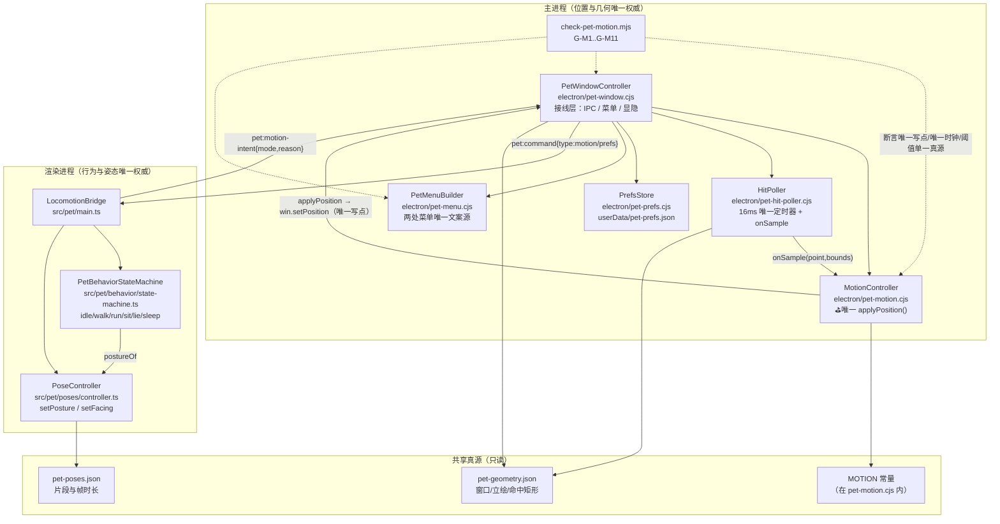
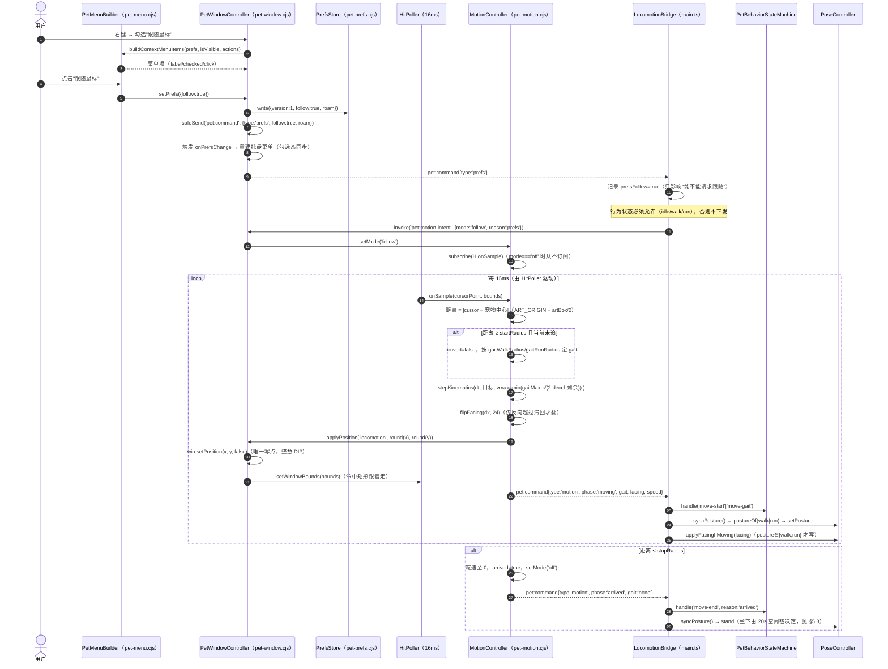
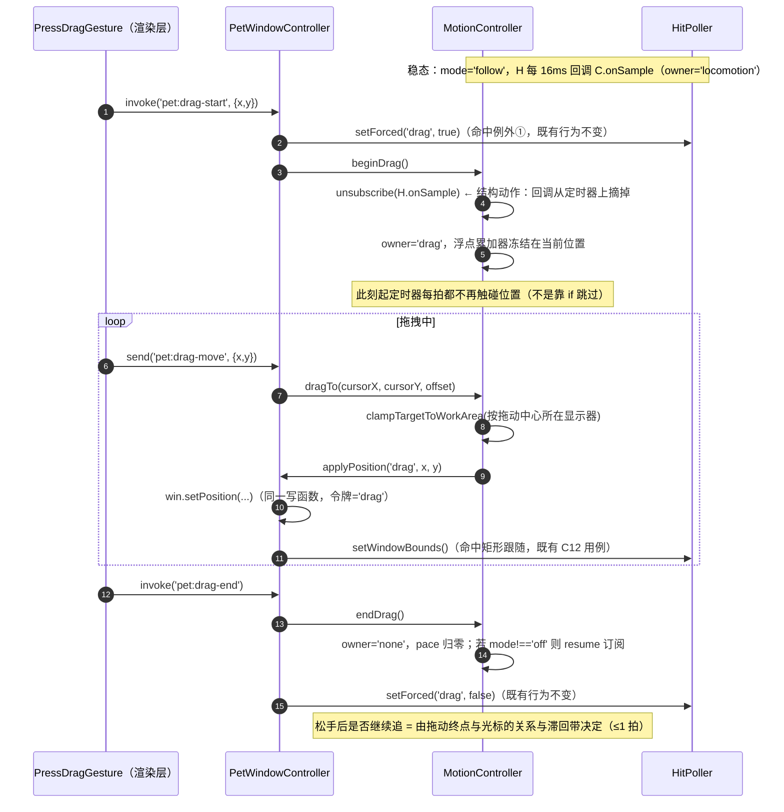
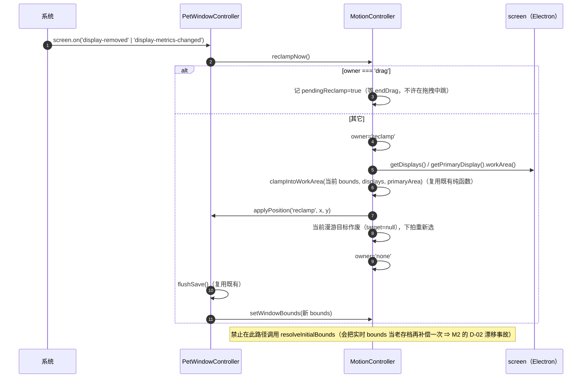
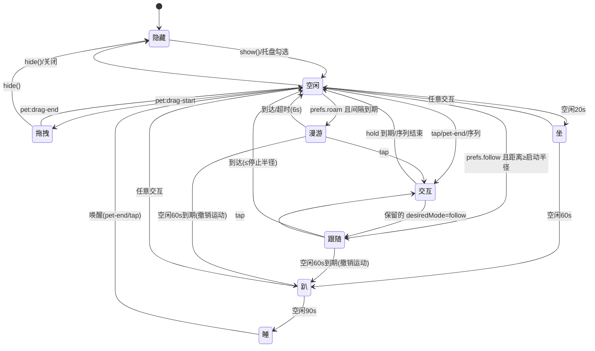
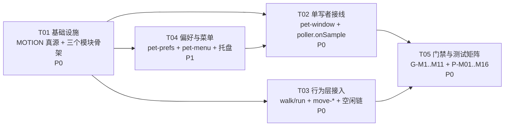

# 桌宠 M3 · 自主移动与跟随：系统设计 + 任务分解

- **阶段**：M3（`docs/desktop-pet-continuation-plan.zh-CN.md` §5 的「自主移动与跟随」）
- **覆盖判据**：S01 自由漫游与角落待机、S03 追随鼠标、A02 走路、A03 奔跑；以及 §6.4「走跑验收同时断言轨迹、方向、速度、步频与结束位置」
- **设计人**：高见远（架构师）　**只出设计，不写实现代码**
- **基线**：M2 全部收尾。任务书给出的基线是 HEAD `09bb5ce6`；**本轮检索时工作树 HEAD 已推进到 `126ab97c`**（工程师新提交：「删掉 `check-pet-not-shipped` 的 dist 侧 pose 体积/PNG 死代码」——与本设计 H5 的"`dist-pet-static-*` 判据不变"不冲突）。本文档所有行号已在当前 HEAD 上**逐条复核未漂**（见 §15.4）。
- **本轮未执行**：`npm run test:pet` / `npm run gate:pet` / `npx vue-tsc -b` / 任何构建 / 任何 `git add|commit`（本轮只产出文档；见 §14 的证据与未执行声明）

---

## 0. 结论速览（TL;DR）

| # | 问题 | 结论 |
|---|---|---|
| 1 | 谁写窗口位置？ | **主进程独占**：今天只有两处运行时写入（`pet-window.cjs:755` 显示器夹取、`:1038` 拖拽）。渲染层**根本没有**位置 API（`pet-preload.cjs` 只暴露 drag/close/menu/hint）。M3 把这两处收口到一个新模块 `electron/pet-motion.cjs` 的**唯一写函数** `applyPosition(token, x, y)`。 |
| 2 | 怎么保证「两个定时器抢写」结构上不可能？ | **三层**：① 全进程**只有一个能写位置的定时器**（运动直接订阅既有 `HitPoller` 的采样回调，不再新起 ticker；`mode==='off'` 时**不订阅** ⇒ 该定时器上根本没有这条回调）；② 写入函数全仓唯一；③ 拖拽时**把订阅退掉**（不是"跳过"）⇒ 抢写在**代码路径上不存在**，不是靠 if 拦住。 |
| 3 | 坐标域 | **一律 DIP**。`screen.getCursorScreenPoint()` / `win.getBounds()` / `display.workArea` / `win.setPosition(x,y,false)` 全是 DIP，**不做任何 `scaleFactor` 换算**。既有门禁已在 `check-pet-hit-ownership.mjs:178-181` 禁用 `scaleFactor/devicePixelRatio/zoomFactor`，M3 把禁词表扩到 `pet-motion.cjs`。 |
| 4 | 自主移动会不会刷新用户空闲计时？ | **不刷新**。运动事件**不写** `lastInteractionAt`；空闲链的触发条件从 `state === 'idle'` 放宽为 `state ∈ {idle, walk, run}`（`IDLE_CHAIN_STATES`）。已实测：M2 的 20s/60s/90s 三段在 `walk/run` 里照样到期。 |
| 5 | facing 怎么做？ | 主进程只报**方向**（`facing: -1 或 1`），带 **24 DIP 翻转滞回**；渲染层 `applyPoseFacing()` 仍是唯一朝向写入点，且**只在 `posture ∈ {walk, run}` 时应用**（`sit/lie/sleep` 是单朝向批，`setFacing` 会触发 `leavePose` 把坐着的猫赶起来——M2 已踩过）。**任何情况禁 `scaleX(-1)`。** |
| 6 | 开关与持久化 | 新增 `electron/pet-prefs.cjs`：`${userData}/pet-prefs.json`，`{version:1, follow, roam, updatedAt}`；逐字段降级、原子写、坏文件不阻塞启动。**托盘与原生右键菜单共用同一个模板函数** `electron/pet-menu.cjs`，禁止第二处菜单文案。 |
| 7 | 体积与打包 | **M3 不新增任何运行资产**（走/跑/跳帧 M2 已交付并入包）。不碰 `scripts/pet-budget.mjs` 的任何阈值，不在别处复制 8MiB/2MiB/400KiB。打包版桌宠恒关（`pet-feature-gate.cjs:78`）不变。 |
| 8 | 切片 | **5 片**：T01 真源与模块骨架 → T04 偏好与菜单（新文件） ∥ T03 行为层接入（渲染层） → T02 单写者接线（主进程） → T05 门禁与变异矩阵。**@8 与 @43 可零重叠并行**（文件表见 §11）。 |
| 9 | 门禁能抓什么？ | 可静态/结构抓：唯一写点、唯一 ticker、DIP 禁词、阈值不复制、菜单文案单一真源。必须运行时抓：拖拽抢占、隐藏 0 采样、空闲链不被刷新、到达即停。只能真机 CDP 抓：轨迹单调、方向与位移一致、速度带内、步幅匹配、无镜像。**逐条给了变异点。** |

---

## 1. 现状取证（只读，全部可复算）

### 1.1 位置写入点穷举（唯一的两个）

```
> findstr /s /n /c:"setPosition" frontend\electron\*.cjs frontend\src\pet\*.ts
frontend\electron\notification-window.cjs:120:      item.win.setPosition(...)   ← 通知窗，与桌宠无关
frontend\electron\pet-window.cjs:755:      win.setPosition(target.x, target.y, false);   ← reclampIntoDisplays（显示器增删/分辨率变化）
frontend\electron\pet-window.cjs:1038:      win.setPosition(target.x, target.y, false);  ← pet:drag-move（拖拽）
```

- 构造期还有一处 `new BrowserWindow({ x, y, ... })`（`pet-window.cjs` 的 `create()`），属于"初始位置"而不是"运行时写入"。
- **渲染层没有任何位置 API**：`pet-preload.cjs` 暴露的 `petAPI` 只有 `startDrag / moveDrag / endDrag / hoverHint / close / openContextMenu / onCommand`。⇒ "渲染层不许 setPosition"这条铁律目前是**结构性成立**的，M3 必须保持（新增的 IPC 也只允许"意图"，不允许"坐标决定权"——见 §8）。
- `frontend/src/pet/main.ts` 里 `setPosition` / `setBounds` **零命中**（同一命令扫过 `src/pet`）。

### 1.2 朝向写入点与"朝向敏感批"的坑

| 事实 | 证据 |
|---|---|
| 唯一朝向写入点 | `main.ts:459 applyPoseFacing(next)` → `poseController.setFacing(next)`；`petFacing` 默认 `-1` |
| 生产态朝向恒 -1 | `main.ts` 构造 `PoseController` 时 `facing: petFacing`，注释写明「生产态 `petFacing` 恒为 -1（漫游未做，D8）」 |
| `setFacing` 对**单朝向批**是 no-op | `controller.ts:324-361`：单朝向批走"什么都不做"分支（M2 切片 2 修的就是"光标移到另一边把猫赶起来"） |
| 对**朝向敏感批**缺向会 `leavePose` | `controller.ts:349` `this.leavePose(\`姿态 ... 朝向 ${next} 没有可播片段\`)` |
| 现可播的双朝向批 | `walk`（`cycle@-1` 4 帧 + `cycle@1` 4 帧）、`run`（6+6）、`jump`（5+5）；`sit/lie/sleep` 只有 `@-1` |

⇒ **朝向只允许在运动态写**。这条不是风格问题：`sit` 单朝向批虽然今天 no-op，但一旦将来美术补了右向 `sit`，`applyPoseFacing` 在坐姿态调用就会让猫**站起来再坐下**。所以判据写成"调用点前置条件"，由运行时断言守住（§10 G-M7）。

### 1.3 IPC 契约现状

| 通道 | 方向 | 类型 | 载荷 | 位置 |
|---|---|---|---|---|
| `pet:drag-start` | 渲染 → 主 | `invoke` | `{x,y}` | `pet-window.cjs:994` |
| `pet:drag-move` | 渲染 → 主 | `send` | `{x,y}` | `:1019` |
| `pet:drag-end` | 渲染 → 主 | `invoke` | — | `:1046` |
| `pet:hover-hint` | 渲染 → 主 | `send` | `{x,y}`（**只叫醒，不作判定**） | `:1070` |
| `pet:close` | 渲染 → 主 | `invoke` | — | `:1076` |
| `pet:context-menu` | 渲染 → 主 | `send` | — | `:1097` |
| `pet:command` | 主 → 渲染 | `send` | `{type:'ready' / 'visible' / 'hit-state', ...}` | `applyIgnoreMouse:670`、`did-finish-load`、`notifyVisibility` |

- 主进程→渲染只有**一个**通道 `pet:command`，用 `type` 分派（`main.ts:146-150` 有类型收窄）。M3 沿用这个形状，新增 `'motion'` / `'prefs'` 两个 `type`，**不新增通道**。
- 所有渲染→主的处理器都先过 `isFromPet(event)`（`:787`）。

### 1.4 菜单与持久化现状

| 项 | 现状 | 位置 |
|---|---|---|
| 原生右键菜单 | 4 项：显示/隐藏桌宠、关闭桌宠、分隔线、退出 LX；模板就地内联 | `pet-window.cjs:1099-1127` |
| 托盘菜单 | 独立一份模板（`...petExposure.enabled ? {...checked: pet.isVisible(), click: pet.toggle()} : []`） | `main.cjs:397-424` |
| 唯一持久化文件 | `${userData}/pet-window-state.json` = `{x,y,width,height,artOrigin,updatedAt}` | `pet-window.cjs:147 STATE_FILE_NAME`、`:716 flushSave`、`:420 writeState` |
| 读失败策略 | `readState()` **任何异常返回 null** ⇒ 回默认角落 | `:398-408` |
| **没有 schema 版本字段** | 状态文件里没有 `version` | 同上 |
| 菜单打开期间的可交互 | `poller.setForced('menu', true)`，`popup` callback 解除，`win.on('blur')` 兜底 | `:1097`、`:152`（门禁断言） |

⇒ M3 的偏好**必须另立文件**：位置是"机器状态"（坏了大不了回默认角落），偏好是"用户选择"（坏了会静默改变产品行为），混在一个文件里会让"位置解析失败"连坐掉偏好。

### 1.5 定时器与事件清单（谁在跑）

| 时钟 | 周期 | 归属 | 写位置？ | 隐藏时 |
|---|---|---|---|---|
| `HitPoller` 定时器 | **16ms**（`HIT_POLL_INTERVAL_MS`，`pet-window.cjs:175`） | 主进程 | **否** | `setSuspended('hidden')` 停表，**0 采样** |
| 位置落盘节流 | 400ms（`SAVE_THROTTLE_MS`） | 主进程 | 否（写盘） | 拖拽结束 `flushSave` |
| 行为拍 | **250ms** | 渲染层（`main.ts:1443`） | 否 | 由功耗档 `off` 停眨眼/微动，**但该 interval 未停** |
| `PosePlayer` 帧定时器 | 逐帧 `frameMs` | 渲染层 | 否 | 播放中照跑（M3 需在 `off` 档暂停） |
| 序列 rAF 循环 | 每帧 | 渲染层 | 否 | 随 `doc.hidden` 暂停 |

⇒ **主进程今天只有一个 16ms 定时器**。M3 的硬性选择：**不再新增第二个定时器**，运动直接挂到 `HitPoller` 的采样回调上（§4.1）。

### 1.6 可复用的既有判定手段

- `frontend/tests/helpers/petWindowHarness.cjs`（449 行）：假 electron（`Module._load` 改写）、`makeManualClock()` 手摇时钟、`makeFakeIpcMain()`、`makeStage()`。**M3 的全部主进程用例直接复用**，不另起一套。
- 既有用例 C7–C22（`petHitOwnership.test.cjs`）已经覆盖：首帧穿透、进入/离开、去重、拖拽例外、窗口移动后命中跟随、隐藏停表、一次跃迁一条回执、提示不当、提示即时。**这些必须保持全绿，一条都不许放宽。**
- 门禁 `scripts/check-pet-hit-ownership.mjs` 已有四段（`checkMainProcess/checkRenderSide/checkInstantTrigger/checkPackagingInvariant`），其中 `:178-181` 的 DIP 禁词表、`:126` 的"`applyIgnoreMouse` 里不许出现 `setTimeout`"是 M3 要复用的**同类断言范式**。
- 几何真源（实读）：`artWidth 156 / artHeight 234 / effectMargin {24,56,18,56} / bubbleHeight 72 / glowPad 16` ⇒ `PET_WIDTH 268`、`PET_HEIGHT 348`、`ART_ORIGIN (56, 96)`；命中矩形 `{x:58.74248, y:108.18672, w:152.64756, h:209.47446}`。- 几何真源（实读）：`artWidth 156 / artHeight 234 / effectMargin {24,56,18,56} / bubbleHeight 72 / glowPad 16` ⇒ `PET_WIDTH 268`、`PET_HEIGHT 348`、`ART_ORIGIN (56, 96)`；命中矩形 `{x:58.74248, y:108.18672, w:152.64756, h:209.47446}`。

---

## 2. 设计硬约束（逐条落成可检查项，不是正文里提一句）

| # | 约束 | 落到哪里检查 |
|---|---|---|
| H1 | `docs/assets/desktop-pet/**` **只读**，M3 不改任何美术资产 | 改动清单里零该路径；`git status --porcelain -- docs/assets` 为空 |
| H2 | **不得改** `scripts/pet-budget.mjs` 的任何阈值（8MiB/2MiB/400KiB），**不得在别处复制这些数字** | M3 不新增资产、不 import 该模块、文档与代码里不出现这些字面量 |
| H3 | **禁 `scaleX(-1)` 镜像**；左右移动靠 `setFacing` + 真实朝向资产 | 既有 G-P12；M3 追加 `pet-motion.cjs`/`main.ts` 的 `-1` 镜像写法禁词（`scaleX(`、`transform: scale(-1` ） |
| H4 | **不许 skip/only/放宽断言/删例/改判据形状** | 全部新增用例走"新增文件"；既有 C1–C23、P-01…P-18 一个字不改 |
| H5 | 生产构建继续隔离桌宠资产：`dist/live2d/pet-*` **零命中**；M3 **不得引入需要进 dist 的桌宠资产** | M3 零新增资产；`pet-asset-isolation.mjs` 的 `closeBundle` 不变；`check-pet-not-shipped.mjs` 三条 `dist-pet-static-*` 判据不变 |
| H6 | 打包版桌宠**恒关**（`pet-feature-gate.cjs`）；新功能不得让打包版出现桌宠窗口 | `resolvePetExposure` 的 `isPackaged ⇒ enabled:false` 一行不动；`check-pet-hit-ownership.mjs:270 checkPackagingInvariant()` 继续守"main.cjs 对 pet-window 的 require 必须是条件式"；M3 新增的 `require('../pet-motion.cjs')` 必须**同样**是条件式的（在 `pet-window.cjs` 内部 require，不在 `main.cjs` 顶层） |
| H7 | 只跑开发环境；真机验收（5275 dev server / 9315 CDP）归主理人 | 本文档不要求任何人起 dev server / electron |
| H8 | **不许 `git add` / `commit` / `push`** | 设计文档不产生提交；工作树由主理人统一提交 |
| H9 | `frontend/package.json` 的**登记权归主理人** | T05 只提供"要加哪几条"的清单，不代写 |
| H10 | 零新增运行时依赖 | 见 §10.1：M3 的依赖包清单是**空的**（只用 node 内建 + 既有 Electron 能力） |

---

## 3. A 部分 · 系统设计（1 实现方案 / 2 文件列表 / 3 数据结构与接口 / 4 程序调用流程 / 5 待明确事项）

### 3.1 实现方案

#### 3.1.1 需求难点（先承认有三处真难）

1. **位置写入权的归属**。今天有两处写入（显示器夹取、拖拽），M3 再加"自主移动/跟随"就是第三、第四处。`win.setPosition` 是**无状态覆盖写**：任何两处同时写，用户看到的就是"猫在两个位置之间抽搐"，而且**没有任何现有断言能抓**（它不抛错、不返回失败）。
2. **跨进程的"谁决定速度"**。速度必须由**主进程**算（它读光标、它有 workArea、它是唯一写者），但"走路还是奔跑"是**姿态**问题，而姿态的唯一派生点在**渲染层**（`postureOf(state)`）。两边都想要这两份信息。
3. **空闲链与自主移动互不影响**。M2 刚把 20s→坐 / 60s→趴 / 90s→睡 做通，判据只认 `state === 'idle'`。M3 一旦引入 `walk/run` 状态，**空闲链会被卡死**（猫在 roaming ⇒ 永远不睡）。

#### 3.1.2 架构模式：**主进程权威渲染层从属（Authoritative Main / Subordinate Renderer）+ 事件驱动状态机 + 纯函数运动学**

- 不是 MVC/MVVM：桌宠没有"视图-模型双向绑定"的需求，只有一个窗口和一个状态机。
- 采用的分层与既有代码一致：
  - **纯函数层**（可 node 单测）：`pet-motion.cjs` 的 `stepKinematics()` / `decideGait()` / `flipFacing()` / `pickRoamTarget()` / `clampTargetToWorkArea()`；`pet-prefs.cjs` 的 `normalizePrefs()`。
  - **效果层**（注入依赖）：`MotionController`（注入了 `readCursor / getBounds / setWindowPosition / getDisplays / now / subscribe`），所以在 node 里用手摇时钟就能确定性断言。
  - **接线层**：`pet-window.cjs`（把 Electron 的真实能力注进去）+ `main.ts`（把 IPC 命令翻译成状态机事件）。
- **双权威分离，各自唯一**（这是本设计的主轴）：

| 权威 | 拥有什么 | 绝不做什么 |
|---|---|---|
| **主进程（位置与几何权威）** | 光标读数、workArea、速度、加减速、坐标夹取、**唯一的位置写入**、朝向**方向**的计算 | 不决定"该不该动"（不判断睡眠/行为状态）、不选姿态、不挑片段 |
| **渲染层（行为与姿态权威）** | 行为状态机、`postureOf` 派生、`setPosture`/`setFacing`、片段选择、空闲计时 | 不写位置、不算速度、不做任何 DIP↔物理像素换算 |

两边靠**意图**（渲染→主）与**事实**（主→渲染）通信：渲染层说"我想跟随/我想漫游/我不动了"，主进程说"我现在在移动、gait=run、facing=1、已到达"。

#### 3.1.3 选定的库与理由

| 需要 | 选择 | 理由 |
|---|---|---|
| 光标位置 / 显示器 / 窗口几何 | **Electron 内建 `screen` 与 `BrowserWindow`** | 已有；DIP 口径统一；引入原生模块（`node-ffi`/`win32-api`）会破坏"零新增依赖"且打包复杂 |
| 运动学积分 | **手写纯函数**（无库） | 需求只有匀速+线性加减速+半径判定；引入 `planck.js`/`matter-js` 属于为 1 个质点引入物理引擎，且它们的单位/重力语义全用不上 |
| 随机（漫游目标） | **注入 `rng: () => number`** | 现有代码已用同样手法（`MotionPacer` 注入 `Math.random`，`main.ts:1400` 附近）。可确定性断言"同种子同轨迹" |
| 定时 | **复用既有 `HitPoller` 的 16ms 定时器**（新增只读订阅口） | 主进程已经有且只有一个 16ms 定时器；再起一个 = 125 次/秒空转翻倍，且引入第二个写者候选（H10 零依赖的延伸） |
| 偏好持久化 | **`node:fs` 手写 + 原子写（临时文件 + rename）** | 已有 `writeState`（`pet-window.cjs:420`）先例；引入 `electron-store` 会新增运行时依赖 |

**拒绝**过的架构（理由见 §12）：渲染层算位置再回报（把判定权还给渲染层，命中重构刚否掉）；主进程起第二个 motion 定时器；把运动参数塞进 `pet-geometry.json`。

#### 3.1.4 模块图（进程边界 + 依赖方向 + 唯一写点）



**读图要点**：位置数据只沿 `MO → PW → win.setPosition` 一条边流动；`HP` 只提供"什么时候采样"和"采样到哪"，不碰位置；`RENDER` 侧对 `MAIN` 只能发**意图**（`mode/reason`），收**事实**（`phase/gait/facing/speed/pos`）。

### 3.2 文件列表（相对 `D:\Code\LingXi\`，全部为绝对路径的基址）

```
frontend/
├─ electron/
│  ├─ pet-motion.cjs                     【新增】运动控制器 + 纯运动学 + 唯一位置写口
│  ├─ pet-prefs.cjs                      【新增】偏好读写 + schema + 降级
│  ├─ pet-menu.cjs                       【新增】托盘与右键菜单的单一模板源
│  ├─ pet-window.cjs                     【改】接线：写口收口 / 拖拽令牌 / 订阅 poller / 菜单换模板 / 快照 IPC
│  ├─ pet-hit-poller.cjs                 【改】纯增量：新增 onSample 只读订阅口（命中行为零改动）
│  └─ main.cjs                           【改】托盘：两项开关 + onPrefsChange 重建菜单
├─ src/pet/
│  ├─ behavior/state-machine.ts          【改】新增 walk/run 状态 + move-* 事件 + IDLE_CHAIN_STATES
│  └─ main.ts                            【改】motion 命令 → 状态机事件；意图下发；朝向前置条件；dev 快照
├─ scripts/
│  ├─ check-pet-motion.mjs               【新增】门禁 G-M1…G-M11（结构 + 运行时）
│  └─ pet-motion-probe.cjs               【新增】只读采样器（主理人 CDP 真机验收用，dev 可跑）
├─ tests/
│  ├─ petMotionController.test.cjs       【新增】运动学/加减速/滞回/夹取/目标选择（纯函数 + 手摇时钟）
│  ├─ petMotionPrefs.test.cjs            【新增】偏好 schema/降级/原子写
│  ├─ qa-motion-singleWriter.test.cjs    【新增】对抗：拖拽抢占、隐藏 0 采样、双写不可能
│  ├─ petMotionGate.test.cjs             【新增】门禁自身的判别力（变异后必须红）
│  ├─ petBehaviorMotion.test.ts          【新增】状态机 walk/run、空闲链不被刷新、朝向前置条件
│  └─ petMotionStride.test.ts            【新增】步幅-速度匹配（读 pet-poses.json 的 clip 时长）
└─ package.json                          【改·主理人登记】test:pet 追加 3 条、gate:pet 追加 1 条
```

**没有**要动的：`frontend/pet-geometry.json`、`frontend/pet-poses.json`、`frontend/pet-sequences.json`、`frontend/pet-layers.json`、`docs/**`、`frontend/public/**`（M3 零新增资产）。

### 3.3 数据结构与接口

#### 3.3.1 类图（含数据模型与服务类）

```mermaid
classDiagram
    class MotionConfig {
        +number tickMs
        +number followStartRadiusDip
        +number followStopRadiusDip
        +number gaitRunRadiusDip
        +number gaitWalkRadiusDip
        +number walkMinDipPerSec
        +number walkMaxDipPerSec
        +number runMinDipPerSec
        +number runMaxDipPerSec
        +number accelDipPerSec2
        +number decelDipPerSec2
        +number facingFlipHysteresisDip
        +number roamMinIntervalMs
        +number roamMaxIntervalMs
        +number roamDwellMs
        +number roamMaxDurationMs
        +number roamCornerBias
        +number roamMarginDip
        +freeze() MotionConfig
    }

    class OwnerToken {
        <<enumeration>>
        none
        locomotion
        drag
        reclamp
    }

    class MotionSnapshot {
        +string mode
        +string owner
        +number x
        +number y
        +number velocityDipPerSec
        +string gait
        +number facing
        +boolean arrived
        +number ticks
        +number samples
        +string suspendReason
    }

    class MotionController {
        -MotionConfig config
        -string mode
        -string owner
        -Vec2D position
        -number velocity
        -number facingValue
        -boolean arrived
        -number deadlineAt
        -string[] suspendedReasons
        -function readCursor
        -function getBounds
        -function setWindowPosition
        -function getDisplays
        +start() void
        +stop() void
        +setMode(mode, reason) void
        +beginDrag() boolean
        +dragTo(screenX, screenY, offsetX, offsetY) void
        +endDrag() void
        +reclampNow() void
        +setSuspended(reason, on) void
        +onSample(point, bounds) void
        +snapshot() MotionSnapshot
        -applyPosition(token, x, y) boolean
        -integrate(dtMs) void
        -emit(kind) void
    }

    class PetPrefs {
        +number version
        +boolean follow
        +boolean roam
        +string updatedAt
    }

    class PrefsStore {
        -string filePath
        +read() PetPrefs
        +write(prefs) boolean
        +path() string
    }

    class PetMenuBuilder {
        +buildContextMenuItems(prefs, isVisible, actions) MenuItemSpec[]
        +buildTrayItems(prefs, isVisible, actions) MenuItemSpec[]
    }

    class HitPoller {
        +number intervalMs
        +number samples
        +start() void
        +stop() void
        +poll() boolean
        +setWindowBounds(bounds) void
        +setForced(reason, on) void
        +setSuspended(reason, on) void
        +onSample(cb) function
    }

    class PetWindowController {
        +create() BrowserWindow
        +show() boolean
        +hide() void
        +toggle() void
        +getPrefs() PetPrefs
        +setPrefs(patch) PetPrefs
        +onPrefsChange(cb) function
        +motionSnapshot() MotionSnapshot
    }

    class LocomotionBridge {
        -string mode
        -string prefsFollow
        -string prefsRoam
        +onMotion(fact) void
        +requestMode(mode, reason) Promise
        +applyFacingIfMoving(facing) void
    }

    class PetBehaviorStateMachine {
        +state string
        +lastInteractionAt number
        +handle(event) Ops[]
        +tick() Ops[]
        +idleElapsedMs(now) number
    }

    class PoseController {
        +posture string
        +facing number
        +setPosture(next) void
        +setFacing(next) void
        +pause() void
        +resume() void
    }

    MotionController --> MotionConfig : 读配置（单一真源）
    MotionController --> OwnerToken : 写入权令牌
    MotionController ..> MotionSnapshot : 产出
    PetWindowController --> MotionController : 注入 readCursor/getBounds/setWindowPosition
    PetWindowController --> HitPoller : 订阅 onSample
    PetWindowController --> PrefsStore : 读写偏好
    PetWindowController --> PetMenuBuilder : 弹菜单
    LocomotionBridge --> PetBehaviorStateMachine : move-* 事件
    LocomotionBridge --> PoseController : setPosture/setFacing（唯一入口）
    LocomotionBridge ..> PetWindowController : pet:command{motion,prefs}
```

#### 3.3.2 关键字段表

| 结构 | 字段 | 类型 | 语义 / 单位 |
|---|---|---|---|
| `MotionConfig` | `tickMs` | number | 采样周期，**恒等于 `HitPoller.intervalMs`**（16）。门禁断言两者相等，防"两个时钟" |
| | `followStartRadiusDip` | number | **启动半径**：光标离宠物中心 **≥** 这个值才起追（220） |
| | `followStopRadiusDip` | number | **停止半径**：≤ 这个值即停（96）。必须 `start > stop + 40`（滞回带，门禁 G-M5） |
| | `gaitRunRadiusDip` / `gaitWalkRadiusDip` | number | 步态切换的**双阈值**（420 / 320），`run>walk+30`，防 walk↔run 抖动 |
| | `walkMin/Max`、`runMin/Max` | number | DIP/秒。`walk∈[56,96]`、`run∈[150,240]`；步幅校验见 §7 |
| | `accel/decel` | number | DIP/秒²（480 / 960）；`decel > accel`（停得住） |
| | `facingFlipHysteresisDip` | number | 朝向翻转滞回（24）：仅当反向位移**超过**它才翻 |
| | `roam*` | number | 漫游间隔 8–20s、停留 4s、单次上限 6s、角落偏好 0.5、边距 48 |
| `MotionSnapshot` | `mode` | `'off' / 'follow' / 'roam'` | 当前意图（由渲染层请求、主进程持有） |
| | `owner` | `'none' / 'locomotion' / 'drag' / 'reclamp'` | **位置写入权**持有者 |
| | `x` / `y` | number | **DIP** 整数（= 最后一次真正写入的值）；浮点累加器在 `position` 里，不上快照 |
| | `velocityDipPerSec` | number | 当前速度（DIP/秒），用于 CDP 采样断言 |
| | `gait` | `'none' / 'walk' / 'run'` | 由速度与目标距离派生，**主进程算** |
| | `ticks` / `samples` | number | 定时器触发次数 / 真正读光标的次数（隐藏时两者都必须停在） |
| `PetPrefs` | `version` | number | schema 版本，当前 `1` |
| | `follow` | boolean | S03 开关（默认 `false`） |
| | `roam` | boolean | S01 开关（默认 `true`，见 §9.3 与未决 U-M4） |

#### 3.3.3 运动配置的单一真源

`frontend/electron/pet-motion.cjs` 顶部一个 `Object.freeze` 的 `MOTION` 常量，**导出给门禁与测试 require**：

```js
const MOTION = Object.freeze({
  tickMs: 16,
  followStartRadiusDip: 220,
  followStopRadiusDip: 96,
  gaitRunRadiusDip: 420,
  gaitWalkRadiusDip: 320,
  walkMinDipPerSec: 56, walkMaxDipPerSec: 96,
  runMinDipPerSec: 150, runMaxDipPerSec: 240,
  accelDipPerSec2: 480, decelDipPerSec2: 960,
  facingFlipHysteresisDip: 24,
  roamMinIntervalMs: 8000, roamMaxIntervalMs: 20000,
  roamDwellMs: 4000, roamMaxDurationMs: 6000,
  roamCornerBias: 0.5, roamMarginDip: 48,
});
```

**为什么不做成 `pet-motion.json`**（我拒绝了这条）：`pet-geometry.json` 之所以是 JSON，是因为**主进程、渲染层、门禁三方都要读**；M3 的速度/半径**只有主进程和门禁要读**（渲染层只收 `gait` 字符串，不算速度），所以一个 CJS 常量就够了。而 JSON 放在 `frontend/` 根会被 `package.json:build.files`（只有 `dist/**`、`electron/**`、`package.json`）**排除在安装包外**，等于给 `pet-geometry.json` 已有的"条件 require"隐患再复制一份。放 `electron/` 下的 CJS 天然随包，且 `require()` 即可被门禁与测试读。

### 3.4 程序调用流程

#### 3.4.1 S03 追随鼠标（含滞回带与到达）



#### 3.4.2 拖拽抢占（位置写入权交接，这是"用户可验证后果"的核心）



#### 3.4.3 显示器拔出 / 分辨率变化（不漂移）



### 3.5 待明确事项

见 §14「未决项」的完整表（每条标明"我决策"还是"需产品澄清"）。摘要：U-M1 gait 阈值手感、U-M2 roam 默认值、U-M3 到达后是否立即坐下、U-M4 reduced-motion 下是否彻底禁漫游、U-M5 多显示器下漫游是否允许跨屏。

---

## 4. 运动控制器（Locomotion / Movement Controller）

### 4.1 唯一位置写入者：三层结构保证（不是靠 if 判断）

要求是"两个定时器抢写必须在**结构上**不可能"。我只用一个 owner 令牌是不够的（那还是一条 `if`）。所以叠三层，**任意一层单独失效，另外两层仍然成立**：

| 层 | 做法 | 为什么它是"结构"而不是"if" |
|---|---|---|
| **L1 · 全进程唯一 ticker** | 运动**不新起定时器**，直接订阅既有的 `HitPoller`（16ms）：`poller.onSample(cb)`。`HitPoller` 是全主进程唯一的位置无关定时器 | "两个定时器抢写"这一前提被删除：**第二个定时器不存在**。门禁 G-M2 断言 `pet-motion.cjs` 里 `setInterval` 出现 **0** 次 |
| **L2 · 唯一写函数** | 全仓只有 `pet-motion.cjs` 的私有 `applyPosition(token, x, y)` 会调用注入的 `setWindowPosition`。`pet-window.cjs` 里 **`win.setPosition` 出现 0 次**（今天 2 次，T02 全部搬走） | 不存在第二个调用点可以竞争。门禁 G-M1 断言：`pet-window.cjs` 中 `setPosition` 计数 = 0、`pet-motion.cjs` 中 = 1 且必须在 `applyPosition` 函数体内（复用 `sliceFunctionBody()` 手法） |
| **L3 · 订阅随所有权摘除** | 拖拽开始时 `unsubscribe(onSample)`，结束时按需重订阅；`mode==='off'` 时**从不订阅** | 拖拽期间定时器的回调表里**根本没有**运动这一项 ⇒ 抢写在代码路径上不存在。而 owner 令牌只用于"同一时刻只允许一个语义来源写"的**剩余三处**（locomotion / drag / reclamp），它们是事件驱动、天然互斥 |

`applyPosition(token, x, y)` 的实现约束（写进 T02 验收）：

```js
// 唯一写入点。三分支：令牌不匹配 / 坐标未变 / 真正写。
function applyPosition(token, x, y) {
  if (token !== this.owner) return false;            // ① 令牌守卫（最后一道，不是第一道）
  const nx = Math.round(x), ny = Math.round(y);      // ② setPosition 只吃整数 DIP
  if (nx === this.position.x && ny === this.position.y) return false;  // ③ 整数未变 ⇒ 不写（省 DWM 调用）
  this.position.x = nx; this.position.y = ny;
  this.setWindowPosition(nx, ny);                    // ④ 唯一出口
  this.onAfterWrite({ x: nx, y: ny });               // ⑤ 通知窗口层刷新命中矩形
  return true;
}
```

**"用户可验证的后果"**（这是评审时该看的，不是看代码结构）：

1. 拖拽一旦开始，自动移动**在 ≤16ms 内**停止，且拖拽全程**没有任何一帧**出现"窗口被拉回目标点"的抽搐；
2. 松手后**不会**出现"猫自己弹回刚才追的点"（终点由用户决定，`mode` 由滞回带重新裁决）；
3. 显示器插拔时**不会**累积漂移（M2 的 D-02 事故形态：连按 5 次显示器事件累计 −200/−40 DIP）；
4. CDP 采样可以证明：拖拽窗口内 `snapshot().owner === 'drag'` 且 `snapshot().ticks` 不再增长（L3 的直接证据）。

### 4.2 DIP 坐标域纪律（写死，不许换算）

| 值 | 单位 | 证据 |
|---|---|---|
| `screen.getCursorScreenPoint()` | **DIP** | Electron 文档与既有实现（`pet-window.cjs:699` 直接喂给 `resolveInside`） |
| `win.getBounds()` | **DIP** | `captureBounds()`（`:707-714`）直接与上面的光标点比较 |
| `display.workArea` / `bounds` | **DIP** | `clampRectToWorkArea()`（`:262`）与 `pickDisplay()`（`:277`） |
| `win.setPosition(x, y, false)` | **整数 DIP** | Electron API：参数为整数屏幕坐标（DIP）；因此我们把浮点累加器 `Math.round` 后再写 |
| 渲染层 CSS px | 与 DIP 1:1（同一窗口坐标系） | `pet.css` 的 `--pet-art-glow-pad` 等 |

**硬规则（门禁可查）**：

- `pet-motion.cjs` 中**禁止出现** `scaleFactor` / `devicePixelRatio` / `zoomFactor` / `dpi` / `* devicePixelRatio`（沿用 `check-pet-hit-ownership.mjs:178-181` 的禁词范式，扩到本文件）。
- 只允许的换算是**纯整数/浮点加减与相乘**：`distance = Math.hypot(dx, dy)`、`v = min(vmax, sqrt(2*a*d))`。
- `position` 内部用**浮点**累加（DIP），落盘/写窗口时才 `Math.round`。**绝不把 round 后的值再当累加基准**（否则低速会卡住：0.6 DIP/拍 若先 round 就永远是 1 或 0 的抖动）。
- 宠物中心 = `ART_ORIGIN + (artWidth/2, artHeight/2)` = 窗口坐标 `(56+78, 96+117) = (134, 213)`，屏幕坐标 = `bounds + (134, 213)`。**从 `GEOMETRY` 派生，不写字面量**（门禁禁烘焙数字 `134`/`213`）。

### 4.3 运动学与加减速（公式写清，便于逐值复算）

每个 `onSample` 拍（`dt = tickMs`）：

```
剩余距离 d = 目标点 − 当前位置（欧氏）
取 vmax_geom = sqrt(2 × decel × d)                 // 保证能停在目标点上（不冲过头）
取 vmax = min(gaitMax, vmax_geom)
v = clamp(v + accel × dt/1000, 0, vmax)            // 加速不超过 vmax；已超则按 vmax 回落（等价于减速）
v = max(0, v − decel × dt/1000)  若 v > vmax      // 需要减时用 decel（停得比起步快）
步长 = v × dt/1000
position += 单位方向 × 步长（浮点累加）
到达判定：d ≤ settleEpsilon(=8) 且 v ≤ walkMin   ⇒ arrived=true，v=0，setMode('off')
```

数值自检（`walkMax=96`、`decel=960`）：减速率需要的刹车距离 = `96²/(2×960) = 4.8 DIP`（远小于停止半径 96，所以正常接近时**几乎全程匀速、最后一拍停住**，观感是"走上去、停下"；不会出现"远远就开始龟速爬行"）。`runMax=240` ⇒ `240²/1920 = 30 DIP`，仍然远小于 `gaitRunRadius=420`。

每次写入的位移（`96 DIP/s × 16ms = 1.536 DIP`）⇒ 平均每 1–2 拍发生一次真正的 `setPosition`（≤62 次/秒），不会每拍都写。

### 4.4 朝向与翻转滞回

- **只有主进程算方向**：`dx = target.x − center.x`；`desiredFacing = dx > 0 ? 1 : -1`。
- **翻转滞回 24 DIP**：只有当 `|dx| > 24` 且 `sign(dx) ≠ 当前 facing` 时才翻。理由：光标在宠物正上方来回微动时，`dx` 会在 ±0 附近抖动；没有滞回 ⇒ 每拍都翻 ⇒ 用户看到"猫左右抖头"。
- **只在运动态应用**：`LocomotionBridge.applyFacingIfMoving(facing)` 内部先判 `poseController.posture ∈ {walk, run}`，否则**丢弃**（不是排队）。理由见 §1.2：`setFacing` 对朝向敏感批会 `leavePose`，对将来的右向 `sit` 会"站起来再坐下"。
- **禁镜像**：`facing` 只改变**选哪条片段**（`clipOf(batch, clipId, facing)`，`manifest.ts:791`；`pickClip` 在其上做候选回退），渲染层与 CSS 里**不许**出现 `scaleX(-1)`（G-P12 既有判据 + M3 扩到 `main.ts`/`pet.css` 的 `scale(-1`）。

---

## 5. 打断优先级状态机

### 5.1 优先级（高 → 低）与"位置写入权"

| 优先级 | 状态 | 进入条件 | 退出条件 | 位置写入权 | 是否刷新空闲计时 |
|---|---|---|---|---|---|
| **1（最高）** | **隐藏 / 关闭** | 托盘取消勾选、右键"关闭桌宠"、`render-process-gone` | 托盘勾选/`pet.show()` | **无人**（`poller.setSuspended('hidden')` + `motion.setSuspended('hidden')`）⇒ **0 采样、0 写** | 不适用（隐藏期间不产生 tick） |
| **2** | **拖拽** | `pet:drag-start`（手势层要求位移 > 4 DIP，`press-drag.ts:33 DRAG_THRESHOLD_PX=4`） | `pet:drag-end` | **`drag` 独占**（L3：运动订阅被摘除） | **刷新**（`behavior.handle('drag-start')` 走 `lastInteractionAt = now`，既有语义，不改） |
| **3** | **点击 / 抚摸 / 唤醒 / 双角色序列** | `tap`（`TAP_HOLD_MS=480`）、`pet-end`、`PLAY` 序列 `start()` | 各自 hold 到期 / 序列 `stop()` | **`locomotion` 暂停**（`reason:'interaction'`：`mode` 转 `off`，但保留"用户意图"以便结束后恢复） | **刷新**（既有语义） |
| **4** | **鼠标跟随（S03）** | `prefs.follow === true` **且** 行为状态 ∈ `{idle, walk, run}` **且** 距离 ≥ `followStartRadius` | 距离 ≤ `followStopRadius`（到达）／`prefs.follow=false`／被 1–3 级打断 | **`locomotion`** | **不刷新** |
| **5** | **自主漫游（S01）** | `prefs.roam === true` **且** 行为状态 ∈ `{idle, walk, run}` **且** 不在 `follow` **且** 漫游间隔到期 | 到达/超时/被 1–4 级打断/空闲链升级到 `sleepy\|sleeping` | **`locomotion`** | **不刷新** |
| **6（最低）** | **空闲坐 / 趴 / 睡** | 空闲 20s / 60s / 90s（`SIT_AFTER_IDLE_MS` / `SLEEPY_AFTER_IDLE_MS` / `SLEEP_AFTER_IDLE_MS`，**一个都没改**） | 任何交互 | **无人**：一旦进入 `sleepy/sleeping`，渲染层立刻 `requestMode('off', reason:'idle-chain')` ⇒ 定时器上的运动回调被摘除 | 自身由空闲计时驱动 |

**注释 1（为什么要 3 级"暂停但保留意图"）**：抚摸时猫可以停下不动（不写位置），但用户手一离开，跟随应该**继续**（否则每次摸一下就永久关掉跟随＝用户无法理解）。实现上 `mode` 有两个字段：`desiredMode`（用户的意图）与 `activeMode`（当前是否真的在写）。3 级打断只清 `activeMode`。

**注释 2（为什么 `sleepy/sleeping` 必须撤销漫游）**：趴着走 = 穿模。判据不能写在主进程（它不知道姿态），所以由渲染层在 `postureOf` 派生到 `lie/sleep` 时下发 `mode:'off'`。门禁断言：`syncPosture` 里 `desired !== 'stand' && desired !== 'walk' && desired !== 'run'` 时必须调 `requestMode('off')`。

### 5.2 状态图（Mermaid）



> 说明：这是**行为层与运动层合成的视图**；`坐/趴/睡` 属于 `PetBehaviorStateMachine`，`跟随/漫游` 属于 `MotionController`，`拖拽/交互` 跨两层。合成视图只用于回答"谁压谁"，实现上仍是两个各自唯一的状态机（§3.1.2）。

### 5.3 自主移动是否刷新用户空闲计时 —— **不刷新**（明确回答）

- **运动事件绝不写 `lastInteractionAt`**：`move-start` / `move-gait` / `move-end` 三条事件在状态机里只改 `stateValue`，不碰计时字段。门禁 G-M6 运行时断言：派发 `move-start` 后 `snapshot().idleElapsedMs` **继续增长**（不清零）。
- **空闲链的触发条件放宽**：`tick()` 里三处 `this.stateValue === 'idle'` 改为 `IDLE_CHAIN_STATES.includes(this.stateValue)`，集合 = `['idle','walk','run']`。这是把 20s/60s/90s 三段的**前提从"状态叫 idle"改成"当前没有被人交互打断"**，阈值常量一个不改。
- **落定后的计时规则（明确写死）**：
  1. 空闲计时**从最后一次用户交互**起算，与运动无关；
  2. 到达目标点时**不重置**计时，也不额外加宽限；
  3. 因此存在"到达瞬间就立刻坐下/趴下"的合法形态（若此刻空闲已 ≥20s/≥60s）——这是**正确**行为，不是 bug：猫已经累了，走完这一步就该趴；
  4. 已在 `sleepy/sleeping` 时不允许发起新漫游（`activeMode` 必须为 off），所以"趴着走"不可能发生。
- 这一条是**判据级**要求，测试用例 P-M13 的原文是：「在 `lastInteractionAt` 之后第 19.5s 发起一次 6s 的漫游 ⇒ 20.5s 时必须已进入 `sit`（哪怕此刻仍在走）」。变异点：若 `move-start` 里偷偷 `lastInteractionAt = now`，这个用例必红。

---

## 6. S03 鼠标跟随滞回带 / S01 自主漫游与角落停留

### 6.1 S03 滞回带（三个半径 + 两个速度档）

| 参数 | 值 | 作用 | 缺了会怎样 |
|---|---|---|---|
| `followStopRadiusDip` | 96 | 进入即停（站定） | 猫会贴脸蹭到光标上，遮住用户正在点的东西 |
| `followStartRadiusDip` | 220 | 只有离开**外圈**才重新起追 | 单阈值 ⇒ 在阈值附近来回抖：走 1px 停 1px，观感像抽搐 |
| 滞回带宽度 | **124**（=220−96） | 门禁断言 `start ≥ stop + 40` | 带太窄等于没有滞回 |
| `gaitWalkRadiusDip` | 320 | 距离 ≥320 才可能进 `run` | 一起步就跑，没有"走过去"的观感 |
| `gaitRunRadiusDip` | 420 | 距离 ≥420 才进 `run`；`<320` 退回 `walk` | 单阈值 ⇒ walk↔run 每拍翻，步态抖 |
| 速度上限 | `walk 56–96`、`run 150–240` | DIP/秒 | 见 §7 步幅匹配 |

- **贴脸不抖**：`stop 96` 的含义是"光标离宠物中心 96 DIP 就停"，猫不会压到光标上；`start 220` 意味着用户必须把鼠标挪开一段距离猫才重新追，这正好覆盖"用户只是小幅移动鼠标"的场景。
- **到达后站定还是坐下**：主进程只报 `phase:'arrived'`；渲染层退到 `idle` ⇒ `postureOf('idle')` 决定（今天 `idle → stand`）。**坐下由 20s 空闲链决定**，不由到达触发。若此刻空闲已 ≥20s，下一拍行为拍就会把姿态推到 `sit`——顺序是"到达 → 站定（可能只有 250ms）→ 坐下"，用户看到的是"停下来坐好"，符合预期。
- **跟随期间不改高度**：M3 只做水平 + 垂直平移（工作区内），不做"贴着窗口边缘走"（那是 M4 的桌面表面互动）。

### 6.2 S01 漫游与角落停留

| 项 | 规则 | 门禁/测试 |
|---|---|---|
| 目标点选在哪 | **窗口当前所在显示器**的 `workArea` 内，四周内缩 `roamMarginDip = 48`；且目标点必须让**整个窗口**留在工作区内（用 `clampRectToWorkArea` 反算） | P-M09：目标点集合 100 次采样，每次都满足 `x ∈ [area.x+?]` 与窗口完整在内 |
| 角落偏好 | `rng() < roamCornerBias(0.5)` ⇒ 从**四角的 48 DIP 内缩点**里随机挑一个（"角落待机"）；否则工作区内均匀随机 | P-M10：注入固定 rng 序列 ⇒ 角/非角各命中预期次数 |
| 间隔 | `roamMinIntervalMs 8000` ~ `roamMaxIntervalMs 20000`（每轮随机，均匀） | P-M11：连续 10 轮间隔全部落在 `[8000, 20000]` |
| 停留 | 到达后 `roamDwellMs 4000` 站定，之后才开始下一轮计时 | 与上一条同用例 |
| 单次上限 | `roamMaxDurationMs 6000`：超过即放弃目标（`phase:'aborted'`），站定 | P-M12：把目标设在极远处（越界被夹），断言 ≤6s 内 `phase` 变 `aborted` |
| 别让猫永远在跑 | 占空比上限 = `6s / (8s+4s+6s) ≈ 33%`；且 `sleepy/sleeping` 一律不发起 | 人工复核 + P-M13（空闲链压制） |
| 跨屏 | **M3 不允许跨屏漫游**：目标点只在"窗口当前所在屏"内选 | P-M09 附带断言：目标点所属显示器 == 当前显示器 |
| 显示器变化 | `display-removed` / `display-metrics-changed` / `display-added` ⇒ 立即 `reclampNow()` + 作废当前目标（§3.4.3） | P-M08：拔出屏幕后位置仍在某块 workArea 内且**不漂移**（连续 5 次事件位置不变） |
| 分辨率变化 | 同上路径；`clampIntoWorkArea` 复用既有纯函数（**禁止** `resolveInitialBounds`） | 同上；变异点：换成 `resolveInitialBounds` ⇒ 漂移断言变红 |
| 多屏 DPI 混合 | 全程 DIP，不做换算 ⇒ 混合 DPI 下"移动速度的物理观感"会有差异，但**坐标正确性**不受影响；观感差异登记为已知限制（U-M5） | 真机 CDP：100%/150%/200% 三档各跑一次轨迹，断言落点 bounds 与 workArea 关系正确 |

---

## 7. A02 / A03：动作—位移—朝向联动（严禁原地滑行）

### 7.1 三条硬联动

| 联动 | 判据 | 谁来保证 |
|---|---|---|
| **walk/run 必须伴随真实位移** | `posture ∈ {walk, run}` 的每一个 100ms 采样窗口内，`abs(Δpos) > 0`；且整段 `Σabs(Δpos) ≥ 0.9 × 直线距离`（不许原地滑行、不许绕圈） | 真机 CDP（P-M17）+ 主进程 `snapshot().velocity > 0` 与渲染层 `posture` 同拍对齐 |
| **位移必须与朝向一致** | 水平位移占主导时 `sign(Δx) === facing`；`abs(Δx) < abs(Δy)`（竖直为主）时**不翻朝向**（猫向上走不换向） | P-M18：竖直段断言 `facing` 不变 |
| **速度档位决定 walk / run** | `gait` 只由主进程按两个半径阈值算，渲染层只把字符串映射成姿态 | G-M6：文本断言 `main.ts` 里不出现任何速度/半径数字（禁烘焙数字） |

### 7.2 步幅—速度匹配（这是"脚步与位移匹配"的可机检形式）

`pet-poses.json` 的片段时长是**既定事实**（实读）：`walk.cycle` = 4 帧 × 110ms = **440ms/循环**；`run.cycle` = 6 帧 × 90ms = **540ms/循环**（M2 交付，M3 不改）。

⇒ 每个循环走过的地面距离 = `speed × cycleSeconds`：

| 步态 | 速度带 (DIP/s) | 每循环步幅 (DIP) | 结论 |
|---|---|---|---|
| walk | 56 → 96 | **24.6 → 42.2** | 落在"小猫一步 25–42 DIP"的合理区间 |
| run | 150 → 240 | **81.0 → 129.6** | 落在"奔跑一步 81–130 DIP" |

门禁 G-M8 断言：`stride = speedBound × cycleMs/1000` 必须落在 `walk ∈ [20, 48]`、`run ∈ [64, 144]`。**变异点**：把 `walkMaxDipPerSec` 改成 300 ⇒ stride 132 ⇒ 红（用户会看到"腿只迈一小步但滑出去一大截"）。

### 7.3 起步 / 停下 / 平稳切回 stand

- **起步**：`v` 从 0 按 `accel=480 DIP/s²` 上升；从 0 到 `walkMin 56` 需 `56/480 = 117ms` ≈ 7 拍。渲染层在这 7 拍内就已经是 `walk` 姿态（`move-start` 一到就切），所以**看不到"站着滑一段再开始走"**。
- **停下**：接近停止半径时 `vmax = √(2·decel·d)` 收紧，最后一拍 `v=0`；`phase:'arrived'` 与 `move-end` 同拍到达渲染层 ⇒ 下一拍 `syncPosture()` 切 `stand`。**姿态切换滞后于位移停止 ≤1 拍（16ms）+ 1 个行为拍（250ms）**，观感是"脚步收住后立刻站好"。
- **`move-end` 之后不立刻坐下**（由 §6.1 的规则决定），也不残留 `walk` 片段（`setPosture('stand')` 会走 `leavePose`/`hold` 收尾，M2 已有 `pendingStand` 幂等门保护）。

---

## 8. IPC 契约（字段级）

### 8.1 新增通道（渲染 → 主）

| 通道 | 类型 | 载荷（字段级） | 谁读 | 校验 |
|---|---|---|---|---|
| `pet:motion-intent` | `invoke` | `{ mode: 'off'\|'follow'\|'roam', reason: 'prefs'\|'idle-chain'\|'interaction'\|'dev' }` | `PetWindowController.setMode` | `isFromPet` 必过；`mode` 不在枚举 ⇒ 返回 `{ok:false, error:'非法 mode'}`；**载荷里没有坐标字段**（意图不含几何） |
| `pet:motion-snapshot` | `invoke` | 无 | 返回 `MotionSnapshot`（只读） | 仅供 dev 后门与 CDP 采样；生产态无人调用 |
| `pet:prefs-set` | `invoke` | `{ follow?: boolean, roam?: boolean }` | `setPrefs` | **只接受布尔**，其它类型整条拒绝；未知键忽略（前向兼容）；**生产态唯一写入者是菜单**，此通道仅 dev 后门使用（门禁断言 `main.ts` 调用点被 `DEBUG` 包裹） |

**注意**：M3 **不新增**"设置位置"类通道。渲染层永远不能指定坐标——这是 §1.1 铁律的延续。

### 8.2 扩展既有通道（主 → 渲染，仍走 `pet:command`）

| `type` | 载荷 | 频率 | 用途 |
|---|---|---|---|
| `'motion'` | `{ phase:'moving'\|'arrived'\|'aborted', gait:'none'\|'walk'\|'run', facing:-1\|1, speedDipPerSec:number, pos:{x:number,y:number}, displayId:number }` | ≤62/s，**只在字段变化时发**（`gait`/`facing`/`phase`/`pos` 整数变化） | 渲染层据此推进状态机与姿态 |
| `'prefs'` | `{ follow:boolean, roam:boolean }` | 变更时 1 条 + 启动 `ready` 后补 1 条 | 渲染层据此决定"允不允许请求跟随/漫游" |

### 8.3 采样频率与"0 采样"的硬要求

| 情形 | 主进程行为 | 断言 |
|---|---|---|
| 正常可见 + `mode==='off'` | `HitPoller` 仍按 16ms 跑（命中需要），但**运动未订阅** ⇒ 运动采样 0 次 | `snapshot().samples === 0` |
| 正常可见 + `mode==='follow'` | 每拍 1 次 `getCursorScreenPoint()`（**复用** `onSample` 已经读到的那一份，**不重复读**） | `samples` 每拍 +1 |
| 正常可见 + `mode==='roam'` | **完全不读光标**（漫游不需要光标）⇒ 只是积分 | `cursorReads` 不增长（复用 harness 的 `state.cursorReads`） |
| **隐藏** | `motion.setSuspended('hidden', true)` + `poller.setSuspended('hidden', true)` ⇒ **定时器停表** | `ticks`/`samples` 均不增长（既有 C15 的同构断言） |
| **拖拽中** | L3：运动订阅已摘除 ⇒ 0 运动采样（`HitPoller` 因 `forced('drag')` 也不读光标） | `snapshot().owner==='drag'` 且 `samples` 不增长 |
| **睡眠** | 渲染层 `mode:'off'` ⇒ 不订阅 ⇒ 0 运动采样 | 同上 |
| **右键菜单打开** | `motion.setSuspended('menu', true)`（猫停住）+ `poller.setForced('menu')`（既有） | 菜单期间 `pos` 不变 |

CPU 定量：最坏情况 `HitPoller` 62.5 次/秒的 `GetCursorPos`（既有，未变）+ 运动每拍做一次 `hypot` 与 4 次比较（无分配）+ 平均 31 次/秒 `setPosition`。**没有新增唤醒源**（L1 的直接收益）。隐藏/睡眠/拖拽三种情形下运动采样恒为 0。

---

## 9. 右键菜单开关与持久化

### 9.1 两个开关、一个模板、两处渲染

| 开关 | 默认 | 影响 | 谁写 |
|---|---|---|---|
| **S03 跟随鼠标** `follow` | **false** | 允许渲染层下发 `mode:'follow'` | 主进程菜单点击 → `setPrefs` |
| **S01 自由漫游** `roam` | **true** | 允许渲染层在空闲时发起漫游 | 同上 |

- **单一模板**：`electron/pet-menu.cjs` 导出 `buildContextMenuItems({prefs, isVisible, actions})` 与 `buildTrayItems({prefs, isVisible, actions})`，**两个菜单都从它取文案与勾选态**。托盘侧 `main.cjs` 只把返回的 spec 转成 Electron `MenuItem`（`{...spec, click}`），不再自己写 `label` 字面量。门禁断言：`label`/`checked` 只允许出现在 `pet-menu.cjs`；`main.cjs` 与 `pet-window.cjs` 中不允许出现"跟随鼠标""自由漫游"字样。
- **同步**：偏好变更 → `PetWindowController` 调 `onPrefsChange` 订阅者 → `main.cjs` 重建托盘菜单（复用既有 `pet.onVisibilityChange` 的同一模式）。**顺序固定**：先落盘 → 再广播给渲染层 → 最后重建托盘（任何一步失败都不影响另两步，最坏是"菜单勾选与行为不同步一笔"，下次点击即纠正）。

### 9.2 持久化：文件、schema、降级

| 项 | 设计 |
|---|---|
| 文件 | `${app.getPath('userData')}/pet-prefs.json`（**与 `pet-window-state.json` 分开**） |
| schema v1 | `{ "version": 1, "follow": false, "roam": true, "updatedAt": "2026-11-XXT..Z" }` |
| 写入 | **原子**：写 `pet-prefs.json.tmp` → `fs.renameSync`；失败只 `console.warn`（偏好丢失不该阻塞启动） |
| 缺字段 | **逐字段降级**到默认值（不是整文件回默认）：`follow` 缺失 ⇒ false，`roam` 缺失 ⇒ true |
| 坏文件（JSON 解析失败） | 全部走默认值 + 把原文件改名成 `pet-prefs.json.corrupt`（**只改一次**，避免每次启动都改名覆盖掉第一现场） |
| 版本过高（`version > 1`） | 只读已知字段，**在用户下一次改动前不回写**（避免旧版程序把新版字段抹掉） |
| 版本缺失 | 视作 1（前向兼容的最小假设） |
| 类型错误（`follow: "yes"`） | 该字段降级默认，其余字段照用 |
| 与位置文件的关系 | **完全独立**：位置文件坏掉只影响下次落点，偏好文件坏掉只影响开关默认值。互不连坐 |

### 9.3 菜单归属（谁拥有哪个菜单）

| 菜单 | 归属 | 内容 | 备注 |
|---|---|---|---|
| **原生右键菜单** | 主进程（`pet:context-menu`，`Menu.popup`） | 显示/隐藏桌宠、**跟随鼠标 ☑**、**自由漫游 ☑**、分隔线、关闭桌宠、退出 LX | 桌宠是 `focusable:false`，自绘菜单会抢焦点，所以必须原生（既有结论不变） |
| **托盘菜单** | 主进程（`main.cjs`） | 显示桌宠 ☑ + 同样两项开关 | 只做"恢复入口"，不做行为配置的权威；勾选态由 `prefs` 单向渲染 |
| 两处一致性 | 同一个 `pet-menu.cjs`；`prefs` 是唯一真源；**没有第二份"菜单状态"** | | 顺序：`prefs` 变 → 两处同时重建 |

---

## 10. 门禁与测试设计

### 10.1 分三层（不许混：能静态查的别用真机，只能用真机的别假装单测覆盖）

| 层 | 手段 | 判据 | 失败即 |
|---|---|---|---|
| **L-A 静态/结构** | `scripts/check-pet-motion.mjs`（新增，接入 `gate:pet`） | 唯一写点、唯一 ticker、DIP 禁词、阈值不复制、菜单文案单一真源、禁镜像 | `gate:pet` 红 |
| **L-B 运行时（node 可跑）** | `tests/*.test.cjs` 复用 `tests/helpers/petWindowHarness.cjs`（假 electron + 手摇时钟） | 拖拽抢占、隐藏 0 采样、空闲链不被刷新、到达即停、滞回带、显示器变化不漂移、原子写/降级 | `test:pet` 红 |
| **L-C 真机 CDP** | `scripts/pet-motion-probe.cjs`（只读采样）+ 主理人验收 | 轨迹单调、方向与位移一致、速度带内、步幅匹配、姿态与位移同拍、无镜像 | 人工判据（见 §10.4） |

### 10.2 门禁清单（G-M1…G-M11，逐条给变异点）

| ID | 层 | 断言什么 | 变异点（改坏哪里必红） | 预期变红位置 |
|---|---|---|---|---|
| **G-M1** | L-A | `pet-window.cjs` 中 `setPosition` 出现 **0** 次；`pet-motion.cjs` 中 **恰好 1** 次且位于 `applyPosition` 函数体内（用 `sliceFunctionBody()` 取函数体再断言） | 在 `pet-window.cjs` 加一句 `win.setPosition(...)`；或把 `applyPosition` 内那行搬到 `integrate()` 里 | `check-pet-motion.mjs` 输出"唯一写点被破坏（找到 2 处/位置不对）"；`gate:pet` exit 1 |
| **G-M2** | L-A | `pet-motion.cjs` 里 `setInterval`/`setTimeout` 出现 **0** 次（运动只能靠订阅） | 给 motion 加一个自己的 `setInterval` | 同上，输出"出现第二时钟" |
| **G-M3** | L-A | `pet-motion.cjs`/`pet-window.cjs` 不出现 `scaleFactor`/`devicePixelRatio`/`zoomFactor`/`dpi` | 在 `pet-motion` 里写 `x * screen.getPrimaryDisplay().scaleFactor` | 输出"DIP 纯度被破坏" |
| **G-M4** | L-A | 阈值只在 `pet-motion.cjs` 的 `MOTION` 里；`pet-window.cjs`/`main.ts`/`pet-menu.cjs` 中不得出现 `220/96/420/320/480/960/24` 这些**烘焙数字**（正则按"独立数字"匹配） | 把 `followStartRadiusDip` 抄成 `pet-window.cjs` 里的字面量 220 | 输出"阈值出现第二份真源" |
| **G-M5** | L-A | 配置自洽：`stop + 40 ≤ start`；`walk + 30 ≤ gaitRun`；`gaitWalk + 30 ≤ gaitRun`；`decel > accel`；`walkMin < walkMax`；`runMin < runMax`；`0 < roamMin ≤ roamMax` | 把 `followStopRadiusDip` 改成 `200`（差 20） | 输出"滞回带退化" |
| **G-M6** | L-A | `main.ts` 中不出现速度/半径数字；`gait` 只来自 `pet:command`；`pet:motion-intent` 的载荷类型里**没有** `x`/`y` 字段（文本断言 `interface MotionIntent` 的字段集） | 给 intent 加上 `{x,y}`；或在渲染层写 `speed > 96` 判 run | 输出"判定权回到渲染层" |
| **G-M7** | L-A + L-B | ①（文本）`applyPoseFacing` 的调用点必须被 `posture === 'walk' \|\| posture === 'run'` 前置条件包裹；②（运行时）派发 `move-start` 后把 `posture` 设成 `sit`，再调 `applyFacingIfMoving(1)` ⇒ **必须不调用** `setFacing`（用桩计数） | 删掉前置条件 | ①`check-pet-motion.mjs`；②`petBehaviorMotion.test.ts` 红 |
| **G-M8** | L-A | 步幅匹配：`stride = speed × cycleMs/1000`；`walk ∈ [20,48]`、`run ∈ [64,144]`（`cycleMs` 从 `pet-poses.json` 的 `clips[].frames[].ms` 求和实读） | `walkMaxDipPerSec = 300`（stride 132） | 输出"步幅-速度不再匹配（walk 132 ∉ [20,48]）" |
| **G-M9** | L-A | 菜单文案/勾选只在 `pet-menu.cjs`：`main.cjs`/`pet-window.cjs` 中不得出现 `跟随鼠标`/`自由漫游`/`'显示桌宠'` 字面量 | 在 `pet-window.cjs` 里再内联一份菜单模板 | 输出"菜单出现第二份真源" |
| **G-M10** | L-A + L-B | `pet-prefs.cjs` 的 schema：文件里写 `version:1`；缺字段/坏类型/坏 JSON 的降级表逐条断言（见 §9.2） | 把 `normalizePrefs` 里 `roam` 的默认值从 `true` 改成 `false`（或整文件回默认） | `petMotionPrefs.test.cjs` + 门禁的默认值断言同时红 |
| **G-M11** | L-A | 打包不变式：`pet-window.cjs` 对 `../pet-motion.cjs` 的 require 必须在函数体内/条件路径上；`main.cjs` 不得顶层 require 它 | 把 `require('../pet-motion.cjs')` 提到 `main.cjs` 顶层 | 输出"打包版会因缺少文件崩"（与既有 `checkPackagingInvariant()` 同构） |

> 复用纪律：G-M1/G-M11 的文本手法直接复用 `check-pet-hit-ownership.mjs` 的 `sliceFunctionBody()`；**不要**新造一套正则框架。**行为断言优先**：能被"把模块真跑起来"的绝不只做文本断言（M2 的 errata 教训）。

### 10.3 测试矩阵（P-M01…P-M20，全部可在 node 跑）

| ID | 文件 | 断言什么 | 变异点 → 预期红 |
|---|---|---|---|
| **P-M01** | `petMotionController.test.cjs` | 加速：从 0 起，7 拍后 `v ≥ walkMin`（手摇时钟逐拍验值） | `accel` 改成 0 ⇒ 永远不动 |
| **P-M02** | 同上 | 减速停住：目标前 5 DIP 处 `v` 已 ≤ `√(2·decel·d)`，最后一拍 `v===0` 且 `arrived===true` | 删掉 `vmax_geom` ⇒ 冲过目标点（`abs(overshoot) > 8`） |
| **P-M03** | 同上 | 整数写入：`abs(Δpos) < 0.5` 的拍**不触发** `setWindowPosition`（计数不变） | 去掉 `nx===x && ny===y` 早退 ⇒ 每拍都写（计数=拍数） |
| **P-M04** | 同上 | 朝向滞回：`dx` 在 `±10` 内来回 40 拍 ⇒ `facing` 翻转 **0** 次；`dx=+40 → -40` ⇒ 翻 1 次 | 把滞回改成 0 ⇒ 翻转 40 次 |
| **P-M05** | 同上 | 目标夹取：目标点在工作区外 ⇒ 写入位置仍让**整窗**在 `workArea` 内 | 用 `clampRectToWorkArea` 换成只夹点 ⇒ 窗口越界 |
| **P-M06** | `qa-motion-singleWriter.test.cjs` | **拖拽抢占**：`mode='follow'` 跑 10 拍 → `invoke('pet:drag-start')` → 再 tick 10 拍 ⇒ 该区间 `samples` 不增长、`owner==='drag'`、`pos` 只被 `drag-move` 改变 | 把 L3 的 `unsubscribe` 改成 `if(owner!=='drag')` 保留订阅（并删掉令牌守卫）⇒ 断言"拖拽期间 pos 未被运动改写"变红 |
| **P-M07** | 同上 | **隐藏 0 采样**：`hide()` 后 tick 100 拍 ⇒ `ticks`/`samples`/`ignoreCalls` 全不增长；`show()` 后一拍收敛 | 删 `motion.setSuspended('hidden')` ⇒ `samples` 增长 |
| **P-M08** | 同上 | **显示器事件不漂移**：连续 5 次 `display-metrics-changed`，位置**完全不变**（0 DIP 位移） | 把 `reclampNow` 换成 `resolveInitialBounds` ⇒ 每次 −40/−8 累积 |
| **P-M09** | `petMotionController.test.cjs` | 漫游目标：100 次采样，每次都让整窗在当前显示器 workArea 内，且显示器 = 当前屏 | 去掉 margin ⇒ 出现贴边目标 |
| **P-M10** | 同上 | 角落偏好：固定 rng 序列下，角目标占比与 `cornerBias` 一致（±1） | `cornerBias=0` 但代码仍挑角 ⇒ 红 |
| **P-M11** | 同上 | 间隔边界：10 轮间隔 ∈ `[8000,20000]` | 把 max 改成 1000 ⇒ 红 |
| **P-M12** | 同上 | 单次上限：目标极远（被夹）时 ≤ `6000ms` 内 `phase='aborted'` | 删 `deadlineAt` ⇒ 一直 moving |
| **P-M13** | `petBehaviorMotion.test.ts` | **空闲链不被刷新**：`lastInteractionAt=0`，在 `t=19500` 派发 `move-start`；`t=20500` 时 `state==='sit'` 且 `idleElapsedMs≈20500` | 在 `move-start` 里写 `lastInteractionAt=now` ⇒ `state` 仍是 `walk/run` |
| **P-M14** | 同上 | `walk/run` 下 `tick()` 仍能升级到 `sleepy/sleeping`（60s/90s 阈值不变） | 把 `IDLE_CHAIN_STATES` 改回 `['idle']` ⇒ 永不入睡 |
| **P-M15** | 同上 | 进入 `lie/sleep` 时**必须**下发 `mode:'off'`（桩计数 = 1，且 `reason:'idle-chain'`） | 删这行调用 ⇒ 断言"趴着还在走"失败 |
| **P-M16** | `petMotionPrefs.test.cjs` | 降级表 5 条：坏 JSON / 缺字段 / 类型错 / version 2 / 空文件 ⇒ 各自结果如 §9.2；原子写：临时文件不残留 | 整文件回默认 ⇒ "缺 follow 时 roam 应保持 true"失败 |
| **P-M17** | 真机 CDP（`pet-motion-probe.cjs`） | 轨迹：连续 60 个采样点，`Σabs(Δpos) ≥ 0.9 × 起终点直线距离`；`posture∈{walk,run}` 期间每 100ms `abs(Δpos)>0` | 原地滑行（位移 0 但姿态 walk）⇒ 人工判红 |
| **P-M18** | 真机 CDP | 方向：`abs(Δx)>abs(Δy)` 的段里 `sign(Δx)===facing`；`abs(Δy)>abs(Δx)` 的段里 `facing` 恒定 | 竖直移动翻向 ⇒ 红 |
| **P-M19** | 真机 CDP | 速度：`speedDipPerSec ∈ [gaitMin×0.8, gaitMax×1.2]`；`gait` 与速度一致 | gait 与速度不匹配 ⇒ 红 |
| **P-M20** | 真机 CDP + 静态 | 无镜像：`getComputedStyle(.pet-pose).transform` 不含 `scale(-1`；且 `main.ts`/`pet.css` 无 `scaleX(-1)` | 加镜像 ⇒ 静态与真机双红 |

### 10.4 只能真机采样的部分（写明"为什么单测覆盖不了"）

| 项 | 为什么单测不行 | 采样方法 |
|---|---|---|
| 轨迹平滑 / 无抽搐 | 需要真实 DWM 合成与真实 `setPosition` 时序 | `pet-motion-probe.cjs` 每 16ms 读 `snapshot()` + `win.getBounds()`，输出 CSV |
| 速度观感 | 帧时间抖动无法在假时钟里表达 | 同上，统计 `Δpos/Δt` |
| 姿态与位移同拍 | 需要渲染层真实 `posture` 与主进程真实位移对齐 | probe 同时读两个域（一张表两个来源），对齐时刻戳 |
| 多 DPI / 多屏 | 假 screen 的 `workArea` 是我们自己造的 | 主理人在 100%/150%/200% 与双屏下各跑一次 |

**门禁**：P-M01…P-M16 进 `test:pet`；G-M1…G-M11 进 `gate:pet`；P-M17…P-M20 由主理人真机验收（**不进 CI**，因为它们需要真实窗口，会 flake）。

---

## 11. B 部分 · 任务分解（6 依赖包 / 7 任务列表 / 8 共享知识 / 9 任务依赖图）

### 11.1 依赖包清单

**零新增运行时依赖与开发依赖。** 下面只标注"本设计实际用到、但已经在仓里"的项（格式与团队一致，便于核对版本）：

```
- electron@^44.5.1: 窗口与屏幕 API（screen.getCursorScreenPoint / BrowserWindow.setPosition / Menu / Tray）
- node:fs, node:path, node:os, node:test, node:assert: 偏好持久化与测试（内建，无版本）
- typescript@~6.0.2: 渲染层类型检查（既有）
- tsx: 运行 TS 测试（既有，test:pet 已在用）
```

**没有引入**（并说明为什么不需要）：物理引擎（`matter-js`/`planck.js`——只有 1 个质点）、动画库（`gsap`/`popmotion`——位移由 `setPosition` 决定，CSS 动画帮不上）、状态机库（`xstate`——现有 `PetBehaviorStateMachine` 是手写且已有 20+ 用例）、`electron-store`（偏好文件只有一个，`node:fs` 够用且已有 `writeState` 先例）。


### 11.2 任务列表（按依赖排序，每条 ≥3 个文件）

| Task | 任务名 | 涉及源文件（绝对路径） | 依赖 | 优先级 |
|---|---|---|---|---|
| **T01** | **项目基础设施：运动真源 + 模块骨架 + 依赖声明** | `D:\Code\LingXi\frontend\electron\pet-motion.cjs`（新增：`MOTION` 冻结常量=配置真源、`OwnerToken`、纯函数 `stepKinematics/decideGait/flipFacing/pickRoamTarget/clampTargetToWorkArea`、`MotionController` 骨架与导出面）<br>`D:\Code\LingXi\frontend\electron\pet-prefs.cjs`（新增：`DEFAULT_PREFS`、`normalizePrefs()`、`readPrefs/writePrefs` 骨架、`PREFS_FILE_NAME`）<br>`D:\Code\LingXi\frontend\electron\pet-menu.cjs`（新增：`buildContextMenuItems()/buildTrayItems()` 的 spec 类型与实现骨架）<br>`D:\Code\LingXi\frontend\package.json`（**主理人登记**：`test:pet` 追加 3 个 test 文件、`gate:pet` 追加 `node scripts/check-pet-motion.mjs`） | — | **P0** |
| **T02** | **单写者接线：唯一写点 / 令牌 / 订阅 poller / 快照 IPC** | `D:\Code\LingXi\frontend\electron\pet-motion.cjs`（实装 `integrate/applyPosition/beginDrag/dragTo/endDrag/reclampNow/setSuspended/onSample/snapshot`）<br>`D:\Code\LingXi\frontend\electron\pet-hit-poller.cjs`（**纯增量**：`onSample(cb)` 订阅口 + 在 `poll()` 采样成功后回调；命中逻辑零改动）<br>`D:\Code\LingXi\frontend\electron\pet-window.cjs`（删除两处 `win.setPosition` 改调 motion；`captureBounds` 注入；`reclampIntoDisplays` 改调 `reclampNow`；`drag-move` 改调 `dragTo`；`drag-start/end` 调 `beginDrag/endDrag`；`hide/show` 调 `setSuspended('hidden')`；新增 `pet:motion-intent`/`pet:motion-snapshot` 处理器；`pet:command{type:'motion'}` 下发；context-menu 改用 `buildContextMenuItems`） | T01、**T04**（需要 pet-menu 的 builder；故本任务排在 T04 之后） | **P0** |
| **T03** | **行为层接入：walk/run 状态、move-* 事件、空闲链不被刷新、朝向前置条件** | `D:\Code\LingXi\frontend\src\pet\behavior\state-machine.ts`（新增 `walk`/`run` 状态与 `move-start/move-gait/move-end` 事件；`IDLE_CHAIN_STATES=['idle','walk','run']`；三处 `state==='idle'` 改集合判定；**不碰任何阈值常量**）<br>`D:\Code\LingXi\frontend\src\pet\main.ts`（`pet:command{type:'motion' 或 'prefs'}` 路由；`LocomotionBridge`；`applyFacingIfMoving`；`requestMode`；进 `lie/sleep` 时下发 `off`；dev 后门快照）<br>`D:\Code\LingXi\frontend\tests\petBehaviorMotion.test.ts`（新增：P-M13/P-M14/P-M15 + G-M7②） | T01 | **P0** |
| **T04** | **偏好持久化与两处菜单（独立新文件 + 托盘接线）** | `D:\Code\LingXi\frontend\electron\pet-prefs.cjs`（实装：原子写、逐字段降级、坏文件改名 `.corrupt` 仅一次、`version>1` 不回写）<br>`D:\Code\LingXi\frontend\electron\pet-menu.cjs`（实装两套 spec：显示/隐藏、跟随鼠标 ☑、自由漫游 ☑、关闭、退出；勾选态由 prefs 单向渲染）<br>`D:\Code\LingXi\frontend\electron\main.cjs`（托盘：把 `buildTrayItems()` 的 spec 转成 `MenuItem`；`pet.onPrefsChange` 时重建；**不改 `resolvePetExposure` 一行**） | T01 | P1 |
| **T05** | **门禁与测试矩阵（G-M1…G-M11 + P-M01…P-M16 + 只读采样器）** | `D:\Code\LingXi\frontend\scripts\check-pet-motion.mjs`（新增，11 条结构断言；复用 `sliceFunctionBody`）<br>`D:\Code\LingXi\frontend\tests\petMotionController.test.cjs`（P-M01…P-M05、P-M09…P-M12）<br>`D:\Code\LingXi\frontend\tests\qa-motion-singleWriter.test.cjs`（P-M06/P-M07/P-M08 对抗）<br>`D:\Code\LingXi\frontend\tests\petMotionPrefs.test.cjs`（P-M16）<br>`D:\Code\LingXi\frontend\tests\petMotionGate.test.cjs`（门禁自身判别力：变异后必须红，恢复后绿）<br>`D:\Code\LingXi\frontend\tests\petMotionStride.test.ts`（G-M8 的运行时镜像）<br>`D:\Code\LingXi\frontend\scripts\pet-motion-probe.cjs`（新增：只读采样器，供主理人 CDP） | T01、T02、T03、T04 | **P0** |

**每个任务的验收判据（全部可真跑）**

| Task | 验收 |
|---|---|
| T01 | `node -e "require('./electron/pet-motion.cjs').MOTION"` 打印配置且 `Object.isFrozen === true`；`node -e "require('./electron/pet-prefs.cjs').DEFAULT_PREFS"` 打印 `{version:1,follow:false,roam:true,...}`；`require('./electron/pet-menu.cjs')` 两个 builder 均返回数组；**此任务不接线，故 `test:pet`/`gate:pet` 必须仍全绿**（新增文件不被任何生产路径 require） |
| T02 | `npm run test:pet` 全绿（尤其 C7–C22 一条不红）；`findstr /n setPosition frontend\electron\pet-window.cjs` **0 命中**；手摇时钟下 `invoke('pet:drag-start')` 后 `snapshot().owner==='drag'` |
| T03 | `npx vue-tsc -b` exit 0；P-M13/P-M14/P-M15 绿；真机（主理人）`forcePose` 之外走真实空闲链能看到 20s 坐 |
| T04 | `petMotionPrefs.test.cjs` 全绿；改 `pet-prefs.json` 里的 `follow` 后重启，右键菜单勾选态与之一致；托盘与右键菜单文案逐字相同（测试断言两处 spec 相等） |
| T05 | `npm run gate:pet` exit 0 且含 `check-pet-motion.mjs`；`npm run test:pet` 计数从 827 起增长且 0 失败；`petMotionGate.test.cjs` 证明"改坏 G-M1/G-M5 的输入后门禁必红" |

### 11.3 共享知识（跨文件约定，工程师必须遵守）

1. **坐标一律 DIP**：`getCursorScreenPoint` / `getBounds` / `workArea` / `setPosition` 同一域；**禁** `scaleFactor`、`devicePixelRatio`、`zoomFactor`、任何 `* dpi / 96`。浮点只用于内部累加，写窗口前 `Math.round`。
2. **位置只有一处写**：`pet-motion.cjs` 的 `applyPosition(token, x, y)`。任何其它文件出现 `setPosition(...)` 即视为缺陷。
3. **运动只有一个时钟**：订阅 `HitPoller.onSample`；`pet-motion.cjs` 内出现 `setInterval/setTimeout` 即缺陷。
4. **意图与事实分离**：渲染层只说 `mode`（`off/follow/roam`）+ `reason`，**载荷不含坐标**；主进程只说 `phase/gait/facing/speed/pos`。
5. **`pet:command` 是唯一的主→渲染通道**，用 `type` 判别；新增语义必须加 `type`，不许开新通道。
6. **姿态唯一派生点**：`postureOf(state, poses, facing)`；朝向唯一写入点 `applyPoseFacing()`，且**只在 `posture ∈ {walk,run}` 调用**。
7. **空闲计时唯一字段**：`lastInteractionAt`。`move-*` 事件**永不写它**。
8. **阈值唯一真源**：`MOTION`（`pet-motion.cjs`）。测试与门禁 `require` 它，**不许复制数字**；文档里出现的数字只是"当前值快照"。
9. **测试纪律**：主进程用例必须复用 `tests/helpers/petWindowHarness.cjs`（假 electron + `ManualClock`），**不许 `await sleep`**；**不许** `skip/only`；新用例只新建文件，不改既有断言。
10. **日志前缀**：`[pet-motion]` / `[pet-prefs]`，且只在状态**变化**时打（不许每拍打日志——16ms × 一条 console 会毁掉功耗预算）。
11. **错误处理**：主进程任何运动/偏好异常都 `console.warn` 后继续（桌宠坏掉不许影响主应用）；渲染层异常不许抛到全局（`dispatchEntryOps` 既有范式）。
12. **打包约束**：新增的 `electron/*.cjs` 必须在 `pet-window.cjs` 内部 require（不在 `main.cjs` 顶层），否则打包版桌宠恒关这条不变量被破坏（`checkPackagingInvariant` 会红）。

### 11.4 任务依赖图



**关键路径**：`T01 → T04 → T02 → T05`（T03 与 T04 并行，T03 只压在 T05 上）。

---

## 12. 切片拆解与零重叠文件边界

### 12.1 切片表（每片可独立评审、可独立 commit）

| 切片 | 目标 | 改动文件（绝对路径） | 依赖/顺序 | 验收方式 | 可否并行 |
|---|---|---|---|---|---|
| **S1 = T01** | 立起真源与骨架，**不接线**（生产路径零行为变化） | `frontend\electron\pet-motion.cjs`、`frontend\electron\pet-prefs.cjs`、`frontend\electron\pet-menu.cjs`、`frontend\package.json`（主理人） | 第 1 个 | `require` 三者成功 + `test:pet`/`gate:pet` 仍全绿 | 独占（先行） |
| **S2 = T04** | 偏好文件 + 两处菜单（新文件为主，只碰 `main.cjs`） | `frontend\electron\pet-prefs.cjs`、`frontend\electron\pet-menu.cjs`、`frontend\electron\main.cjs` | 依赖 S1 | P-M16 绿；托盘与右键 spec 相等；重启后勾选态一致 | **可与 S3 并行**（文件零重叠） |
| **S3 = T03** | 渲染层：walk/run 状态、move-* 事件、空闲链不被刷新、朝向前置条件 | `frontend\src\pet\behavior\state-machine.ts`、`frontend\src\pet\main.ts`、`frontend\tests\petBehaviorMotion.test.ts` | 依赖 S1 | `vue-tsc -b` exit 0 + P-M13/M14/M15 绿 | **可与 S2 并行**（渲染层 vs 主进程，零重叠） |
| **S4 = T02** | 单写者接线（本设计的心脏） | `frontend\electron\pet-motion.cjs`、`frontend\electron\pet-hit-poller.cjs`、`frontend\electron\pet-window.cjs` | 依赖 S1、**S2**（需要 `buildContextMenuItems`） | C7–C22 全绿 + P-M06/M07/M08 绿 + `pet-window.cjs` 中 `setPosition` 0 次 | 不可与 S2 并行（`pet-window.cjs` 与 `main.cjs` 虽不同文件，但菜单模板契约要先定） |
| **S5 = T05** | 门禁 11 条 + 测试 16 条 + 只读采样器 | `frontend\scripts\check-pet-motion.mjs`、`frontend\scripts\pet-motion-probe.cjs`、`frontend\tests\petMotionController.test.cjs`、`frontend\tests\qa-motion-singleWriter.test.cjs`、`frontend\tests\petMotionPrefs.test.cjs`、`frontend\tests\petMotionGate.test.cjs`、`frontend\tests\petMotionStride.test.ts` | 依赖 S1–S4 | `gate:pet` exit 0 + `test:pet` 全绿 + 门禁判别力（变异必红） | 最后一片 |

### 12.2 零重叠文件边界（@8 与 @43 并行可行性）

| 文件 | 归属 | 说明 |
|---|---|---|
| `frontend\electron\pet-motion.cjs` | **@8** | S1 建骨架、S4 实装。**@43 不得触碰** |
| `frontend\electron\pet-window.cjs` | **@8** | 唯一编辑者（S4） |
| `frontend\electron\pet-hit-poller.cjs` | **@8** | 唯一编辑者（S4，纯增量 `onSample`） |
| `frontend\electron\pet-prefs.cjs`、`pet-menu.cjs`、`main.cjs` | **@8** | S2 |
| `frontend\src\pet\behavior\state-machine.ts`、`frontend\src\pet\main.ts` | **@43** | S3，**@8 不得触碰**（避免与 M2 姿态链互相踩） |
| `frontend\tests\petBehaviorMotion.test.ts` | **@43** | S3 |
| `frontend\scripts\check-pet-motion.mjs`、`pet-motion-probe.cjs` | 后到者（建议 @43，写测试的人顺手写门禁） | S5，需在 S4 之后 |
| `frontend\tests\petMotion*.test.*`、`qa-motion-*.test.cjs` | 同上 | S5 |
| `frontend\package.json` | **主理人** | 只有他能改；@8/@43 只提交"要加的清单" |
| `docs\assets\desktop-pet\**`、`frontend\public\**` | **无人** | M3 零资产改动 |

**并行结论**：`S2（主进程菜单/偏好）` 与 `S3（渲染层行为）` 可以 **@8 与 @43 同时开工且文件零重叠**；`S1` 必须先合（否则两边都没有 `MOTION`/事件名可依）；`S4` 是 @8 独占的收口；`S5` 在 S4 之后由写测试的人接手。

---

## 13. 风险与拒绝过的方案

### 13.1 我拒绝过的方案（含理由）

| 被拒方案 | 为什么拒 |
|---|---|
| **渲染层算位置、IPC 回报坐标后主进程照写** | 把"位置决定权"还给渲染层 —— 这与 M2 刚确立的"命中判定归主进程、渲染层无话语权"是同一类错误（回声耦合）。而且渲染层拿不到 `workArea`，必然要在渲染层复制一份显示器几何 = 第二真源 |
| **给运动单起一个 `setInterval(16ms)`** | 主进程会变成 125 次/秒空转（功耗翻倍），且产生第二个"可能写位置"的定时器 —— 直接违反"结构上不可能抢写" |
| **用 `requestAnimationFrame` 在主进程驱动运动** | Electron 主进程没有 rAF；用 `setImmediate` 轮询等价于自己造一个更高频的定时器，更糟 |
| **把 `MOTION` 配置写进 `pet-geometry.json`** | 几何是"窗口长什么样"，运动是"怎么走路"，混在一起会让 `check-pet-geometry.mjs` 的 17 条断言全都要跟着改，且 M4/M5 的手势/夜间参数也会想往里塞 |
| **把 `MOTION` 做成 `frontend/pet-motion.json`** | 见 §3.3.3：JSON 在 `frontend/` 根不进 `build.files`，会复制 `pet-geometry.json` 已有的"条件 require"隐患；而渲染层不需要这些数字 |
| **让主进程决定姿态（直接下发 `posture`）** | 会产生"姿态两个派生点"（`postureOf` 与 IPC 载荷），M2 刚把这一点收敛成唯一；改成事件（`move-start/gait/end`）在渲染层派生姿态，代价为零 |
| **用 CSS 动画做位移（`transform: translate`）** | 窗口位置不是 CSS 能改的（改的是窗口内绘制内容），只能 `setPosition`；CSS 位移会与命中矩形（屏幕坐标）脱节 |
| **到达后用 `sit` 作为"站定"姿态** | `sit` 有 2600ms 首帧 + 循环眨眼（M2 切片 4），"到了就坐下"会让每次移动都以一次坐姿入场动画结束；正确做法是站定，坐下交给 20s 空闲链 |
| **漫游允许跨屏** | 跨屏需要处理混合 DPI、副屏任务栏、负坐标，M4 才具备探针能力；M3 跨屏会引入"猫跑到看不见的屏"这类不可接受的失败模式（用户找不回来） |

### 13.2 设计风险（含缓解与回退）

| # | 风险 | 等级 | 缓解 | 回退 |
|---|---|---|---|---|
| R1 | 动 `state-machine.ts`（M2 的姿态链核心）引入回归 | **高** | 只加状态与事件、只把三处 `state==='idle'` 换成集合判定；阈值常量零改动；权威用例 C/P 系列一条不改 | 保留 `IDLE_CHAIN_STATES=['idle']` 一行开关即可退回今天的行为（此时漫游与空闲链互斥，属降级） |
| R2 | 改 `pet-window.cjs`（刚重构完的命中链） | **高** | S4 只允许"搬移"与"接线"，不改 `applyIgnoreMouse`/`poll`/`setForced`/`setSuspended` 的任何语义；C7–C22 必须全绿才可合并 | 命中链与运动解耦得很干净：`pet-hit-poller.cjs` 的改动只有 `onSample` 一个新增方法，删掉即回到 M2 状态 |
| R3 | 16ms 运动 + 16ms 命中在同一回调里，某一拍变慢会拖累另一拍 | 中 | `onSample` 回调里 try/catch 包裹 + 只做纯整数运算；异常时自动退订（`console.warn` 一次），命中链路完全不受影响 | 一旦有抖动，退化成"运动 33ms 取样（隔拍）"，命中不变 |
| R4 | 混合 DPI 下"速度的物理观感"不一致（DIP/秒 vs 物理像素/秒） | 中 | 我选 DIP 是**正确性**优先：坐标不能错。观感差异登记为已知限制 | 若产品不接受，只能按显示器的 `scaleFactor` 补偿速度——但那会把 `scaleFactor` 引入主进程（与 G-M3 冲突），需主理人重新裁决（U-M5） |
| R5 | 用户开了"自由漫游"以后觉得吵 | 中 | 间隔 8–20s + 停留 4s + 单次上限 6s ⇒ 占空比 ≈33%；菜单可一键关；`prefers-reduced-motion` 时默认不漫游（U-M4） | 把 `roam` 默认值改成 `false`（一行） |
| R6 | `pet-prefs.json` 与位置文件写盘竞争（同一目录两次 rename） | 低 | 两个文件不同名、写发生在不同时机（菜单点击 vs 拖拽结束），且各有 try/catch | 偏好写入失败只丢偏好，不影响位置 |
| R7 | 门禁 G-M4 的"禁烘焙数字"会误伤（比如代码里合法出现 24） | 中 | 用"带上下文的正则"（如 `RadiusDip\s*[:=]\s*\d`、`speed\s*[<>]=?\s*\d`），不用裸数字匹配；先实现成"只警告不变红"，稳定后再升为硬失败（**这是放宽判据的例外，需主理人批**） | 见 U-M6 |
| R8 | 真机 CDP 采样与"看起来对"不一致（探针自身有 bug） | 中 | `pet-motion-probe.cjs` 只读、不改状态；采样表同时输出主进程 `snapshot()` 与窗口 `getBounds()`，两者不一致即探针有 bug | 探针独立于生产代码，可随时删 |

---

## 14. 未决项

| ID | 未决项 | 归属 | 不定的后果 |
|---|---|---|---|
| **U-M1** | 手感参数（`followStart 220 / stop 96`、`walk 56–96`、`run 150–240`）是否合适 | **我决策**（已给初值，真机可调） | 只需改 `MOTION` 一处；不改结构 |
| **U-M2** | `roam` 默认**开**是否可接受（首启就会自己走） | **需产品澄清** | 若不可接受 ⇒ 改一个默认值（S1 里一行） |
| U-M3 | S03 到达后"站定"（我的裁决）还是"直接坐下" | 我决策（站定），产品可否决 | 否决 ⇒ 到达时额外下发一次 `setPosture('sit')`，但会与空闲链的 20s 语义打架 |
| U-M4 | `prefers-reduced-motion` 时是否**彻底禁漫游与跟随** | **需产品澄清** | 我倾向"漫游禁、跟随降速"，但那会让 S01/S03 在开启该选项的机器上完全无法验收 |
| U-M5 | 混合 DPI 下要不要按 `scaleFactor` 补偿速度观感 | **需产品澄清**（与 G-M3 的 DIP 纯度冲突） | 不补 ⇒ 150% 缩放下猫"看起来"走得快一些；补 ⇒ 主进程要读 `scaleFactor`，G-M3 判据要改写 |
| U-M6 | G-M4"禁烘焙数字"是否一开始就硬失败 | 我决策（先警告后硬失败） | 过早硬失败容易误伤合法字面量 |
| U-M7 | 是否需要"猫在漫游时不要挡住用户正在用的窗口"（M4 的桌面表面互动） | **产品/后续阶段** | M3 不做；本设计只保证不越出 workArea |
| U-M8 | 双角色序列（play）播放期间是否允许漫游 | 我决策（不允许：序列期间 `activeMode=off`） | 若允许，需要序列与运动的优先级再定义 |

**没有一条未决项会阻塞 S1/S2/S3/S5 的开工**：它们全部集中在"默认值"与"观感档位"上，都能用改一行配置解决。

---

## 15. 附录：本轮只读取证与"未执行"声明

### 15.1 本轮实际跑过的命令（全部只读）

| # | 命令（摘要） | 取到什么 |
|---|---|---|
| 1 | `findstr /s /n /c:"setPosition" frontend\electron\*.cjs frontend\src\pet\*.ts` | 3 命中：`notification-window.cjs:120`（无关）、`pet-window.cjs:755`、`:1038` |
| 2 | `node -e "…readFileSync…pet-window.cjs…"`（模式匹配 `setPosition/workArea/ipcMain/setInterval/screen.` 等） | 位置写入、IPC、菜单、定时器的全部行号 |
| 3 | `node -e` 读 `pet-poses.json` | `accepted=[sit,walk,run,jump,lie,sleep]`；`walk` 4f×2、`run` 6f×2、`jump` 5f×2；`totals.frames=43`、`distinctFiles=78` |
| 4 | `node -e` 读 `pet-geometry.json` + `require('./electron/pet-hit-region.cjs').deriveHitRect()` | `PET_WIDTH 268 / PET_HEIGHT 348 / ART_ORIGIN (56,96)`、命中矩形四值 |
| 5 | `node -e` 读 `frontend/package.json` 的 `scripts` | `test:pet`（CJS 22 条 + TS 30 条）与 `gate:pet`（5 段）的真实清单 |
| 6 | `node -e` 读 `check-pet-hit-ownership.mjs` 的 `problems.push` / `forbidden` 列表 | 既有 4 段门禁与 DIP 禁词表（`:178-181`） |
| 7 | `node -e` 读 `tests/helpers/petWindowHarness.cjs` 的导出面 | `makeStage/withPetWindow/makeManualClock/makeFakeIpcMain` 等可复用手法 |
| 8 | `read_file` 读 `pet-window.cjs`（1-120 / 120-300 / 300-540 / 540-800 / 800-1177）、`pet-hit-poller.cjs`（全文）、`pet-feature-gate.cjs`（全文）、`main.ts` 片段、`state-machine.ts` 导出面、`poses/controller.ts` 方法面 | 本文件所有 `文件:行号` 的依据 |
| 9 | `load_memory 桌宠.md` + 读 `docs/desktop-pet-continuation-plan.zh-CN.md` | §3/§4.2/§5 M3 的判据原文与历史教训 |

### 15.2 本轮**没有**执行（如实声明，不许当成"跑过"）

- ❌ `npm run test:pet`、`npm run gate:pet`、`npx vue-tsc -b` —— 本任务是"只出设计"，不产生任何代码改动，跑基线只能验证"改动前是绿的"，与本文档的正确性无关；且工程师可能正在同一批文件上施工。
- ❌ 任何构建（`build-pet-poses` / `build` / `vite build`）。
- ❌ 起 dev server / Electron（真机验收归主理人）。
- ❌ `git add` / `git commit` / `git push`。

**一个必须告知主理人的仓库事实**：`docs/` 整体被 `.gitignore:79` 的 `/docs/*` 忽略（只放行 `docs/assets/desktop-pet/**`，见 `:80-82`）。所以本文件在 `git status --porcelain` 里**不会出现**——**不是"没写"，而是"被忽略"**。已入库的同类文档（`docs/desktop-pet-m1-design.zh-CN.md`）也是用 `git add -f` 加进来的，提交本文件时需要对它做同样处理：`git add -f docs/desktop-pet-m3-design.zh-CN.md`。

⇒ 本文档中所有 `文件:行号` 都是**检索时刻**的结果，请按**符号名**定位；所有"实测/实读"字样均指上表的只读命令，**没有一条来自运行测试**。⇒ 本文档中所有 `文件:行号` 都是**检索时刻**的结果，请按**符号名**定位；所有"实测/实读"字样均指上表的只读命令，**没有一条来自运行测试**。

### 15.3 文档结构自检（本轮真实运行，非手写）

命令：`node .lingxi\tmp\check-doc.mjs docs\desktop-pet-m3-design.zh-CN.md`（自建校验器，自带断言，任一项不满足即非零退出）

```text
文件：docs\desktop-pet-m3-design.zh-CN.md
行数：1131
字节：93846（91.6 KiB）
h2 数量：16（序号：0, 1, 2, 3, 4, 5, 6, 7, 8, 9, 10, 11, 12, 13, 14, 15）
标题总数：72
代码围栏：30 条 = 15 个块，其中 mermaid 7 个
内部章节引用：§1 §3 §4 §5 §6 §7 §8 §9 §10 §11 §12 §14 §15
结构自检：PASS（0 个问题）
退出码：0
```

校验器断言的东西（不是"看起来没问题"）：围栏成对且无空围栏；h2 必须带 `数字.` 前缀、序号**严格升序**、同层标题**不重名**；每个表格必须有分隔行且**分隔行与每一行的列数 = 表头列数**（先替换 `\|` 再切分——本节写作过程中就抓到 12 处"单元格里写了裸 `|`"的表格破损，已逐条改为 `\/` 或 `abs(...)`）；文中每个 `§N` 引用的章节必须存在；mermaid 块 ≥ 4（本文档 7 个：模块图 1、类图 1、时序图 3、状态机 1、任务依赖图 1）。

> 数字时效性：上面的行数/字节是**某次运行的快照**；本节自身再被编辑就会漂。**永不失效的复现方式是重跑那条命令**。> 数字时效性：上面的行数/字节是**某次运行的快照**；本节自身再被编辑就会漂。**永不失效的复现方式是重跑那条命令**。

### 15.4 行号复核（在当前 HEAD `126ab97c` 上逐条验证）

```text
> findstr /n /c:"HIT_POLL_INTERVAL_MS = 16" /c:"win.setPosition" frontend\electron\pet-window.cjs
175:const HIT_POLL_INTERVAL_MS = 16;
755:      win.setPosition(target.x, target.y, false);
1038:      win.setPosition(target.x, target.y, false);

> findstr /n /c:"checked: pet.isVisible()" /c:"pet.toggle()" frontend\electron\main.cjs
402:            checked: pet.isVisible(),
404:              pet.toggle();

> findstr /n /c:"export function clipOf" frontend\src\pet\poses\manifest.ts
791:export function clipOf(batch: PoseBatch, clipId: string, facing: Facing): PoseClip | null {

> findstr /n /c:"DRAG_THRESHOLD_PX = 4" frontend\src\pet\gesture\press-drag.ts
33:export const DRAG_THRESHOLD_PX = 4;
```

| 本文档引用 | 值 | 复核结果 |
|---|---|---|
| 唯一 ticker 周期常量 | `pet-window.cjs:175` | ✅ 未漂 |
| 唯一两处运行时位置写入 | `pet-window.cjs:755`、`:1038` | ✅ 未漂（正是 M3 要收口的两处） |
| 托盘"显示桌宠"勾选态 | `main.cjs:402`、`:404` | ✅ 未漂 |
| 片段按朝向精确匹配 | `manifest.ts:791 clipOf` | ✅ 未漂 |
| 拖拽位移阈值 | `press-drag.ts:33 = 4` | ✅ 未漂 |

> 工程师还会继续提交 ⇒ **请按符号名定位，不要按行号盲改**。


