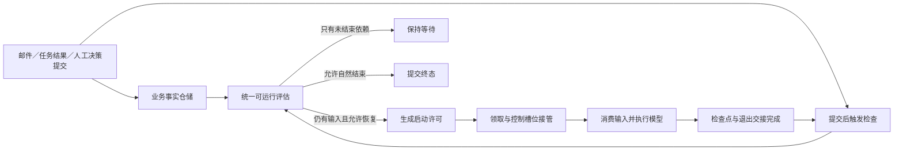

# 执行唤醒架构方案：业务事实驱动与检查点交接

日期：2026-11-01。状态：架构提案，供评审；本次不修改业务、框架、数据库或运行实例。

源码基线：`8e43cd2a9b317b9485cd77ecfb65c3ee87b9a0d4`。现场问题与复现见[委派后挂起立即恢复诊断](qa/delegation-retained-wake-diagnosis-2026-10-31.md)。工作树存在其他任务修改，实施时需重新确认基线并保持提交边界。

## 1. 决策

移除 `pendingWakes` 这类“来过一次通知，就欠一次恢复”的独立账本，采用**基于业务事实的可运行判断，加上明确的执行退出交接协议**。

通知只表示“目标执行的条件可能变化，请检查”；是否运行模型由当前尚未处理的输入和执行状态决定。处理完输入后，可运行条件自然消失，不再需要给另一份唤醒账本消账。重复或延迟通知可以产生重复检查，不能直接变成重复模型调用。

检查点窗口属于执行所有权交接：当前循环退出、检查点提交、等待状态可见和下一循环接管必须有明确顺序。换成 H2 能改善不同记录之间的写入竞争，但不能替代这份协议，也不能自动消除同一记录的业务竞态。

推荐方案是本文件的目标架构，不把“给 pendingWakes 加来源或计数器”“挂起时无条件清空”“加延迟避开窗口”作为最终实现。

## 2. 当前问题及影响面

当前 `ExecutionResumeCoordinator.accept` 把邮件、子执行结束、后台任务完成和人工决策统一当作恢复请求。目标活跃时仅记录 executionId，挂起释放后 `flushPendingWake` 再次调用 accept。记录既不知道通知对应的事实，也不知道该事实是否已被当前循环处理。

| 当前入口 | 实际业务事实 | 当前风险 |
| --- | --- | --- |
| `CommanderMailWakeService` | 发给原主理人的邮件 | 邮件已消费，旧唤醒仍在 |
| `SubExecutionLifecycle.onFinished` | 子执行终态及其终结提醒 | 投递提醒和直接 accept 都能触发检查；通知失败仍盲目恢复 |
| `SubAgentWaitInterceptor` | 未读协作输入或未结束子执行 | “不能结束”和“需要再跑一轮”被混在同一条唤醒路径 |
| `BackgroundTaskCompletion` / `BackgroundTaskLoopInterceptor` | 任务终态及检查点里的交付回执 | 完成已被当前循环吸收，仍可能保留额外恢复 |
| 选择、计划、命令审批、补充恢复 | 明确的用户决策与已保存的工具槽位 | 必须继续一次，不能因邮箱为空就被自动输入检查抑制 |
| `LocalExecutionRepository.unregister` | 检查点已提交、控制槽位释放 | 目前先释放槽位，再开放卡片、更新子登记和轮次；新运行可能早于旧运行投影完成 |

必须区分两种条件：

- **有未处理输入**：可以推动当前执行继续，例如待收邮件、尚未进入上下文的任务结果。
- **有未结束依赖**：只要求暂不结束，例如仍在运行或等待审批的子执行；不能仅因它存在就不断恢复模型。

## 3. 三个职责面



### 3.1 业务事实面

复用各模块已有数据，不建立通用逐事件唤醒日志：

- 邮件：原收件人的待处理消息及其协作归属。
- 后台任务：该 execution 发起的终态任务，以及随已提交检查点保存的任务交付回执。
- 子执行：终态与对应的去重终结提醒。每份新交付可被处理，不必等所有子执行结束。
- 人工决策：已经提交的命令标识、整组答案或审批结论及回填槽位。
- 未结束依赖：子执行、后台任务与未决工具的当前状态。

“检查通知已经送过”不属于业务事实。“子执行数量变成零”也不等于又有一份新内容需要模型处理。

### 3.2 可运行评估面

建议增加应用层协作类 `ExecutionReadinessResolver`。邮箱、子代理、后台任务分别提供自己的 `ExecutionReadinessContributor`，返回结构化事实摘要，统一归并为 `CONTINUE`、`WAIT`、`COMPLETE` 或 `REJECT`。

贡献者只查询，不消费、不落恢复请求、不运行模型；依赖领域仓储接口。不能把各模块查询和处理全部塞进一个协调器。评估失败必须明确失败并保留事实，不能被当作“没有输入”而自然结束。

结果使用业务身份和版本，不用时间先后、延时或线程存活猜测。外部通知携带的 executionId 只用于定位，不能授权一次模型调用。

### 3.3 派发与运行面

保留 `execution_resume_task` 的可靠派发职责：它表达**某个已提交挂起边界获得了一次启动许可**，记录领取、失败和结果；不承担未读邮件清单或待消唤醒计数。

自动输入检查与人工继续分成不同应用入口：

- `requestEvaluation(executionId)`：事实变更后的检查提示，可合并、可重复；只做判断不代表已受理继续。
- `admitContinuation(command)`：用户明确批准或回答；决策、工具结果、检查点引用与许可保持事务原子性，沿用 commandId 幂等语义。

自动许可的 worker 起步前重读可运行事实，人工许可则核对已提交决策和工具槽位，不能统一套用“邮箱非空”。两者均需核对终态、挂起代际、版本与控制槽位所有权。

## 4. 执行状态与所有权

业务主状态继续使用现有 RUNNING / SUSPENDED / 终态。调度交接中增加明确的运行期阶段，避免把“没有 active 条目”直接等价为“可以接管”：

```text
RUNNING -> QUIESCING -> PARKED -> RUNNING
                       |
                       +-> CLOSED
RUNNING -> QUIESCING -> CLOSED
```

- `RUNNING`：当前循环拥有控制槽位，会在后续模型调用前吸收输入。
- `QUIESCING`：当前循环已经进入退出交接，仍拥有执行；检查点、业务等待投影或退出提交尚未全部完成。通知到达不启动第二个循环。
- `PARKED`：挂起检查点与必要投影已提交，控制槽位确已交出；允许重新评估并申请接管。
- `CLOSED`：终态已提交；旧通知只能返回结束，不能复活执行或换绑到另一轮。

这些阶段描述当前运行的所有权，不保存“曾来过几次通知”。复用当前控制槽位身份作为本次运行标识，复用 `resume_generation` 作为已提交挂起边界；不能只用 executionId 区分旧回调与新运行。

需要持久化一个明确的挂起策略，例如“允许输入驱动继续”或“必须等待人工”。它是当前等待状态的一部分，不是通知计数。取消、失败、用户主动暂停优先于自动输入；未决人工工具不能因有邮件而被跳过。

## 5. 检查点窗口的交接协议

### 5.1 输入生产者

生产者先提交真实输入，再在提交后触发检查。检查发现 RUNNING / QUIESCING 时，不写 pendingWakes：当前循环后续的消费点或退出交接必定再次读取事实。

发现 PARKED 时，评估事实、核对阻塞条件，然后生成该挂起边界的启动许可；发现 CLOSED 时按业务路由明确拒绝或保留为不可自动恢复的历史消息，禁止恢复旧执行。

目标身份检查、输入提交和最终结束仲裁必须遵守同一个 execution 的协调顺序。涉及父子执行时，不允许持子锁反向等待父锁；模块先整理待提交事实，再按固定顺序进入协调与短事务。锁内不运行模型或外部命令，不用覆盖全局数据库的锁把所有执行串行化。

### 5.2 当前循环退出

退出路径无论有没有收到通知，都执行一次交接，不以存在某个 pending 标记为前提：

1. 当前循环提出退出结果，进入 QUIESCING，保持所有权。
2. 完成输入消费回执及检查点提交。正文继续流式发布，数据库引用与回执按事务提交；模型调用不在事务内。
3. 按该运行身份完成必要投影：准备卡片、子执行等待登记、轮次等待状态。任何迟到回调必须核对仍属于本次运行，不能把新运行写回 WAITING。
4. 对最终结束或挂起进行统一仲裁；校验取消、等待策略、阻塞工具、未处理输入和未结束依赖。
5. 挂起路径发布 PARKED，再释放控制槽位并触发无条件再评估。直到这一步，外部事件都不能启动下一循环。
6. 允许结束的路径提交终态、发布 CLOSED 后释放所有权，不额外调用模型“确认结束”。

第 4 步到退出提交之间与输入生产者形成同一仲裁边界：输入先提交则退出方必须看见；终态先提交则生产者必须看见已结束并执行明确的路由规则。不能让生产者认为已投递可恢复输入、退出方却按旧判断提交 COMPLETED。

### 5.3 当前框架的契约缺口

当前只读框架中，`AgentLoopStepRunner.completeWithoutToolCalls` 调用 `onBeforeComplete` 后返回退出结果；`RuntimeProcessorTemplate` 随后调用 `completeChecked()`、保存，再在 finally 中保存并 unregister。它们之间不是业务方的一次原子仲裁。

因此：**仅改 onBeforeComplete 或在 unregister 后查邮箱，可以覆盖部分挂起竞态，但不能证明封住最终结束窗口。** `completeChecked` 只接受 RUNNING，也不能先强制 SUSPENDED 再直接改 COMPLETED。

目标需要一个明确的“退出提交协作”契约：在运行所有者尚未释放时，让业务方完成最终判定，运行时按该结果提交相应状态，并保证异常与取消路径释放交接资源。该契约覆盖判断到提交，不是在两处挂独立回调。模型、外部工具和大正文准备位于仲裁临界区之外。

实施前先验证现有运行时适配能否提供这一完整边界；不能提供时，应单独设计最小框架扩展并在其所属仓库交付，不在 LingXi 侧绕过受检状态转换或跨方法手工扣住一个锁。`D:\Code\starter` 当前只读，本方案不改框架源码，也不把“现有扩展点已经足够”当成已验证结论。完整退出协议是上线门槛，不把局部修复宣称为全部竞态已消除。

## 6. 哪些事实应推动恢复

| 当前事实与状态 | 调度结果 |
| --- | --- |
| RUNNING，通知来了，输入随后被本循环处理 | 当前循环继续；退出时无待处理输入则不补一轮 |
| QUIESCING，有新输入提交 | 不起第二个循环；由交接看到事实后保持可继续的挂起边界 |
| PARKED，有未处理输入且无阻塞工具，策略允许自动继续 | 生成一个启动许可 |
| PARKED，没有新输入，但仍有未结束子执行或后台任务 | WAIT；不调用模型 |
| 所有依赖已结束，对应输入也已经处理，当前回复已完成 | 允许自然结束；不因“最后一个子任务刚注销”再调用模型 |
| 选择组只回答了一部分或命令审批未落定 | WAIT；邮件不得绕过工具闸门 |
| 整组答案或审批已提交 | 人工继续许可；即使邮箱为空也要继续 |
| 用户主动暂停、取消或执行终态 | 按明确策略等待或拒绝；自动通知不能越权 |

对有依赖的执行，输入可在任一交付到达时处理，其余依赖继续阻止收尾。这里没有“等全部子执行结束才能读取第一份结果”的退化。

## 7. 输入处理的提交边界

### 7.1 邮件

当前 `consumePending` 先把邮件改为 CONSUMED，之后 `AgenticLoopInterceptor` 才追加到运行上下文。调度若只以 PENDING 为事实，需要同时解决“已消费但上下文尚未持久化就失败”的窗口，不能把这类丢失包装成去重成功。

目标契约是按本批 messageId 读取、注入并确认，**包含这些消息的检查点引用与本批消费标记同事务提交**。正文仍按现有文件协议先发布，数据库失败则回滚新引用和消费标记；本次运行明确失败或重新读取已提交状态，不继续使用被污染的内存对象。回滚后允许重新投递，不追求外部模型调用的全局 exactly-once。

不新增“唤醒确认表”。邮件自己的消费状态与已提交上下文就是事实；不能批量把随后到达、未纳入本批的邮件一起标记已处理。`consumeMessage` 等其他消费入口也必须遵守执行归属与交接协议，不能成为绕过仲裁的旁路。

协作邮箱目前按根会话与收件角色共享，通知定位的却是根 execution。新的自动投递应绑定协作根 execution 身份，必要时在邮件事实中补 `root_execution_id`；保留邮箱业务键和历史浏览方式。消费及自动可运行判断按该绑定筛选，不能因下一轮换了 execution 就动态吸收旧轮唤醒。历史数据只从权威关系补绑定，无法证明归属的记录不自动猜测迁移，实施时提供显式处理方式。

### 7.2 子执行结束

继续使用带去重键的终结提醒，主理人通过正常输入路径处理。子执行终态摘要与必要的父侧交付事实应同事务提交，投递提示在提交后发出；模块协作从当前 afterCommit 临时通知提升为提交编排的一部分，文件正文协议保持不变。

这样“子任务结束”只新增一份可查询事实，不额外欠一次恢复。依赖注销负责更新能否收尾，不再无条件 accept。通知创建失败不能像当前路径一样仅告警后盲目恢复，更不能据此宣称父侧已收到交付；失败必须阻止相关完成编排被标记成功，并暴露诊断。

未建立子执行的失败也必须留下明确的失败交付或失败受理事实，再解除等待；只删除注册表条目不足以说明主理人知道发生了什么。这部分涉及终态提交协作，纳入第 5.3 节契约验证，不承诺仅移动一行调用就能获得原子性。

### 7.3 后台任务和人工决策

后台任务沿用 `Task` 终态与检查点内的交付回执。任务完成仅触发检查；当前循环已经注入并提交回执时，新检查得到没有待交付结果。收尾拦截器只返回等待事实，不再登记自我唤醒。

人工答案、审批与补充恢复保留原子受理和 commandId 幂等；它们是明确授权继续的业务命令，不能被改造成普通邮件或以通知去重决定是否生效。执行正处 QUIESCING 时，应按现有互动准备规则等待可操作边界，不能伪造一个已接受的临时状态。

## 8. 启动许可与恢复任务表的边界

本方案移除的是 pendingWakes 的业务意图账本，保留的是一次启动的交付记录。两者不能再共用无条件 accept。

- 空检查、重复通知不创建任务，也不消耗 `resume_generation`。代际仅随真实进入挂起状态递增。
- 许可区分自动输入与明确用户继续，worker 按相应依据复核；不在任务行保存另一份待消费事件清单。
- 同一挂起边界最多启动一个循环；数据库条件领取与框架控制槽位共同裁决，当前进程内的去重提示不作权威。
- 当前 `(executionId, generation)` 唯一行若已被一次未启动的过期检查作废，新的真实输入不能因此永久无法受理。实施时要明确“未启动许可可撤销并重新申请”和“已开始启动不可自动重放”的状态区别及条件更新，不能直接沿用现有 enqueue 的“已有行就返回”逻辑。
- 重新申请只适用于尚未开始的许可；模型、命令或启动过程一旦开始，失败仍沿用单次尝试和明确失败收口，不能自动重跑副作用。
- worker 发现执行已被合法运行接管时只让位，不再补 pendingWakes。新运行自身消费与退出交接负责覆盖输入。

具体许可字段与索引在实施设计中以“一个有效许可、一次真实启动”为判据确定，H2/SQLite 使用同一业务约束。不得以弱化唯一约束换取表面上的再次可用。

## 9. 时序覆盖与不变量

| 输入提交时机 | 必须发生的行为 |
| --- | --- |
| 当前模型调用前 | 本循环读取并提交消费，不补恢复 |
| 模型调用期间或最后一次消费之后 | 后续正常消费点处理；若循环准备退出，交接看到未处理事实 |
| 等待判断之后、检查点准备或提交期间 | QUIESCING 仍有所有者；交接再次判断，不能遗落输入 |
| 挂起已提交、投影尚未完成 | 不允许新循环抢跑；投影结束后发布 PARKED 并复查 |
| PARKED 后，通知先于或晚于交接复查 | 至少一侧看到事实；重复检查归并为同一有效启动许可 |
| 新循环已接管，旧挂起回调才返回 | 旧回调按运行身份失效，不能覆盖新循环或重新消费 |
| 最终结束判断与输入入库交错 | 由共同仲裁边界确定先后，不能既成功接受可恢复输入又提交不可恢复终态 |
| 重复或延迟通知到达 | 输入已处理则不运行；还有真实输入才可能运行 |

必须成立：无未处理输入时没有自动模型调用；存在阻塞工具或人工暂停时不越权；已提交输入不因检查点交接丢失；同一 execution 没有两个合法 loop；旧代际任务不作用于新挂起点；终态不能被通知复活。

进程崩溃另按现有策略处理：不因引入此方案就重启后自动重放未确认的命令。已提交输入和许可用于诊断、失败收口或显式恢复。通知派发失败必须可见，不能只输出成功回执后静默失去推进机会；本方案不宣称解决进程崩溃下所有外部副作用的 exactly-once，也不新增常驻扫描来掩盖交接错误。

## 10. 模块改造与验收顺序

| 阶段 | 设计/实施交付 | 门槛 |
| --- | --- | --- |
| A：退出契约验证 | 最小组合夹具验证等待判断、终态提交、两次 save、投影与 unregister 的精确时序；评估框架扩展 | 证明第 5 节边界能落地；若不足，先确定独立框架契约 |
| B：事实查询与归属 | 各模块 Contributor、自动输入绑定、挂起策略、邮件与回执提交契约 | 查询不消费；没有第二份意图账本；历史身份有明确迁移规则 |
| C：统一仲裁与许可 | ReadinessResolver、退出交接、自动检查/人工继续分离、许可复核 | 同 execution 单飞、取消优先、无空检查占坑、代际准确 |
| D：来源迁移 | 邮件、子执行完成、后台完成与等待拦截器接入统一协议 | 每个来源的真实输入有且仅有明确业务事实，不再直接要求模型再跑 |
| E：删除与验收 | 删除 pendingWakes、flush/clear、自我唤醒旁路；更新文档与有效变异 | 确定性竞态和实际双引擎测试均通过 |

保留 `ExecutionCoordination` 的按 execution 协调思想，但不把大事务、模型和外部命令放进全局锁。应用层依赖领域仓储；新增字段遵守领域方法更新、PO/BaseMapper/AbstractRepository，与 H2/SQLite 两套迁移和测试同步。框架侧扩展若确有必要独立评审提交；本提案阶段仅只读参考。

## 11. 回归与变异清单

先用屏障和可控回调固定时序，再补压力测试，不靠 sleep 命中窗口：

1. 运行中收信、当前循环消费、仍有子执行而挂起：额外恢复与模型调用均为 0。
2. 最后一次消费后收到新信：提交并释放后恰有一个合法循环继续，邮件进入对应上下文。
3. 检查点准备、数据库提交、投影、释放、最终结束的每个边界分别插入输入与取消。
4. 新旧运行回调交错：新运行开始后旧等待投影必须失效，不能覆盖新状态。
5. 两个子任务先后交付：第一份能被及时处理，第二份不被第一份的消费误确认；无新交付不空转。
6. 终结提醒创建失败：不把子交付判为已投递，不靠空恢复掩盖；修复后去重一致。
7. 后台任务在当前调用前完成、当前调用中完成、挂起后完成：分别验证不重复、及时恢复与回执持久化。
8. 选择组部分回答、完整回答、重复提交、与邮件交错：原子性与人工继续语义不变。
9. 邮件注入与消费提交中途失败：已提交上下文和消费标记一致，新到消息不被批量误确认。
10. 相同代际空检查或未启动许可失效后再来真实输入：可重新受理；已经启动的许可不会被自动重放。
11. 执行终态、旧通知、旧代际、用户主动暂停、进程重启：不能复活、换绑或重复执行外部命令。

每条关键断言需用会改变行为的回退变异证实：恢复无条件重放、删掉交接复查、提前发布 PARKED、去掉运行身份检查、拆开消费与引用提交、让已启动许可重新可领取，都应有对应失败。等价改动不算变异证据。

模块逻辑用隔离组合夹具验证；持久化、版本、许可领取和输入确认分别用真实 H2 与 SQLite 文件库运行。测试采用正确目标对象与不同代际，不能用 mock 全绿代替两个模型循环确实没有重叠。完成相关事务、并发回归后再执行全量检查。

本次只完成架构方案与源码核对；上述接口、字段、测试和协议尚未实现或验证。下一步先做 A 的退出契约验证，不能直接删除 pendingWakes 后宣称修复完成。
