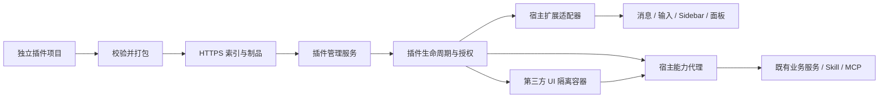

# LingXi 插件平台与市场推进方案

日期：2026-10-25。状态：待实施的工程方案；本文不代表插件运行时、隔离或市场已经交付。

## 1. 目标与范围

最终形成一条完整链路：开发者在独立仓库开发插件 → 构建并验证插件包 → 发布到插件源 → 用户在 LingXi 内发现和安装 → 授权后启用 → 升级、禁用、回滚和卸载。

插件能扩展界面、命令、主题、Skill、Agent 预设和 MCP 能力。首版覆盖桌面端及其绑定的宿主实例，普通浏览器端沿用协议，单独验收。组件替换是平台的一部分，市场分发、兼容和权限同样是交付条件。

最小成功标准：另一位开发者只依赖公开 SDK，在独立项目中实现一个有实际用途的插件；用户安装已发布的包后能使用，整个过程不修改 LingXi 源码、不重建宿主安装包。

首个市场版本采用静态 HTTPS 索引和不可变制品，支持官方源及用户添加的源。账号、付费、评价、排行榜和开发者运营后台放在后续，不影响首次生态闭环。

## 2. DeepSeek Harness 的参考边界

截至本文核对，DeepSeek Harness 的公开架构以插件贡献服务、类型化事件和可撤销的注册；插件卸载时回收注册。其市场文档采用静态 JSON 索引列出插件与版本，客户端完成发现、兼容判断与安装。以上分别参考[架构文档](https://github.com/deepseek-ai/deepseek-harness/blob/master/docs/architecture.md)和[市场文档](https://deepseek-harness.github.io/deepseek-harness/en/guide/plugin-market)。

LingXi 借鉴生命周期、扩展契约和轻量分发方式，保留 Java 业务端、Vue 前端及既有框架边界。首版不承诺兼容 DSH 插件二进制、SDK 或配置，也不要求把 Agent 内核全部改成可动态装卸的插件。

## 3. 当前起点与需要先处理的边界

| 已核对的源码 | 当前事实 | 对方案的影响 |
| --- | --- | --- |
| `frontend/src/types/chatMessageSlots.ts`、`ChatMessageItem.vue` | body/actions 支持类型契约、注入实现及默认实现 | 作为内部渲染适配器起点，公开 SDK 需使用稳定 DTO 和动作协议 |
| `frontend/src/views/chat/ChatView.vue` | 直接装配 Sidebar、输入区等，注册固定的消息默认渲染器 | 需要统一的扩展宿主与按区域建立的扩展点 |
| `frontend/src/components/chat/ChatInputArea.vue` | 包含 TeamAPI、AgentAPI、附件和提示词优化调用 | 输入能力应由宿主服务持有，替换视图使用公开能力 |
| `frontend/src/theme/`、主题及插槽测试 | 已建立主题契约和局部真实渲染验证 | 复用已有检查，并补安装、卸载、异常和独立开发者验证 |
| `frontend/electron/main.cjs`、`preload.cjs` | 主窗口 `nodeIntegration:false`、`contextIsolation:true`、`sandbox:false`，preload 暴露桌面能力 | 下载的第三方代码不能获得主窗口上下文或现有 electronAPI |
| `shared/config/CorsConfig.java`、`WebConfigure.java`、前端 interceptor | CORS 允许所有来源，现有代码明确按本地无登录身份、无认证头设计 | 需要验证并封闭第三方代码直连业务 API 的路径，单靠插件 SDK 或 CORS 不能构成权限边界 |
| `workflow/infrastructure/mcp/HostMcpScopeProvider.java` | 两个 openScope 重载均复用宿主连接，Workspace 参数未在此形成隔离 | 市场中的本地 MCP 进程接入需要另行验证 OS 边界 |

本地源码的组件替换能力和第三方可执行代码的隔离能力分别验收。TypeScript 的 readonly、Vue provide/inject、独立 Worker 或普通子进程均不能单独作为安全隔离的证明。

## 4. 总体结构与职责

- **业务端插件模块**：管理插件源、安装记录、版本、授权、启用范围、操作状态和恢复；通过应用服务协调 Skill/MCP，插件不直接操作 PO/Mapper。
- **前端扩展宿主**：根据当前宿主实例的真实状态挂载扩展点，把现有业务状态转换成公开 DTO，把动作转换成现有业务请求。
- **桌面载体**：提供受限的原生文件选择、隔离容器和必要传输；不成为第二套插件安装数据库或业务授权中心。
- **独立 SDK**：提供 manifest schema、贡献点类型、RPC 协议、测试工具和构建脚手架，不导出内部 store、services 或 Vue 组件源码路径。
- **市场源**：提供可验证的目录与制品，客户端不能仅凭作者展示名称判断可信等级。

安装的归属必须明确为一个宿主实例及其配置范围。桌面端连接远程后端时，界面显示目标宿主，安装请求送到该宿主；不得本地安装、远端执行或共用相互冲突的权威记录。开发版、安装版和不同后端的数据目录继续隔离。

## 5. 先确定的协议

### 5.1 插件包与版本

建议制品为预构建的 `.lxplugin` 压缩包，包含 manifest、UI 资源和声明式能力资源。用户安装时不执行 npm install、postinstall 或任意安装脚本。npm/Git 可作为开发与发布入口，第一版安装器只消费确定版本的成品包。

manifest 最少包含：

| 字段 | 用途 |
| --- | --- |
| `schemaVersion` | manifest 解析版本 |
| `id`、`version` | 命名空间插件标识及精确 SemVer 版本 |
| `publisher`、`license`、`repository` | 发布者声明、许可证与源码入口；发布者身份需另行验证 |
| `engines.host`、`engines.sdk`、`platforms` | 宿主、SDK 和平台兼容范围 |
| `contributes` | 命令、面板、渲染器、主题、Skill、Agent 预设及 MCP 声明 |
| `permissions` | 能力、资源和作用范围声明；新增权限必须重新授权 |
| `entries` | 包内入口和资源路径，只能引用已验证的包内文件 |

市场索引另外保存：格式版本、插件展示信息、版本清单、兼容范围、制品 HTTPS URL、大小、SHA-256、发布者签名与签名密钥标识。下载时重新校验包内 manifest 与索引的一致性。

摘要只能验证内容一致性，不能验证作者身份。官方源应固定信任根并签名索引或可信发布记录；第三方源单独显示信任状态，不能自动取得官方权限。制品签名校验失败必须拒绝，不能退化为“只校验哈希”。

首版 SDK 自带构建依赖，插件资源自包含，不把 Vue 内部版本当作跨隔离边界的 ABI。首版不支持插件间可执行依赖；需要的库在构建期打入包内。后续若引入插件依赖，需要一起设计版本锁、循环检测、卸载约束和升级事务。

### 5.2 扩展点与冲突规则

| 扩展点 | 模式 | 第一轮契约 |
| --- | --- | --- |
| `message.body` | 单一生效实现 | 稳定消息 DTO、流式快照/增量、正文与复制动作 |
| `message.actions` | 有序追加；整区替换需显式选择 | 命令引用、显示条件、禁用原因；复制等动作只有一个执行入口 |
| `composer.actions`、`composer.view` | 操作追加 / 整区单一替换 | 草稿、附件句柄、发送、停止、模型与 Agent 选择 |
| `sidebar.items`、`sidebar.view` | 入口追加 / 整区单一替换 | 会话列表投影、分页、选择、创建、重命名和删除 |
| `tool.renderers` | 按工具匹配选择 | 只读工具结果、状态及允许的操作 |
| `workspace.panels`、`settings.sections` | 多个命名面板 | 布局、配置 schema、生命周期和主题变量 |
| `commands` | 多个命名命令 | 输入 schema、授权、取消和幂等键 |
| `themes`、`skills`、`agent.presets`、`mcp.servers` | 声明式资源 | 版本归属、启用范围和配置引用 |

以上为目标协议，按阶段逐项实现，不一次性开放所有点。单一替换点由用户配置选择实现，不使用“最后加载覆盖”。追加项有稳定排序及唯一贡献 ID。冲突、未知贡献类型和不兼容版本在激活前给出明确错误。

后端固定工具名继续使用 `AgentToolName`；MCP 保持动态工具集合。未来原生插件工具使用明确命名空间并通过工具目录注册，不在前端增加工具名字面量判断。

### 5.3 生命周期与状态

插件至少区分安装状态、期望启用状态和实际运行状态；安装成功不能直接等同于已生效。操作记录使用服务端生成的权威 ID，前端只展示真实状态。

运行流程：校验 → 安装为禁用 → 授权 → 等待安全切换点 → 激活；失败记录结构化原因。禁用时撤销能力句柄和订阅，停止接收新调用，处理在途请求后释放注册、计时器和资源。

升级采用不可变版本目录、暂存验证和活动版本切换，保留上一可用版本。数据事务不能覆盖整个文件系统操作，需持久化操作步骤并支持重启对账。首版以重启生效为主，激活失败可进入安全模式禁用第三方插件；热卸载只在资源回收验证完成后逐步开放。

执行中的会话固定已接纳的工具和运行时插件版本，禁用或升级不在轮次中途改变工具 schema。终止在途能力必须返回明确失败结果，不遗失工具结果。UI 可显示待重启或待当前执行结束；用户业务数据不因插件回滚而删除。

## 6. 运行与权限边界

### 6.1 两条执行通道

1. 随宿主构建、经代码审查的内置适配器可以直接注册 Vue 组件，继续复用现有 body/actions 契约。包里的 `trusted:true` 或作者名称不能赋予这种权限。
2. 市场下载的 UI 代码使用独立、受限的渲染容器，通过可序列化 RPC 获取宿主提供的数据和动作。候选为独立来源的 sandboxed frame，以及桌面端独立 WebContentsView；P0 用真实平台验证后确定承载器。无法满足要求时先交付声明式扩展，不以同上下文执行代码替代隔离。

市场中的按钮、菜单和常规卡片优先使用声明式描述，宿主负责渲染。复杂自定义界面放在隔离区域。完整输入区/Sidebar 替换需要同时提供区域级容器、焦点/键盘/尺寸协议及宿主语义 API，不能仅把 Component 类型改名为 Plugin。

插件读不到宿主 DOM、Pinia、localStorage、认证凭据和 electronAPI；默认禁止直接网络与本地文件访问。资源来源、导航、弹窗、下载、表单、网络通道和窗口权限均由宿主约束。容器异常需能停用和恢复；独立 frame 不等于已经证明 CPU、内存或进程崩溃隔离。

实现应遵循 [Electron 安全文档](https://www.electronjs.org/docs/latest/tutorial/security)对进程沙箱、上下文隔离、IPC 来源验证和不向不可信内容暴露桌面 API 的要求；是否达到边界以攻击性用例为准。

### 6.2 能力代理

每次调用在宿主或后端校验插件实例身份、版本、能力、资源、配置范围及当前授权。身份绑定到宿主创建的通道或能力句柄，不能相信请求体里的 pluginId。授权撤销后旧句柄立即失效，且不能通过旧的业务 REST、SSE、资源下载接口绕行。

第一批能力建议为：当前会话摘要读取、选中消息读取、草稿写入、命令执行、插件自有配置读写和限定来源的网络请求。读取历史正文、发送消息、调用模型、访问工作区和执行命令分别授权；读消息与向外部域名发请求的组合权限需要在安装时清楚展示。

后端直连接口的保护需要覆盖现有敏感读写入口。P0 定义桌面启动凭据、浏览器端连接/配对方式、远程宿主认证和凭据轮换，避免把管理凭据交给插件；还要验证 SSE 重连及 multipart 上传。限制 CORS 只是配套措施，不能代替身份与能力检查。

凭据保存在宿主凭据服务，插件只持有受限引用；日志不输出密钥。网络代理检查初始地址、重定向和实际连接目标，默认拒绝 loopback、私网和元数据地址，用户明确配置的连接另行授权。

### 6.3 Skill、MCP 与未来运行时扩展

- Skill 包经版本管理后挂载到现有 Skill 加载链，来源与插件版本可追踪。包含脚本的 Skill 最终仍通过现有工具执行权限，不因安装而获得执行授权。
- MCP 声明由现有 MCP 应用服务接入，安装不自动启动进程、不自动启用全部工具；密钥使用宿主引用。卸载仅删除插件拥有的配置与注册，保留用户独立创建的数据。
- 首个公开市场可提供远程 HTTPS MCP 配置型插件；携带本地可执行 MCP 的包需在明确的受信模式或经验证的 OS 执行边界下开放。普通子进程不会自动限制宿主文件与网络访问。
- 原生模型适配器、Agent 请求钩子和工具执行钩子作为后续平台能力：定义进程外、可取消、限时的协议，通过 LingXi 适配既有框架扩展点，不加载任意 JAR 进入 Spring 或修改本机只读框架仓库。观察型事件和能改变执行语义的钩子分别定义失败处理，消费型数据不得静默丢弃。

## 7. 分阶段实施

估算为单人有效工程时间，不含外部审核与市场运营等待；各阶段工作量包含该阶段测试，不把组件改造重复计入。P0 完成后重新估算隔离与认证工作。

| 阶段 | 核心交付 | 可验证的完成条件 | 人日 |
| --- | --- | --- | ---: |
| P0：协议与边界验证 | manifest/索引 schema、贡献点语义、宿主归属、认证与隔离原型、安装恢复设计 | 两个冲突插件得到确定结果；恶意插件原型无法直连敏感 API、读取宿主或调用 IPC；确认容器的实际限制 | 3–5 |
| P1：本地插件闭环 | 生命周期、安装记录、包校验、禁用/重启生效、诊断、安全模式；先接消息操作区与命令 | 从独立项目打包并安装，不重建宿主；重启仍生效；禁用后入口消失；错误包无法激活 | 6–9 |
| P2：核心组件与能力 | 抽离输入区宿主服务；接输入区、Sidebar、面板、工具渲染器；稳定 DTO/RPC | 独立包替换输入区或 Sidebar；发送、停止、附件、焦点与会话分页等行为通过真实页面验证 | 9–13 |
| P3：市场发现与分发 | 官方/自定义 HTTPS 源，搜索、详情、兼容版本、安装、升级、回滚、签名验证 | 从源安装精确版本；断网、篡改、崩溃和权限增加有确定结果；旧版本可恢复 | 6–9 |
| P4：第三方开放与能力包 | 在产品中落地隔离容器与代理；封闭直连绕过；接主题、Skill、预设及受限 MCP；发布者信任与撤销 | 越权、伪造身份、旧句柄、跨插件数据和来源攻击均被拒绝；不可信代码达不到主窗口权限 | 8–13 |
| P5：开发者预览发布 | SDK、脚手架、示例、协议检查、CI 验证、发布说明和兼容政策 | 新开发者仅凭公开文档发布并安装插件；干净环境与打包版全链路通过 | 4–6 |

P0 → P1 → P2 → P3 → P4 → P5 是默认推进顺序。隔离和认证从 P0 设计并验证，不能留到 P4 才发现不可行；P1–P3 的阶段演示先限官方或明确受信包，不宣称已经开放不可信第三方代码。

- P0–P1：约 9–14 人日，形成可安装的本地插件底座。
- P0–P3：约 24–36 人日，形成官方/受信插件市场试用版。
- P0–P5：约 36–55 人日，形成允许第三方开发和分发的开发者预览版，单人约 8–12 个工作周。

这是开发者预览的投入区间，成熟生态的运营、持续兼容和安全维护不在此区间内。前一次 10–15 人日仅估算核心组件替换，不覆盖上述平台和市场工作。

## 8. 第一批实际插件

| 插件 | 用途 | 需要证明的机制 |
| --- | --- | --- |
| 消息导出助手 | 给消息操作区追加 Markdown 导出入口 | 独立包、消息 DTO、限定读取、命令唯一触发、安装禁用 |
| 紧凑会话导航 | 替换 Sidebar 的列表展现 | 整区替换、分页、真实会话 ID、工作区状态及焦点 |
| 提示词快捷操作 | 给输入区追加模板和草稿操作 | 输入区能力与视图分离、附件不丢失、发送不双触发 |
| 主题包 | 覆盖允许的语义颜色 | 声明式包、覆盖白名单、明暗态和默认恢复 |
| 文档服务连接包 | 按用户授权接远程 MCP，并携带 Skill/Agent 预设 | 凭据引用、能力包归属、授权、停用与卸载清理 |

首个插件选择消息导出助手，直接复用已具备的操作区试点。第二个选择输入区快捷操作，用真实复杂交互验证 SDK；第三个验证整区替换。示例在独立工程构建，不从宿主源码相对路径 import。

## 9. 代码落点与实施约束

建议逐步建立以下位置，最终命名在 P0 确定：

| 位置 | 职责 |
| --- | --- |
| `frontend/src/extensions/` | 注册表、扩展宿主、默认适配器、UI 容器与能力桥 |
| `frontend/src/views/plugins/` | 已安装、发现、详情、授权和诊断页面 |
| `frontend/src/services/plugin.ts` | 业务端权威状态 API |
| `src/main/java/com/summit/dp/plugin/` | 插件领域、安装/启用应用服务、制品与市场基础设施、API |
| `packages/plugin-sdk/` | 可独立发布的公共类型、schema、RPC 与开发工具 |
| `examples/plugins/` | 独立构建的参考项目及兼容测试输入 |

前端 SDK 的导出面不依赖业务端内部模型；现有 `ChatMessage`、`ChatTurn` 在适配器内投影，避免内部字段变更拖动所有插件。公开协议对新增字段和未知事件有明确策略，schema 失败不能伪造成功状态。

业务侧新持久化遵守项目当前要求：领域仓储继承 RepositoryTemplate，实现继承 AbstractRepository，使用 PO + BaseMapper + MyBatis-Plus；安装记录、授权、源和操作日志是业务事实，制品文件只是资源。现存 MCP 的 JSON 仓储实现不作为新模块照搬的依据，不在本方案中顺手重写旧模块。

复杂安装入口按事务脚本编排 Validator、Resolver、Installer 等独立协作类；领域状态通过领域方法变更，入口校验使用 throwIf。框架源码只读参考；确需新增框架扩展能力时单独列出框架需求与版本适配工作。

## 10. 验证与发布门槛

每个阶段交付可独立评审的提交。修复缺陷必须补能因回退变红的回归守卫，关键断言使用真实行为变异验证。静态“不存在”扫描先做金丝雀并确认递归与字节覆盖；不以文件名、测试标题或源码匹配代替生产路径执行。

公开第三方安装前至少完成：

1. **真实页面**：默认、追加、替换、冲突、空注册、异常、重启后恢复；流式输出、审批/选择、附件、停止与重发、子会话不回归。
2. **安装事务**：错误兼容范围、篡改、zip 路径穿越/绝对路径/链接逃逸、解压体积限制、Windows 路径与文件占用、并发安装和操作中崩溃；恢复后安装记录与活动制品一致。
3. **权限边界**：未授权读写、伪造 pluginId、跨宿主/跨配置范围调用、撤销后的旧通道、敏感 REST/SSE 绕过、localhost 网络、导航和 IPC；不能只测 SDK 的拒绝分支。
4. **运行恢复**：激活异常、卡死、资源配额、订阅泄漏、旧版本回滚、安全模式；终止插件不会留下未结算业务动作。
5. **分发与开发者体验**：过期索引、不可用源、密钥轮换/撤销、权限升级、宿主升级造成不兼容；SDK 的最低与当前支持版本均验证，Windows 打包版必须通过独立安装。

现有前端 CI 主要执行 build。实施时按阶段增加协议、生命周期、安装恢复和关键 UI 测试；Electron/OS 边界增加 Windows 作业。视觉基线需固定环境，复用现有主题门禁，不能通过重建基线掩盖意外变化。

## 11. 下一批提交顺序

1. P0-A：固定 manifest/索引 schema、贡献点冲突规则、插件状态与宿主归属；补接受与拒绝样例。
2. P0-B：用一个恶意原型验证隔离容器和 API 认证设计，包括 SSE、上传及远程宿主；记录无法保证的资源隔离边界。
3. P1-A：消息操作区迁入有生命周期的注册表，保留内置默认适配器；验证禁用与清理，不改变现有视觉。
4. P1-B：实现本地包验证、安装操作记录、不可变版本目录、重启生效与安全模式；每个完整逻辑单元独立提交。
5. P1-C：消息导出助手在独立工程打包，完成“安装 → 授权 → 使用 → 禁用 → 再启用 → 卸载”演示。
6. 通过上述闭环后进入 P2，按宿主能力整理输入区，再推广 Sidebar 与其他区域；主题残余整理另行推进。

本方案的下一个实质里程碑是“独立插件包能安装并真正生效”。后续各组件的拆分以这个目标验收，避免只有插槽数量增加、外部开发者仍必须修改宿主源码。
