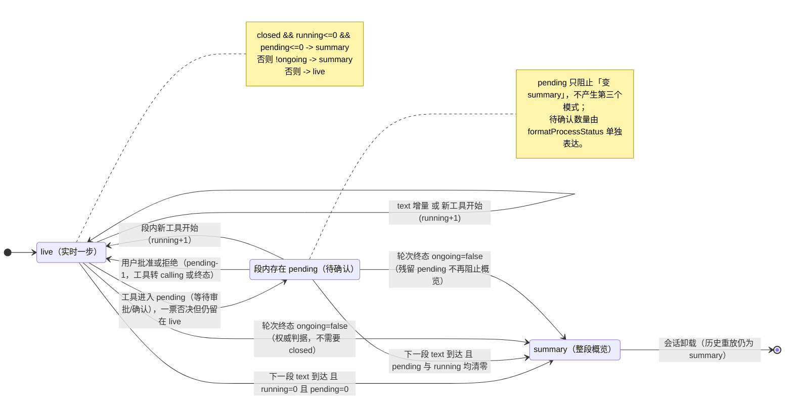

# 过程段状态机（呈现契约）

> **本文是契约**：改判据必须同步改 `frontend/tests/processSegments.test.ts` + 本文 +
> `docs/qa/process-debt-verification.md` 的验证矩阵，三者同一提交。
> 判据的唯一实现是 `frontend/src/utils/processSegments.ts` 的 `resolveProcessSegmentMode`，
> 本文负责解释「为什么」。

---

## 1. 定位

AI 回复里的「执行过程」被切成若干**过程段**，每段上方有一行摘要。这行摘要在两种呈现模式之间切换：

| 模式 | 文案来源 | 用户此刻应该看到 |
|---|---|---|
| `live`（实时一步） | `formatProcessHeadline(summary, { active: true })`：标题=最新工具名/思考，预览=最新一步正文或命令意图 | 「现在正在干什么」 |
| `summary`（整段概览） | `formatProcessHeadline(summary)`：标题=操作类别去重列举，预览=目标列表 | 「这一段一共做了什么」 |

明细区（`ProcessDetails`）默认折叠，点摘要行才展开 —— 运行态不再直接铺满细节。

---

## 2. 术语与状态

| 术语 | 定义 | 来源（唯一实现） |
|---|---|---|
| `ProcessSegment.closed` | 段的边界由「其后出现了下一段 text」确定；未 closed 的段随时可能继续增长 | `buildProcessSegments`（`processSegments.ts`） |
| `runningCount` | 段内状态为 `calling` / `running` 的步骤数 | `summarizeProcess` + `resolveProcessToolStatus` |
| `pendingCount` | 段内状态为 `pending` 的步骤数（等待用户确认 / 待定） | 同上 |
| `unknownCount` | 状态拿不到的步骤数；**不参与模式判定**，只在状态文案里如实显示 | 同上 |
| `ongoing` | 整轮是否仍在进行。有 turn 时看 `turn.status` 是否活跃；无 turn 时 `message.isComplete !== true && isTurnRunning`，其中 `isTurnRunning` 还兜住「有工具停在 calling/pending」的守卫真空 | `ChatMessageItem.processIsOngoing`（唯一来源） |
| 子代理状态 | 以**子会话权威态**为准（`asyncSubSessionStatus`），工具 `success` 不等于任务完成 | `resolveProcessToolStatus` |

数据流向（单一来源，禁止回写）：

```
processTimeline → processSegments(分段/摘要/closed) → processViewModel(mode + headline) → 组件(哑)
                                                              ↑
                                                  ChatMessageItem.processIsOngoing
```

---

## 3. 状态图



> 图上**刻意不画 `Summary → Live`**：`closed` 不回退、轮次终态不可逆，任何反向迁移都是 bug
> （见 §6 反例清单）。

---

## 4. 判定表（与 `resolveProcessSegmentMode` 一一对应）

| # | `closed` | `runningCount` | `pendingCount` | `ongoing` | `mode` | 判定依据 |
|---|---|---|---|---|---|---|
| 1 | true | 0 | 0 | true | **summary** | 段已被下一段 text 收尾且步骤全定型 ⇒ 该段是「已发生的历史」 |
| 2 | true | 0 | 0 | false | **summary** | 同上；轮次终态 |
| 3 | true | >0 | 0 | true | **live** | running 一票否决：概览会淹没「正在跑的那一步」 |
| 4 | true | 0 | >0 | true | **live** | pending 一票否决：待确认就是「等你决断」，不能折叠进概览 |
| 5 | true | >0 | >0 | false | **summary** | 轮次终态是权威：残留计数只是没收到终态通知的陈旧事实 |
| 6 | false | 任意 | 任意 | false | **summary** | 最后一段永远不会被 text 收尾，轮次结束即历史 |
| 7 | false | 0 | 0 | true | **live** | 段仍在增长，其后随时可能追加；概览会给出「还会变的结论」 |
| 8 | false | >0 | 任意 | true | **live** | 演进中 |

`unknownCount` 不参与判定：`unknown` 表示「状态拿不到」，既不能证明在跑也不能证明已定型。

---

## 5. 三条判定理由（可引用论证）

### 5.1 为什么只有 `closed` 的段才可以汇总

段边界由「后面出现了下一段 text」确定。未 closed 的段随时可能追加思考或工具，此时给出整段概览
等于把「还会变的事实」当作结论展示：标题和下一步会自相矛盾（例如标题写着「读取、写入」，下一帧
又冒出「执行命令」）。

### 5.2 为什么 `running` / `pending` 一票否决

1. **概览会淹没「正在跑的那一步」**：去重列举把当前动作压进历史集合，用户看不出现在在等什么。
2. **用户此刻需要知道「还在等什么」**：实时一步给的是最新工具名 + 目标，正是这一段的可行动信息。
3. **`pending` 的语义是「等你决断」**：把它折叠进概览等于藏起待办事项，是功能性问题而不是排版问题。

### 5.3 为什么轮次终态无条件是 `summary`

轮次收尾后，最后一段永远不会被 text 收尾（它后面没有文本了），也没有任何步骤会再变化。
此时展示「最新一步」是把历史当实时；残留的 `running` / `pending` 只是没收到终态通知的陈旧事实。

### 5.4 为什么判定必须留在 `utils/processSegments.ts`

判据必须能脱离 SFC 单测（`processSegments.test.ts` 六条用例锁定语义）。`processViewModel.ts`
只负责「组装 facts 再调用」，不允许二次实现；`ChatProcessSegment.vue` 已不再 import 它。

---

## 6. 反例清单（这些改法会破坏契约）

| 反例 | 后果 |
|---|---|
| 把 `ongoing` 塞进 `ProcessSegment` / 给 `buildProcessSegments` 加轮次参数 | 纯数据层持有轮次态，段身份随轮次漂移，`processSegments.test.ts` 的「段身份不随内容与尾部增长改变」直接崩 |
| 把 `mode` 写进 `ProcessSummary` | 事实聚合混入呈现态，`formatProcessStatus` 的 `running: 'auto'` 会与 mode 打架，出现两处真值 |
| 在组件里 `watch(ongoing)` / `setTimeout` 校正模式 | 与 computed 派生重复，挂起重挂载时补不上，折叠行出现陈旧模式 |
| 用 `provide/inject` 下发 `ongoing` | 隐式依赖，`processViewModel` 的纯函数性被破坏，单测无法穷举 |
| 把 `unknownCount` 加进否决条件 | 状态未知既不能证明在跑也不能证明定型；「状态未知」本来就该只出现在状态文案里 |
| 让 `Summary → Live` 回退（例如工具重试后重新打开） | `closed` 不回退、轮次终态不可逆；反向迁移会让用户看到「历史段落突然复活」 |
| 在 renderer 里自己 `summarizeProcess` / `resolveProcessSegmentMode` | 判据二次实现，一票否决语义分叉 |

---

## 7. 变更流程

1. 改判据 → 改 `frontend/src/utils/processSegments.ts` 的 `resolveProcessSegmentMode`；
2. 同一次提交内同步更新 `frontend/tests/processSegments.test.ts`（六条用例）、
   `frontend/tests/processViewModel.test.ts`（判定表）与本文判定表；
3. 更新 `docs/qa/process-debt-verification.md` 的验证矩阵；
4. 相关 Electron smoke 只在有真实布局环境时补跑，结论回填到验证记录。
